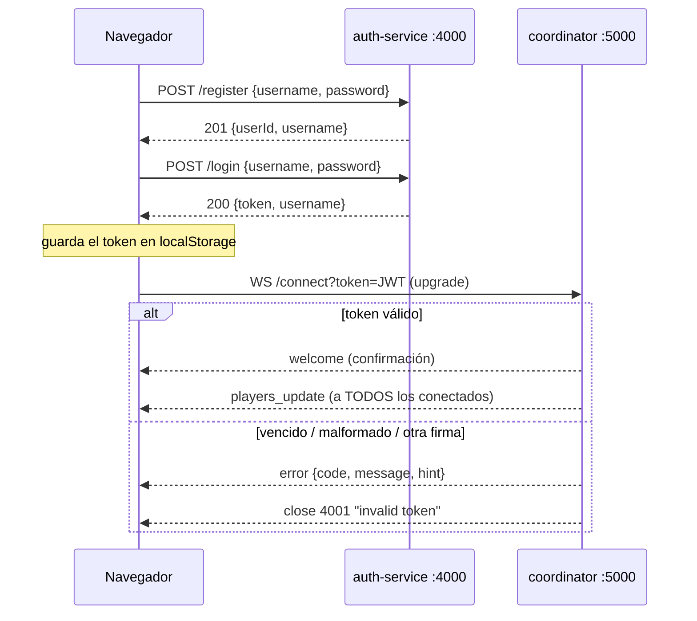

# Parqués en línea — Taller 1: Identidad (login + lobby)

Primera pieza del proyecto final de Sistemas Distribuidos: un parqués web multijugador.
Este taller resuelve la **identidad**: registro, login con JWT y un lobby en tiempo real
que muestra quién está en línea, a través de un WebSocket autenticado.

## Arquitectura

Tres procesos independientes, cada uno en su propio puerto y su propio túnel de ngrok:

```
                         ┌──────────────────────────────┐
                         │  Navegador (cliente web)     │
                         │  login.html  ·  lobby.html   │
                         └──────┬────────────────┬──────┘
           1) POST /register    │                │ 3) WS /connect?token=JWT
              POST /login (HTTP)│                │    ← players_update (broadcast)
                                ▼                ▼
┌───────────────────────────────────┐   ┌───────────────────────────────────┐
│ auth-service   :4000  (Express)   │   │ coordinator   :5000 (HTTP + ws)   │
│ · bcrypt (bcryptjs, 10 rounds)    │   │ · verifica el JWT en el upgrade   │
│ · emite JWT {userId, username,    │   │ · Map userId → {username, socket, │
│   iat, exp} firmado con JWT_SECRET│   │   connectedAt}                    │
│ · SQLite propia (node:sqlite)     │   │ · broadcast al entrar/salir       │
└───────────────────────────────────┘   └───────────────────────────────────┘
        2) devuelve { token }                ▲
                                             │ misma JWT_SECRET (cada uno en su .env)
             el coordinador NUNCA llama a auth: valida el token localmente

┌───────────────────────────────────┐
│ client   :3000  (Express mínimo)  │  sirve login.html, lobby.html, css/ y js/
└───────────────────────────────────┘  las URLs de auth y coordinador van en js/config.js
```



## Estructura del repositorio

```
taller1-auth/
├── auth-service/        Servicio de autenticación (HTTP :4000)
│   ├── index.js
│   ├── package.json
│   └── .env.example
├── coordinator/         Coordinador de sesiones (HTTP + WebSocket :5000)
│   ├── index.js
│   ├── package.json
│   └── .env.example
├── client/              Cliente web (HTML + JS plano, servido en :3000)
│   ├── login.html       Formularios de registro y login
│   ├── lobby.html       Lobby con jugadores en línea
│   ├── css/styles.css   Estilos (colores del parqués)
│   ├── js/config.js     ÚNICO lugar con AUTH_URL y COORDINATOR_WS
│   ├── js/login.js      Lógica de registro y login
│   ├── js/lobby.js      WebSocket y lista en vivo
│   ├── server.js        Express mínimo que sirve los archivos en :3000
│   ├── package.json
│   └── .env.example
├── docs/
│   └── taller1.postman_collection.json   Peticiones listas para Thunder Client / Postman
├── .gitignore           node_modules/, *.db, .env
└── README.md
```

## Cómo correrlo (local)

### Requisitos

- **Node.js 22.5 o superior** (incluye `npm`; recomendado 22 LTS). Descárgalo de https://nodejs.org y verifica con
  `node -v` y `npm -v`.
- Git.
- Para las pruebas: `wscat` (`npm install -g wscat`), Thunder Client (extensión de VS Code) o curl.
- ngrok con cuenta y authtoken configurado (`ngrok config add-authtoken TU_TOKEN`).

### Instalar dependencias

Las dependencias **no** vienen en el repositorio (`node_modules/` está en `.gitignore`); cada
carpeta las declara en su `package.json` y se instalan con `npm install` dentro de esa carpeta:

| Carpeta | Dependencias |
|---|---|
| `auth-service/` | express, cors, bcryptjs, jsonwebtoken, dotenv (+ `node:sqlite`, que ya viene con Node) |
| `coordinator/` | express, ws, jsonwebtoken, dotenv |
| `client/` | express, dotenv (solo para servir los archivos) |

Ninguna dependencia necesita compilarse, así que `npm install` funciona en cualquier Windows,
Mac o Linux sin Python ni Visual Studio Build Tools (ver decisión de diseño 9).

**1. Auth service**

```bash
cd auth-service
npm install
cp .env.example .env        # en Windows: copy .env.example .env
# edita .env y pon una JWT_SECRET larga
npm start                   # → Auth service en puerto 4000
```

**2. Coordinador** (en otra terminal)

```bash
cd coordinator
npm install
cp .env.example .env
# pon EXACTAMENTE la misma JWT_SECRET que en auth-service/.env
npm start                   # → Coordinador en puerto 5000
```

**3. Cliente** (en otra terminal)

```bash
cd client
npm install
cp .env.example .env        # solo trae PORT=3000
npm start                   # → http://localhost:3000
```

Las URLs que usa el navegador están en `client/js/config.js`. En local ya traen
`http://localhost:4000` y `ws://localhost:5000`; no hay que tocar nada.
(Alternativa sin Express: `npx serve client -l 3000`.)

Abre `http://localhost:3000`, crea una cuenta e inicia sesión.

### Variables de entorno

| Servicio | Variable | Ejemplo | Para qué |
|---|---|---|---|
| auth-service | `PORT` | `4000` | Puerto HTTP |
| auth-service | `JWT_SECRET` | `una_cadena_larga` | Firma de los tokens (igual en el coordinador) |
| auth-service | `JWT_EXPIRES_IN` | `1h` (o `30s`) | Duración del token |
| auth-service | `BCRYPT_ROUNDS` | `10` | Costo de bcrypt (mínimo 10, se fuerza en el código) |
| auth-service | `DB_PATH` | `users.db` | Archivo SQLite |
| coordinator | `PORT` | `5000` | Puerto HTTP + WS |
| coordinator | `JWT_SECRET` | `una_cadena_larga` | Verificación de los tokens |
| coordinator | `HEARTBEAT_MS` | `30000` | Cada cuánto se envía ping para detectar conexiones muertas |
| client | `PORT` | `3000` | Puerto del servidor estático |
| client (`js/config.js`) | `AUTH_URL` | `http://localhost:4000` | URL del auth (con ngrok: `https://…`) |
| client (`js/config.js`) | `COORDINATOR_WS` | `ws://localhost:5000` | URL del coordinador (con ngrok: `wss://…`) |

## Contrato de la API

Todas las respuestas confirman lo que pasó. Los **éxitos** traen los campos que pide el
enunciado más un `message`. Los **errores** tienen siempre la misma forma: qué falló
(`error` / `code`), una explicación (`message`) y cómo solucionarlo (`hint`).

### HTTP — auth-service (`http://localhost:4000`)

Formato de error (todos los endpoints):

```json
{ "error": "USERNAME_TAKEN", "message": "El usuario \"alice\" ya existe", "hint": "Elige otro username, o inicia sesión con POST /login si la cuenta es tuya" }
```

| Endpoint | Caso | HTTP | Respuesta |
|---|---|---|---|
| `POST /register` | creado | 201 | `{ userId, username, message }` |
| | username ya existe | 409 | `USERNAME_TAKEN` |
| | falta username o password | 400 | `MISSING_FIELDS` (dice cuál falta) |
| | sin body / sin `Content-Type: application/json` | 400 | `MISSING_BODY` |
| | username con formato inválido | 400 | `INVALID_USERNAME` |
| | contraseña corta (< 6) o larga (> 72) | 400 | `INVALID_PASSWORD` |
| | JSON mal escrito | 400 | `INVALID_JSON` |
| `POST /login` | correcto | 200 | `{ token, username, expiresIn, message }` |
| | usuario no existe o contraseña mala | 401 | `INVALID_CREDENTIALS` |
| | faltan campos / JSON mal escrito | 400 | `MISSING_FIELDS` / `MISSING_BODY` / `INVALID_JSON` |
| `GET /` | información y lista de endpoints | 200 | `{ service, message, endpoints }` |
| `GET /health` | estado | 200 | `{ status: "ok", message }` |
| cualquier otra ruta | ruta o método equivocado | 404 | `NOT_FOUND` (lista los endpoints válidos) |
| — | body de más de 10 KB | 413 | `BODY_TOO_LARGE` |
| — | falla inesperada | 500 | `INTERNAL_ERROR` (sin detalles internos) |

Con `401` no se dice si falló el usuario o la contraseña, a propósito: así nadie puede
averiguar qué usuarios existen.

### HTTP — coordinator (`http://localhost:5000`)

| Endpoint | Respuesta |
|---|---|
| `GET /` | Información, URL del WebSocket y mensajes disponibles |
| `GET /health` | `{ status: "ok", message, players }` |
| `GET /players` | `{ players: [{ userId, username }], message }` |
| otra ruta | 404 `NOT_FOUND` |

### WebSocket — coordinator (`ws://localhost:5000/connect?token=JWT`)

**Mensajes del servidor al cliente**

| `type` | Cuándo | Contenido |
|---|---|---|
| `welcome` | al conectarse (solo al que entra) | `message`, `user: {userId, username}`, `tokenExpiresAt`, `clientMessages` |
| `players_update` | alguien entra, sale o se reconecta (**a todos**) | `players: [{userId, username}]`, `event: {action, username}`, `message` |
| `pong` | respuesta a `ping` | `message`, `serverTime` |
| `logout_ok` | respuesta a `logout` (luego se cierra con 1000) | `message` |
| `error` | cualquier problema | `code`, `message`, `hint` |

`players_update` respeta el formato del enunciado (`type` + `players`); `event` y `message`
son información extra para saber qué cambió.

**Mensajes del cliente al servidor**

| Mensaje | Respuesta |
|---|---|
| `{"type":"ping"}` | `pong` |
| `{"type":"get_players"}` | `players_update` solo para quien lo pidió |
| `{"type":"logout"}` | `logout_ok` y cierre con código 1000 |
| texto que no es JSON | `error` `INVALID_JSON` |
| JSON sin `type` | `error` `MISSING_TYPE` (lista los tipos válidos) |
| `type` desconocido | `error` `UNKNOWN_TYPE` (lista los tipos válidos) |

**Errores y códigos de cierre.** Antes de cerrar, el coordinador **siempre** envía un mensaje
`error` que explica el motivo; luego cierra con el código correspondiente.

| `code` del mensaje | Cierre | Cuándo |
|---|---|---|
| `MISSING_TOKEN` | `4001 invalid token` | se conectó sin `?token=` |
| `MALFORMED_TOKEN` | `4001 invalid token` | el token no tiene formato JWT |
| `INVALID_SIGNATURE` | `4001 invalid token` | token modificado o firmado con otra clave |
| `TOKEN_EXPIRED` | `4001 invalid token` | se conectó con un token ya vencido |
| `TOKEN_EXPIRED` | `4001 token expired` | el token venció **con la conexión abierta** |
| `SESSION_OPENED_ELSEWHERE` | `4002 session opened elsewhere` | el mismo usuario se conectó desde otra pestaña |
| `BAD_PATH` | `4004 bad path` | se conectó a una ruta distinta de `/connect` |
| — | `1000 logout` | el usuario envió `logout` |
| — | `1006` | conexión perdida (por ejemplo, el coordinador se cayó) |

El cliente web muestra el `message` y el `hint` del último error, y vuelve al login.

## Pruebas con curl / Thunder Client / wscat

En Thunder Client: método `POST`, URL `http://localhost:4000/register` (o `/login`),
pestaña **Body → JSON** con `{"username":"alice","password":"secret123"}`.
También se puede importar `docs/taller1.postman_collection.json` (Thunder Client →
Collections → Import → Postman), que trae todos los casos de éxito y error; solo hay que
cambiar la variable `authUrl` por la URL de ngrok.

```bash
# Registro → 201
curl -X POST http://localhost:4000/register \
  -H "Content-Type: application/json" \
  -d '{"username":"alice","password":"secret123"}'
# {"userId":"1","username":"alice","message":"Usuario \"alice\" registrado. Ahora inicia sesión con POST /login"}

# Otra vez el mismo → 409 USERNAME_TAKEN
# Sin password → 400 MISSING_FIELDS
curl -X POST http://localhost:4000/register \
  -H "Content-Type: application/json" -d '{"username":"bob"}'

# Login → 200
curl -X POST http://localhost:4000/login \
  -H "Content-Type: application/json" \
  -d '{"username":"alice","password":"secret123"}'
# {"token":"eyJhbGc...","username":"alice","expiresIn":"1h","message":"Bienvenido, alice. ..."}

# Contraseña equivocada → 401 INVALID_CREDENTIALS
curl -X POST http://localhost:4000/login \
  -H "Content-Type: application/json" \
  -d '{"username":"alice","password":"mala"}'
```

```bash
npm install -g wscat

wscat -c "ws://localhost:5000/connect?token=PEGA_AQUI_EL_TOKEN"
# < {"type":"welcome","message":"Conectado al coordinador como alice",...}
# < {"type":"players_update","players":[{"userId":"1","username":"alice"}],"message":"alice entró al lobby (1 en línea)",...}
> {"type":"ping"}
# < {"type":"pong","message":"Conexión activa",...}
> hola
# < {"type":"error","code":"INVALID_JSON","message":"El mensaje no es un JSON válido","hint":"Envía un objeto como {\"type\":\"ping\"}"}
> {"type":"logout"}
# < {"type":"logout_ok","message":"Sesión de alice cerrada. ¡Hasta pronto!"}
# Disconnected (code: 1000, reason: "logout")

wscat -c "ws://localhost:5000/connect?token=basura"
# < {"type":"error","code":"MALFORMED_TOKEN","message":"El token está mal formado (jwt malformed)","hint":"Copia el token completo que devuelve POST /login, sin comillas ni espacios"}
# Disconnected (code: 4001, reason: "invalid token")
```

Con ngrok se usan las mismas pruebas cambiando la URL: `https://…` en Thunder Client y
`wss://…/connect?token=…` en wscat.

## Reproducir el caso de token vencido (30 s)

1. En `auth-service/.env` cambia `JWT_EXPIRES_IN=1h` por `JWT_EXPIRES_IN=30s`.
2. Reinicia **solo** el auth (`Ctrl+C` y `npm start`). El log dice `tokens de 30s`.
   El coordinador no se reinicia: la expiración viaja dentro del token (`exp`).
3. En el navegador, cierra sesión e inicia sesión otra vez para obtener un token nuevo.
4. En el lobby se ve "El token vence en: 30 s" bajando.
5. Al llegar a 0, el coordinador envía `TOKEN_EXPIRED` y cierra con `4001 "token expired"`;
   el cliente muestra el aviso, borra el token y vuelve al login. Los demás ven que salió.
6. Si recargas con ese token vencido, el coordinador lo rechaza en el upgrade con
   `4001 "invalid token"`.

Con wscat: haz login con curl, espera 30 s y conecta con ese token → `TOKEN_EXPIRED` y
`Disconnected (code: 4001, reason: "invalid token")`.

Al terminar, vuelve a poner `JWT_EXPIRES_IN=1h`.

## Decisiones de diseño

**1. El JWT se verifica en el `upgrade`, no dentro de `connection`.**
`server.on('upgrade')` verifica firma, formato y expiración antes de que el socket llegue a
`wss.on('connection')`. Un socket con token malo nunca entra al `Map` ni recibe la lista de
jugadores. Para que el cliente reciba el código **4001** (el enunciado lo exige) y una
explicación, se completa el handshake, se envía un mensaje `error` con el motivo exacto
(vencido, firma inválida, mal formado, sin token) y se cierra con `ws.close(4001, 'invalid token')`.
Si respondiéramos un `HTTP 401` en el upgrade, el navegador y wscat solo verían un error
genérico y no podrían distinguir "token inválido" de "coordinador caído".

**1b. Todo mensaje recibe respuesta.** En HTTP y en WebSocket, cada petición devuelve una
confirmación o un error con la forma `{ code/error, message, hint }`. Así se puede probar todo
desde Thunder Client o wscat sin mirar los logs del servidor.

**2. Mismo usuario en dos pestañas: gana la conexión más nueva.**
Cuando llega una segunda conexión del mismo `userId`, el coordinador le envía a la anterior un
error `SESSION_OPENED_ELSEWHERE`, la cierra con `4002 "session opened elsewhere"` y guarda la
nueva en el Map. Los demás jugadores reciben `"alice se reconectó desde otra pestaña"`.
Lo justificamos así:
- En el parqués un jugador no puede ocupar dos asientos: una cuenta = una conexión.
- Si la primera pestaña quedó "colgada" (laptop suspendido, red caída sin `close` limpio),
  rechazar la segunda dejaría al usuario bloqueado sin poder entrar.
- En un juego, la sesión válida es la que el usuario está usando *ahora*.
- El Map sigue siendo `userId → una sola conexión`, así que el usuario aparece una sola vez en
  la lista y no hay que contar pestañas.

Detalle importante: el `close` de la conexión vieja **no** borra al usuario del Map, porque
`removePlayer()` compara `players.get(userId).socket !== ws` y, si ya fue reemplazada, no hace nada.
En el cliente, la pestaña vieja no borra el token de `localStorage` (que es compartido entre
pestañas), para no cerrarle la sesión a la pestaña nueva.

**3. El token también vence con el socket abierto.**
Validar solo al conectar dejaría a un usuario con token vencido conectado indefinidamente.
Al aceptar la conexión, el coordinador programa un `setTimeout` hasta el `exp` del token y
cierra con `4001 "token expired"`. Así el caso de "token vencido" se ve en vivo, sin recargar.

**4. El coordinador no le pregunta nada al auth.**
El JWT es auto-contenido: el coordinador lo valida con la misma `JWT_SECRET` y no necesita
consultar la base de datos ni hacer una petición HTTP por cada conexión. Los servicios quedan
desacoplados: si el auth se cae, los jugadores que ya tienen token pueden seguir en el lobby.

**5. Funciones claras y broadcast a todos, después de actualizar el Map.**
El coordinador se divide en `verifyToken()` (valida el JWT), `addPlayer()` (Map + cierre de la
pestaña anterior), `removePlayer()` y `broadcastPlayers()`. En la entrada, `addPlayer` hace
`players.set(...)` y luego `broadcastPlayers()`; en la salida, `removePlayer` hace
`players.delete(...)` y luego `broadcastPlayers()`. El mensaje llega a todos los conectados,
incluido el que acaba de entrar, así que cada cliente siempre tiene la lista completa.

**6. Seguridad del auth.**
- bcrypt con mínimo 10 rounds (el código fuerza `Math.max(10, …)`).
- La contraseña no se loguea ni se devuelve nunca; solo se guarda `password_hash`.
- Consultas preparadas de SQLite (sin concatenar strings → sin inyección SQL).
- Mismo mensaje `401 "Credenciales inválidas"` si el usuario no existe o la contraseña es
  incorrecta, y un `bcrypt.compare` contra un hash señuelo cuando el usuario no existe, para
  que ni el mensaje ni el tiempo de respuesta revelen qué usuarios están registrados.
- `username` único sin distinguir mayúsculas (`COLLATE NOCASE`): `Alice` y `alice` son el mismo.
- Límite de 72 bytes en la contraseña (bcrypt ignora lo que sobra).
- Errores 500 sin detalles internos para el cliente.

**5b. Heartbeat ping/pong cada 30 s.**
Si un navegador se cuelga o se corta la red sin cerrar el socket, el evento `close` puede no
llegar nunca y el jugador seguiría "en línea". Cada `HEARTBEAT_MS` el coordinador envía un
`ping` de protocolo a cada socket; si no respondió el anterior, lo termina (`terminate()`), lo
que dispara `close` → `removePlayer` → broadcast.

**7. URLs del cliente sin hardcodear.**
El cliente es HTML + JS plano. Las URLs de auth y del coordinador están solo en
`client/js/config.js` (`AUTH_URL` y `COORDINATOR_WS`), que las páginas cargan antes que
`login.js` y `lobby.js`. Cambiar de local a ngrok es editar ese archivo y recargar la página.
Los puertos y la secret de los servicios están en el `.env` de cada uno.

**8. ngrok.**
Las peticiones `fetch` al auth llevan el header `ngrok-skip-browser-warning`, porque el plan
gratuito de ngrok pone una página de aviso delante del tráfico de navegador. El auth usa
`cors()` porque el cliente y el auth están en orígenes distintos.

**9. `node:sqlite` y `bcryptjs` en vez de `better-sqlite3` y `bcrypt`.**
El enunciado sugiere `better-sqlite3` y `bcrypt`, pero los dos son módulos nativos: en Windows,
si no hay binario precompilado para tu versión de Node, `npm install` intenta compilarlos y pide
Python y Visual Studio Build Tools. Para que el proyecto se instale en cualquier equipo con un
simple `npm install`:
- **SQLite:** usamos `node:sqlite`, el SQLite que ya trae Node 22.5+. La API es la misma
  (`prepare`, `get`, `run`, `exec`) y sigue siendo un archivo `users.db` propio del servicio.
  El script `npm start` oculta el aviso "ExperimentalWarning" que Node imprime al usarlo.
- **bcrypt:** usamos `bcryptjs`, la misma función bcrypt (salt + rounds, hashes `$2b$…`)
  escrita en JavaScript. Mismo costo mínimo de 10 rounds.

## Despliegue con ngrok

Cada servicio va en su propio túnel. Con el plan gratuito, lo más confiable es un solo agente
con los tres endpoints en el archivo de configuración (`ngrok config edit`):

```yaml
version: 3
agent:
  authtoken: TU_AUTHTOKEN
endpoints:
  - name: auth
    upstream:
      url: 4000
  - name: coordinator
    upstream:
      url: 5000
  - name: client
    upstream:
      url: 3000
```

```bash
ngrok start --all
```

Si tu cuenta permite varios agentes, también funcionan tres terminales separadas:

```bash
ngrok http 4000     # → https://AAAA.ngrok-free.app   (auth)
ngrok http 5000     # → https://BBBB.ngrok-free.app   (coordinador)
ngrok http 3000     # → https://CCCC.ngrok-free.app   (cliente)
```

Luego pon las URLs en `client/js/config.js` y recarga la página (Ctrl+F5):

```js
const AUTH_URL       = 'https://AAAA.ngrok-free.app';
const COORDINATOR_WS = 'wss://BBBB.ngrok-free.app';
```

Fíjate en que el coordinador va con **`wss://`**, no `ws://`: la página se sirve por HTTPS y el
navegador bloquea un WebSocket sin cifrar desde una página segura (contenido mixto).

Comandos de ngrok que usamos en la entrega:

```
(pegar aquí los comandos y las tres URLs del día de la sustentación)
```
