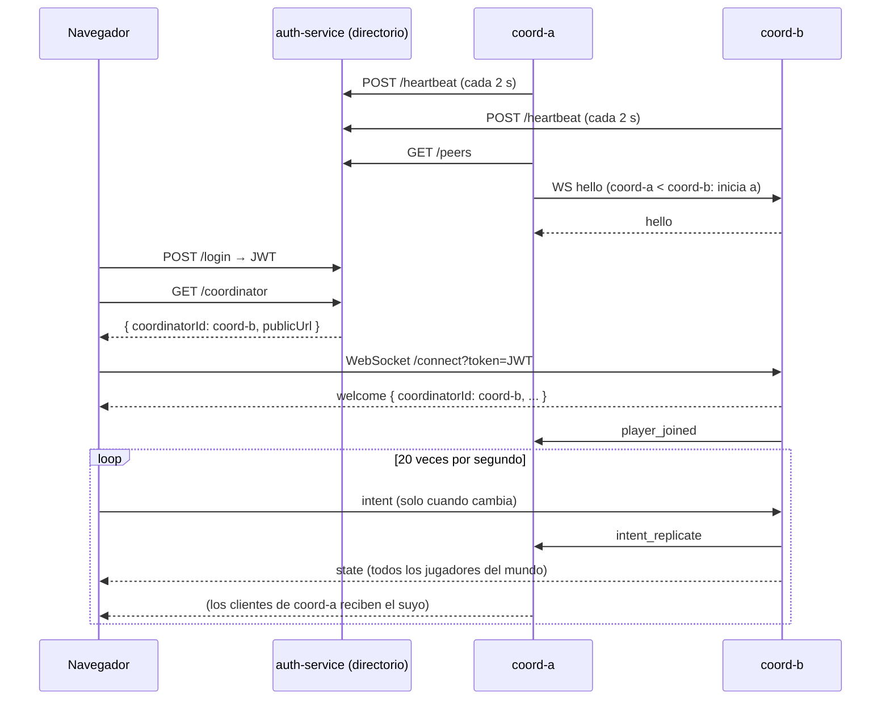

# Parqués en línea — Taller 6 · Proyecto final, Parte III

**Sistemas Distribuidos · Universidad de Boyacá** · Integrantes:Daniela Navarro. Andres Tibocha, Jenifer Nossa, Francy Olmos

Videojuego web multijugador en tiempo real. En la Parte I (Taller 4) los jugadores se
identificaban y entraban a un lobby; en la Parte II (Taller 5) se agregó el juego en vivo con
servidor autoritativo y el login con Google. En esta **Parte III (Taller 6)** el coordinador
deja de ser un punto único de falla:

- **Varios coordinadores en paralelo**, intercambiables, con el mismo estado del juego.
- **El auth-service es también un directory service**: los coordinadores se registran con
  heartbeats (`POST /heartbeat`) y los clientes preguntan a cuál conectarse (`GET /coordinator`,
  el de menos jugadores). *Client-side load balancing*: el auth no proxea tráfico.
- **Mesh entre coordinadores** por WebSocket (`GET /peers` + una conexión por par): lo que hace
  Alice en el coordinador A lo ve Bob en el coordinador B.
- **El cliente** hace login → `GET /coordinator` → WebSocket al coordinador asignado, **muestra
  cuál es**, y si se cae **vuelve a pedir** coordinador en vez de reintentar el mismo.

Todo lo de las Partes I y II (login local y Google, servidor autoritativo a 20 Hz, color e
insignia, duración de sesión en vivo) sigue igual. Las secciones 18 a 23 explican lo nuevo.

---

## Contenido

1. [Arquitectura](#1-arquitectura)
2. [Estructura del repositorio](#2-estructura-del-repositorio)
3. [Tecnologías](#3-tecnologías)
4. [Modelo de datos](#4-modelo-de-datos)
5. [Endpoints HTTP](#5-endpoints-http)
6. [Protocolo WebSocket](#6-protocolo-websocket)
7. [Flujos de autenticación](#7-flujos-de-autenticación)
8. [Game loop y autoridad del servidor](#8-game-loop-y-autoridad-del-servidor)
9. [Característica extra: color e insignia](#9-característica-extra-color-e-insignia)
10. [Duración de sesión en vivo](#10-duración-de-sesión-en-vivo)
11. [Instalación y ejecución](#11-instalación-y-ejecución)
12. [Configuración de Google Cloud](#12-configuración-de-google-cloud)
13. [Despliegue con ngrok](#13-despliegue-con-ngrok)
14. [Pruebas](#14-pruebas)
15. [Decisiones de diseño](#15-decisiones-de-diseño)
16. [Limitaciones conocidas](#16-limitaciones-conocidas)
17. [Solución de problemas](#17-solución-de-problemas)
18. [Taller 6 — Directory service](#18-taller-6--directory-service-auth-service)
19. [Taller 6 — Mesh de coordinadores](#19-taller-6--mesh-de-coordinadores)
20. [Taller 6 — Cambios en el cliente](#20-taller-6--cambios-en-el-cliente)
21. [Taller 6 — Cómo ejecutar tres coordinadores](#21-taller-6--cómo-ejecutar-tres-coordinadores)
22. [Taller 6 — Guion de la sustentación](#22-taller-6--guion-de-la-sustentación)
23. [Taller 6 — Decisiones de diseño y limitaciones](#23-taller-6--decisiones-de-diseño-y-limitaciones)

---

## 1. Arquitectura

Procesos independientes, cada uno en su puerto y con su túnel de ngrok:

| Servicio | Puerto | Responsabilidad |
|---|---|---|
| **auth-service** | 4000 | Registro e inicio de sesión (local y Google), emisión del JWT. **Directory service**: registro de coordinadores por heartbeat y asignación (`/heartbeat`, `/coordinator`, `/peers`). |
| **coordinator** × N | 5001 en cada PC (jugadores en `/connect`, mesh en `/peer`) | Recibe los WebSocket de jugadores, valida el JWT, mantiene el estado **de todo el mundo** (jugadores locales y remotos), ejecuta el game loop a 20 Hz y se replica con los demás coordinadores. |
| **client** | 3000 | Login, pide coordinador al auth, canvas del juego. Solo envía intenciones y dibuja lo que manda su coordinador. |

```
                    ┌──────────────── auth-service :4000 ────────────────┐
                    │  /register /login /auth/google   (Partes I y II)   │
                    │  /heartbeat  /coordinator  /peers (directorio)     │
                    └───▲──────────────▲──────────────────▲──────────────┘
          POST /heartbeat (cada 2 s) │ GET /peers        │ GET /coordinator
         ┌───────────────┴──┐   ┌─────┴────────┐          │ (después del login)
         │                  │   │              │          │
   ┌─────┴──────┐  mesh WS ┌─┴──┴───────┐  mesh WS  ┌─────┴──────┐
   │  coord-a   │◄────────►│  coord-b   │◄─────────►│  coord-c   │
   │ :5001      │◄─────────┴────────────┴──────────►│ :5001      │
   └─────▲──────┘     (una conexión por par; el id menor la inicia)   └─────▲──────┘
         │ WS jugadores                  │ WS jugadores                    │
     Alice, ...                       Bob, ...                          Carol, ...
```



## 2. Estructura del repositorio

```
taller1-auth/
├── auth-service/                 Autenticación + directorio (HTTP :4000)
│   ├── index.js                  users, /register, /login, /auth/google, /session-policy,
│   │                             /heartbeat, /coordinator, /peers, /coordinators
│   ├── test.js                   Pruebas automáticas (npm test)
│   └── .env.example
├── coordinator/                  Juego + mesh (un puerto: /connect jugadores, /peer coordinadores)
│   ├── index.js                  verifyToken, game loop, mesh, heartbeat, descubrimiento
│   ├── test.js                   Pruebas del juego, un coordinador (npm test)
│   ├── mesh-test.js              Pruebas del mesh, 3 coordinadores (npm run test:mesh)
│   ├── .env.example              UN solo archivo para los 3 coordinadores (se copia como .env)
│   └── package.json              start:a · start:b · start:c
├── client/                       Cliente web (HTML + JS plano, :3000)
│   ├── login.html / js/login.js
│   ├── lobby.html / js/lobby.js  GET /coordinator, reconexión, "Coordinador: coord-x"
│   ├── js/config.js              ÚNICO lugar con una URL: AUTH_URL
│   └── css/styles.css
├── docs/taller1.postman_collection.json
├── .gitignore                    node_modules/, *.db, .env, .env.*
└── README.md
```

---

## 3. Tecnologías

| Pieza | Uso |
|---|---|
| Node.js 22.5+ | Los tres servicios. Incluye `node:sqlite` y `fetch` |
| Express 5 | HTTP del auth, del coordinador y del cliente |
| `node:sqlite` | Base de datos del auth (la misma API que usa el PDF) |
| `bcryptjs` | Hash de contraseñas (≥ 10 rounds) |
| `jsonwebtoken` | JWT propio (firmar en el auth, verificar en el coordinador) |
| `google-auth-library` | Verificación del ID Token de Google (`verifyIdToken`) |
| `ws` | WebSocket del coordinador |
| Google Identity Services | Botón oficial "Iniciar sesión con Google" en el cliente |
| HTML + JS plano + Canvas 2D | Cliente, sin frameworks |
| `dotenv` | Configuración por `.env` |

---

## 4. Modelo de datos

**Una sola tabla** `users` para los dos proveedores (`auth-service/index.js`, `USERS_SCHEMA`):

```sql
CREATE TABLE users (
  id            INTEGER PRIMARY KEY AUTOINCREMENT,
  username      TEXT UNIQUE NOT NULL COLLATE NOCASE,   -- 'Alice' y 'alice' son el mismo
  provider      TEXT NOT NULL CHECK (provider IN ('local','google')),
  password_hash TEXT,                                  -- NULL para usuarios de Google
  google_sub    TEXT UNIQUE,                           -- NULL para usuarios locales
  email         TEXT,                                  -- opcional para local
  created_at    TEXT DEFAULT CURRENT_TIMESTAMP,
  CHECK ((provider = 'local'  AND password_hash IS NOT NULL AND google_sub IS NULL) OR
         (provider = 'google' AND google_sub IS NOT NULL    AND password_hash IS NULL))
);
```

- `provider = 'local'` → tiene `password_hash`, no tiene `google_sub`.
- `provider = 'google'` → tiene `google_sub` y `email`, no tiene `password_hash`.
- El `CHECK` final hace que **la base misma** rechace un registro que rompa esas reglas.
- `UNIQUE ... COLLATE NOCASE`: un mismo username no puede repetirse **entre proveedores ni
  cambiando mayúsculas**.

**Migración automática.** Si el auth encuentra una `users.db` del Taller 4 (sin `provider`,
con `password_hash NOT NULL` o sin `NOCASE`), al arrancar:
1. Guarda una copia `users-backup-AAAAMMDDhhmmss.db`.
2. Crea la tabla nueva y copia los usuarios como `provider='local'`, del más antiguo al más nuevo.
3. Si dos usernames solo difieren en mayúsculas (`Alice` / `alice`), **conserva el más antiguo**
   y muestra en la consola cuál descartó.
4. Todo ocurre en una transacción: si algo falla, no se cambia nada.

---

## 5. Endpoints HTTP

Todos los errores tienen la misma forma: `{ "error": "codigo", "message": "qué pasó", "hint": "cómo solucionarlo" }`.

### auth-service (`:4000`)

| Método | Ruta | Body | Respuesta |
|---|---|---|---|
| POST | `/register` | `{ username, password }` | **201** `{ userId, username, message }` |
| POST | `/login` | `{ username, password }` | **200** `{ token, username, provider, expiresIn, message }` |
| POST | `/auth/google` | `{ idToken, username? }` | ver tabla siguiente |
| GET | `/auth/google/config` | — | `{ clientId }` (público; lo usa el botón de Google) |
| GET | `/session-policy` | — | `{ expiresIn, seconds, updatedAt }` |
| GET | `/health` · `/` | — | estado / información |

| Caso | HTTP | `error` |
|---|---|---|
| Registro: username ya existe (cualquier proveedor, sin importar mayúsculas) | 409 | `username_taken` |
| Registro: username fuera de 3–32 o con símbolos | 400 | `invalid_username` |
| Registro: contraseña < 6 caracteres (o > 72 bytes) | 400 | `invalid_password` |
| Falta username o password | 400 | `missing_fields` |
| Sin body JSON / JSON mal escrito | 400 | `missing_body` / `invalid_json` |
| Login: usuario inexistente **o** contraseña incorrecta | 401 | `invalid_credentials` |
| Login con contraseña de una cuenta de Google | 401 | `use_google_login` |
| **Google: ya existía o se creó** | **200** | `{ token, username }` |
| **Google: primer acceso sin username** | **409** | `username_required` |
| **Google: el username elegido ya existe** | **409** | `username_taken` |
| **Google: ID Token inválido** (firma, audience o vencido) | **401** | `invalid_id_token` |
| Google: correo no verificado | 401 | `email_not_verified` |
| Google: falta `idToken` | 400 | `missing_id_token` |
| Body > 4 KB | 413 | `body_too_large` |
| Ruta inexistente | 404 | `not_found` |
| Error interno | 500 | `internal` (sin detalles internos) |

**El JWT propio** (igual para los dos proveedores): `{ userId, username, provider, iat, exp }`,
firmado con `JWT_SECRET`.

### coordinator (`:5000`)

| Ruta | Respuesta |
|---|---|
| `GET /` | Información, mundo y mensajes que acepta |
| `GET /health` | `{ status, players, sessionPolicy }` |
| `GET /players` | Jugadores conectados |

---

## 6. Protocolo WebSocket

Conexión: `ws://HOST:5000/connect?token=JWT` (`wss://` por ngrok).

### Cliente → servidor

| Mensaje | Qué hace el servidor |
|---|---|
| `{"type":"intent","intent":{"dir":{"x":1,"y":0}}}` | Guarda la intención, con cada eje en -1, 0 o 1 (`Math.sign`). **No mueve ni responde**: la confirmación es el siguiente `state` |
| `{"type":"extras_update","extras":{"color":"#e53935"}}` | Valida (objeto, ≤ 1024 caracteres, color de la paleta), guarda en `player.extras` y responde `extras_ok` |
| `{"type":"ping"}` | `pong` |
| `{"type":"get_players"}` | `players_update` solo para quien pregunta |
| `{"type":"reauth","token":"..."}` | Vuelve a validar la sesión con otro token (lo envía el cliente si el token guardado cambia) |
| `{"type":"logout"}` | `logout_ok` y cierre 1000 |

### Servidor → cliente

| `type` | Cuándo | Contenido |
|---|---|---|
| `welcome` | al conectar | `you {userId, username, provider}`, `world {width, height, playerRadius, tickRate}`, `colors`, `tokenExpiresAt` |
| `state` | **20 veces por segundo** | `t`, `players: [{ userId, username, x, y, extras, badge }]` |
| `players_update` | alguien entra, sale o se reconecta | `players`, `event`, `message` |
| `extras_ok` | color aceptado | `extras`, `message` |
| `session_update` | cambió la duración de la sesión | `expiresAt`, `message` |
| `reauth_ok` · `pong` · `logout_ok` | respuestas | `message` |
| `error` | cualquier problema | `code`, `message`, `hint` |

### Errores y cierres

| `code` | Cierre | Cuándo |
|---|---|---|
| `missing_token`, `malformed_token`, `invalid_signature`, `invalid_token`, `token_expired` | `4001 invalid token` | token malo al conectar o en `reauth` |
| `token_expired` | `4001 token expired` | la sesión venció con la conexión abierta |
| `token_user_mismatch` | `4001 invalid token` | `reauth` con el token de otro usuario |
| `session_opened_elsewhere` | `4002 session opened elsewhere` | la misma cuenta se conectó en otro lugar |
| `bad_path` | `4004 bad path` | ruta distinta de `/connect` |
| `invalid_intent`, `invalid_extras`, `extras_too_large`, `invalid_color`, `invalid_json`, `missing_type`, `unknown_type` | — (no cierra) | mensaje inválido |

---

## 7. Flujos de autenticación

**Local.** `POST /register` → bcrypt → fila `provider='local'`. `POST /login` → busca el
usuario (sin importar mayúsculas) → si es de Google, lo rechaza → `bcrypt.compare` → JWT propio.

**Google (opción A del PDF: Google Identity Services).** Elegimos la opción A porque no necesita
`redirect_uri` ni Client Secret, el backend sigue siendo una API JSON igual a `/login`, y el
cliente usa el botón oficial de Google.

1. `login.html` carga `https://accounts.google.com/gsi/client` y pide el Client ID a
   `GET /auth/google/config`.
2. El usuario pulsa el botón y Google devuelve un **ID Token** (JWT firmado por Google).
3. El cliente envía `POST /auth/google { idToken }`.
4. El auth lo **verifica contra Google**: `googleClient.verifyIdToken({ idToken, audience: GOOGLE_CLIENT_ID })`
   revisa la firma con las claves públicas de Google, el vencimiento y que `aud` sea nuestro
   Client ID. Después exige `email_verified === true`.
5. Busca por **`sub`** (identificador estable de Google, no el email):
   - existe → **200** con el JWT propio;
   - no existe y no mandó username → **409 `username_required`**: el cliente muestra
     "Elige tu nombre de usuario" y reenvía `{ idToken, username }`;
   - el username está ocupado → **409 `username_taken`**;
   - si no → crea la fila `provider='google'` y responde **200**.

En los dos casos el cliente guarda el JWT en `sessionStorage` y entra al juego.

---

## 8. Game loop y autoridad del servidor

`coordinator/index.js`, sección 10:

```js
const PLAYER_SPEED = 200;  const TICK_RATE = 20;  const TICK_MS = 1000 / TICK_RATE;
function tick() {
  const now = Date.now();
  const dt  = (now - lastTick) / 1000;          // segundos desde el tick anterior
  lastTick  = now;
  for (const p of players.values()) {
    const mag = Math.hypot(p.intent.x, p.intent.y);
    if (mag > 0) { p.x += (p.intent.x / mag) * PLAYER_SPEED * dt;  p.y += (p.intent.y / mag) * PLAYER_SPEED * dt; }
    p.x = Math.max(PLAYER_RADIUS, Math.min(WORLD_WIDTH  - PLAYER_RADIUS, p.x));
    p.y = Math.max(PLAYER_RADIUS, Math.min(WORLD_HEIGHT - PLAYER_RADIUS, p.y));
  }
  broadcast({ type: 'state', t: now, players: snapshot() });
}
setInterval(tick, TICK_MS);
```

- **`dt`**: la velocidad no depende del `TICK_RATE`. Si un tick se atrasa, el siguiente
  compensa.
- **`Math.hypot`**: en diagonal la intención es (1, 1), de largo √2 ≈ 1,41. Al dividir por ese
  largo, la diagonal avanza igual que en línea recta (sin esto se iría ~41 % más rápido).
- **Límites**: `Math.max/Math.min` dejan el centro del círculo a un radio del borde.
- **Un solo `state` por tick**, para todos. El handler de `intent` **no** mueve ni hace
  broadcast.

**Autoridad.** El cliente nunca envía posiciones, solo `intent` con `Math.sign`, así que
`{x: 9999}` cuenta como 1. Lo que el cliente dibuja es `lastState`, el último `state` del
servidor. Si alguien modifica `lastState` desde DevTools, solo cambia **su propio dibujo**:
el servidor no se entera, la posición oficial no cambia y los demás siguen viendo la real.

**Mundo:** 960 × 600 px, radio 18 px. El cliente arma el canvas con el `world` del `welcome`.

---

## 9. Característica extra: color e insignia

**Color (replicado y persistente durante la sesión).**
1. El jugador elige un color en el panel **Tu color**.
2. El cliente envía `{"type":"extras_update","extras":{"color":"#8e24aa"}}`.
3. El servidor valida: debe ser un objeto (no un arreglo), de ≤ 1024 caracteres, y el color
   debe estar en la **paleta de 8 colores** (`ALLOWED_COLORS`). Así nadie puede inyectar texto
   arbitrario que luego se dibuje en otros navegadores.
4. Se guarda en `player.extras` y viaja en **cada** `state`: todos lo ven en el siguiente tick
   y se mantiene mientras el jugador esté conectado, aunque cambie de pestaña.

**Insignia del proveedor.** Cada jugador muestra `G` (Google) o `L` (local) dentro de su
círculo y en la lista. La decide **el servidor** a partir del `provider` del JWT (`badge`),
así que el cliente no puede falsificarla.

---

## 10. Duración de sesión en vivo

`JWT_EXPIRES_IN` se puede cambiar **con el sistema encendido**, sin reiniciar nada:

1. El auth vigila su `.env` cada segundo. Al guardar el archivo, los tokens nuevos salen con
   la duración nueva (`[config] Duración del token: 1h → 30s`). Un valor inválido se ignora.
2. El coordinador consulta `GET /session-policy` cada 3 segundos (`AUTH_URL` en su `.env`). Si
   la duración cambió, recalcula para cada jugador conectado:
   **vence = mínimo(exp del token, iat + duración nueva)**. Envía `session_update` y saca con
   `4001 token expired` a quien ya superó la duración.
3. También el upgrade y `reauth` aplican la duración vigente.

Un token ya emitido no se puede **alargar**, porque su `exp` va firmado. Por eso, si se vuelve
de `30s` a `1h`, los tokens de 30 s siguen venciendo a los 30 s.

---

## 11. Instalación y ejecución

> Para levantar **tres coordinadores** y hacer la demo del Taller 6, ver la sección
> [21](#21-taller-6--cómo-ejecutar-tres-coordinadores). Esta sección es lo básico.

### Requisitos
- **Node.js 22.5 o superior** (recomendado 22 LTS): `node -v`.
- ngrok con cuenta (`ngrok config add-authtoken TU_TOKEN`).
- Para pruebas: `wscat` (`npm install -g wscat`), Thunder Client o curl.

### Dependencias (en cada carpeta)

```powershell
cd auth-service ; npm install ; cd ..
cd coordinator  ; npm install ; cd ..
cd client       ; npm install ; cd ..
```

Ninguna dependencia necesita compilarse, así que no hace falta Python ni Visual Studio Build Tools.

### Archivos `.env` (nunca se suben al repositorio)

| Archivo | Variables |
|---|---|
| `auth-service/.env` | `PORT=4000`, `JWT_SECRET` (≥ 32, igual en los coordinadores), `JWT_EXPIRES_IN=1h`, `GOOGLE_CLIENT_ID`, `BCRYPT_ROUNDS=10`, `DB_PATH=users.db`, y opcionales del directorio: `COORDINATOR_TTL_MS=6000`, `PENDING_TTL_MS=5000` |
| `coordinator/.env` (el mismo formato en cada PC) | `JWT_SECRET`, `AUTH_URL`, `HEARTBEAT_MS`, opcional `MESH_SECRET`, `COORD_PORT` (puerto local) y `COORD_PUBLIC_URL` (la URL de ngrok de **ese** PC; la usan jugadores **y** mesh). El ID sale del comando: `npm run start:a` / `:b` / `:c` |
| `client/.env` | `PORT=3000` |
| `client/js/config.js` | `AUTH_URL` (la única URL que usa el navegador) |

Generar una `JWT_SECRET`:
```powershell
node -e "console.log(require('crypto').randomBytes(32).toString('hex'))"
```

### Orden de arranque (una terminal por servicio)

```powershell
cd auth-service ; npm start        # 1. auth + directorio  → :4000
cd coordinator  ; npm run start:a  # 2. coord-a (PC 1)    → :5001 (jugadores /connect, mesh /peer)
cd coordinator  ; npm run start:b  #    coord-b (PC 2)    → :5001 en su equipo
cd coordinator  ; npm run start:c  #    coord-c (PC 3)    → :5001 en su equipo
cd client       ; npm start        # 3. cliente            → http://localhost:3000
```

Abrir **http://localhost:3000**. Para cerrar un servicio: `Ctrl+C`.

### Comprobar que cada servicio funciona
- Auth: `http://localhost:4000/health` y `http://localhost:4000/coordinators` (coordinadores vivos y su carga)
- Coordinador: `http://localhost:5001/health` → `{ coordinatorId, connectedPlayers, worldPlayers, peers: [...] }`; `http://localhost:5001/mesh`
- Cliente: `http://localhost:3000` → página de login

### Dos jugadores a la vez
- **Dos pestañas del mismo navegador, con usuarios distintos:** funciona, porque la sesión se
  guarda en `sessionStorage`, que es independiente por pestaña.
- **El mismo usuario en dos lugares** (aunque sea en dos coordinadores distintos): se cierra la
  conexión anterior (4002).

---

## 12. Configuración de Google Cloud

1. Entrar a https://console.cloud.google.com y crear un proyecto.
2. **Google Auth Platform** (antes: APIs y servicios → Pantalla de consentimiento de OAuth):
   público **Externo**, nombre de la app, correo de soporte y scopes `openid`, `email`, `profile`.
3. **Público → Usuarios de prueba:** agregar los correos que van a iniciar sesión (los
   integrantes y el profesor). Sin esto Google muestra "Acceso bloqueado".
4. **Clientes → Crear cliente → Aplicación web.** En **Orígenes de JavaScript autorizados**
   agregar `http://localhost:3000` y la URL https de ngrok **del cliente** (sin `/` final).
   Las URIs de redirección se dejan vacías (opción A).
5. Copiar el **Client ID** (`....apps.googleusercontent.com`) en `auth-service/.env` como
   `GOOGLE_CLIENT_ID`. El Client Secret no se usa.

El cliente obtiene el Client ID con `GET /auth/google/config`, así que no hay que repetirlo en
`config.js`.

---

## 13. Despliegue con ngrok

Cada servicio que el navegador necesita alcanzar tiene su propio túnel:

```powershell
ngrok http 4000   # auth         → https://AAAA.ngrok-free.dev
ngrok http 5001   # coord-a (PC 1) → https://BBBB.ngrok-free.dev
ngrok http 5001   # coord-b (PC 2) → https://CCCC.ngrok-free.dev
ngrok http 5001   # coord-c (PC 3) → https://DDDD.ngrok-free.dev
ngrok http 3000   # cliente      → https://EEEE.ngrok-free.dev
```

> El plan gratuito de ngrok limita el número de túneles/sesiones simultáneas. Si no alcanzan:
> `ngrok.yml` con varios túneles en una sola sesión (`ngrok start --all`), o un túnel menos
> sirviendo el cliente desde el mismo equipo (`http://localhost:3000`) y solo exponer auth y coordinadores.

Después:
1. `client/js/config.js`: `const AUTH_URL = 'https://AAAA.ngrok-free.dev';`
2. En el `coordinator/.env` de **cada PC**: `COORD_PUBLIC_URL=wss://…` con la URL de **su** túnel
   (**`wss://`**: PC 1 `wss://BBBB…`, PC 2 `wss://CCCC…`, PC 3 `wss://DDDD…`) y
   `AUTH_URL=https://AAAA.ngrok-free.dev`. El mesh usa **esa misma URL** (`wss://BBBB…/peer`), así que
   **no hace falta un túnel extra** para los coordinadores.
3. Google Cloud: la URL del **cliente** en "Orígenes de JavaScript autorizados".
4. Reiniciar los coordinadores (leen el `.env` al arrancar).
5. En cada navegador, abrir una vez `https://BBBB.ngrok-free.dev/health` (y los de los otros
   coordinadores) y pulsar **Visit Site**: el aviso de ngrok del plan gratuito bloquea el
   WebSocket hasta hacerlo. Con varios coordinadores hay que hacerlo con **cada uno**.

URLs usadas en la entrega:
```
Cliente:  https://__________________.ngrok-free.dev   (ngrok http 3000)
Auth:     https://__________________.ngrok-free.dev   (ngrok http 4000)
coord-a:  wss://___________________.ngrok-free.dev    (ngrok http 5001)
coord-b:  wss://___________________.ngrok-free.dev    (ngrok http 5002)
coord-c:  wss://___________________.ngrok-free.dev    (ngrok http 5003)
```

---

## 14. Pruebas

### Pruebas automáticas

```powershell
# Con el auth encendido
cd auth-service ; npm test
# Con el auth y el coordinador encendidos
cd coordinator  ; npm test
# Por ngrok
node test.js https://AAAA.ngrok-free.dev                                    # auth
node test.js https://AAAA.ngrok-free.dev wss://BBBB.ngrok-free.dev          # coordinador
```

**`auth-service/test.js` (19 pruebas):** health, `session-policy`, registro 201, repetido 409,
mismo nombre en minúsculas y en MAYÚSCULAS 409, username inválido, contraseña corta, campos
faltantes, JSON roto, login 200, JWT con `userId/username/provider/iat/exp`, login sin importar
mayúsculas, contraseña incorrecta 401, usuario inexistente 401, Client ID, Google sin idToken
400, Google con token falso 401, ruta inexistente 404.

**`coordinator/test.js` (22 pruebas, dos jugadores reales):**

| Prueba | Resultado medido |
|---|---|
| `welcome` con `world` y `you` | ✔ |
| Mensajes `state` por segundo | 20 |
| Horizontal / vertical en 1 s | 201 px / 201 px |
| Diagonal en 1 s | **201 px** (sin normalizar serían 283) |
| `intent {x: 9999}` en 0,5 s | 100 px (no hay teletransporte) |
| Límites del mundo | se queda en (18, 18) |
| Mensajes inválidos | `invalid_intent`, `invalid_json`, `unknown_type`, `invalid_extras`, `extras_too_large`, `invalid_color` |
| Color replicado y persistente | el otro jugador lo ve y se mantiene |
| Desconexión | desaparece del `state` de los demás |
| Token alterado | cierre 4001 |

Resultados reales: **_(pegar aquí la salida de `npm test` de cada servicio)_**.

**`coordinator/mesh-test.js` (19 pruebas, Taller 6)** — con el auth y tres coordinadores
encendidos (`npm run test:mesh`): `/peers` lista los tres, `POST /heartbeat` inválido → 400, 4
clientes pedidos a `GET /coordinator` se reparten entre los tres, Alice en un coordinador y Bob en
otro se ven y se mueven en vivo en ambos sentidos (posición coincide ±15 px), el color se replica,
la misma cuenta en dos coordinadores cierra la vieja con 4002 y no queda duplicada, y al
desconectarse desaparece en el otro coordinador.

### Pruebas manuales en el navegador
1. **Juego:** dos pestañas (`alice` y `bob_google`); mover con flechas/WASD en una y ver el
   movimiento en la otra; cambiar el color y verlo en la otra.
2. **Autoridad:** en la pestaña de `alice`, consola (F12):
   ```js
   setInterval(() => { const yo = lastState.players.find(p => p.username === miUsuario); yo.x = 60; yo.y = 60; }, 5);
   ```
   `alice` se ve en la esquina **solo en su pestaña**; en la otra sigue en su posición real.
   Al recargar se quita la trampa. También se puede probar
   `ws.send(JSON.stringify({type:'intent', intent:{dir:{x:9999, y:0}}}))`: se mueve a
   velocidad normal.
3. **Token propio inválido:** F12 → Application → Session Storage → `token`, cambiar unas
   letras → el jugador sale solo, sin recargar.
4. **Token vencido:** `JWT_EXPIRES_IN=30s` en `auth-service/.env` (sin reiniciar) → cerrar
   sesión, entrar de nuevo, esperar 30 s.

### Pruebas de Google
| Sin credenciales (cualquiera puede correrlas) | Con Client ID real y cuenta de prueba |
|---|---|
| `GET /auth/google/config` · sin idToken → 400 · token falso → 401 `invalid_id_token` | primer acceso → 409 `username_required` · elegir `alice` → 409 `username_taken` · elegir `bob_google` → 200 · segundo acceso → 200 directo · `bob_google` en `/login` → 401 `use_google_login` |

Para probar `/auth/google` en Thunder Client con un token real: en la consola de la página de
login escribir `MOSTRAR_ID_TOKEN = true`, pulsar el botón de Google y copiar el ID Token que
aparece en la consola (dura ~1 hora). La colección `docs/taller1.postman_collection.json` ya
trae todos estos casos.

---

## 15. Decisiones de diseño

1. **Una sola tabla `users` con `provider`.** Un username es único en todo el sistema y el
   coordinador no necesita saber cómo se autenticó cada uno: recibe el mismo JWT. El `CHECK`
   hace que la base garantice las reglas de cada proveedor.
2. **Google opción A** (sección 7). Verificación **en el backend** con `verifyIdToken` y
   `audience`: decodificar no alcanza, porque cualquiera puede fabricar un JSON con esa forma.
   Se usa `sub` (no el email) porque el email puede cambiar.
3. **Usernames sin distinguir mayúsculas** (`COLLATE NOCASE`), para que `Alice` y `alice` no
   sean dos cuentas. La migración conserva al usuario más antiguo.
4. **El JWT se verifica en el `upgrade`** (del Taller 4). Un token malo nunca llega al Map;
   antes de cerrar con 4001 se envía un `error` con el motivo exacto.
5. **Servidor autoritativo.** El cliente envía intenciones saneadas con `Math.sign`; el
   game loop mueve con `dt` y `Math.hypot` y envía un `state` por tick. Así la velocidad no
   depende de cuántos mensajes mande el cliente ni de su `TICK_RATE`.
6. **`intent` sin respuesta propia.** Un `intent` válido no se contesta (la confirmación es el
   `state` siguiente, 50 ms después); uno inválido sí recibe `error`. Responder cada tecla
   duplicaría el tráfico.
7. **Color con paleta cerrada.** Además del límite de 1024 caracteres, solo se aceptan 8
   colores: evita texto arbitrario o enorme replicado a todos.
8. **Insignia derivada del JWT**, no de `extras`, para que no se pueda falsificar.
9. **`sessionStorage` en vez de `localStorage`.** Con `localStorage` las pestañas comparten el
   token, y la demo de dos pestañas con usuarios distintos se rompía. La regla "una cuenta,
   una conexión" la sigue aplicando el coordinador (4002).
10. **Dos pestañas con la misma cuenta: gana la más nueva** (del Taller 4), conservando
    posición y color.
11. **Duración en vivo (sección 10).** El auth relee su `.env`; el coordinador consulta
    `/session-policy`, una ruta pública que solo informa la duración.
12. **Mensajes amigables para el jugador.** El servidor responde códigos y detalles técnicos
    (útiles en Thunder Client y wscat); el cliente los traduce a un texto sencillo y deja el
    detalle en la consola.
13. **El Client ID vive solo en el `.env` del auth** y el cliente lo pide a
    `/auth/google/config`. No es secreto, pero así se configura en un solo lugar.
14. **`node:sqlite` y `bcryptjs`** (los mismos del PDF): no necesitan compilarse en Windows.

---

## 16. Limitaciones conocidas

- El estado del juego vive **en memoria**. Con el mesh, si un coordinador muere sus jugadores
  se reconectan a otro y **reaparecen en una posición nueva** (ver sección 23).
- El cliente dibuja exactamente el último `state` (20 por segundo) sin interpolar; con mucha
  latencia el movimiento puede verse a saltos.
- Un token ya emitido no se puede alargar; los cambios de duración en vivo solo pueden acortarlo.
- Mientras la app de Google Cloud esté en modo de prueba, solo pueden entrar los correos
  agregados como usuarios de prueba.
- Si cambia la URL de ngrok del cliente, hay que agregarla en Google Cloud y esperar unos minutos.

---

## 17. Solución de problemas

| Síntoma | Causa | Solución |
|---|---|---|
| `JWT_SECRET falta o tiene menos de 32 caracteres` | Clave corta o sin `.env` | Generar una y ponerla **igual** en auth y coordinador |
| `GOOGLE_CLIENT_ID falta o no es válido` | Falta la línea en `auth-service/.env` | Agregarla (sección 12) |
| El botón de Google no aparece; consola: *origin is not allowed* | La URL del cliente no está en Google Cloud | Agregarla exacta en "Orígenes de JavaScript autorizados" |
| Google: *Acceso bloqueado* | El correo no es usuario de prueba | Agregarlo en Google Cloud |
| "No pudimos verificar tu cuenta de Google" | Client ID distinto entre Google Cloud y el `.env` | Revisar `GOOGLE_CLIENT_ID` |
| "Tu sesión no es válida" al entrar al juego | `JWT_SECRET` distinta entre auth y coordinador | Igualarlas y reiniciar ambos |
| "Se perdió la conexión con el servidor del juego" | `COORDINATOR_WS` mal escrita, `ws://` en vez de `wss://`, coordinador apagado o aviso de ngrok pendiente | Revisar `config.js`; abrir `https://URL-COORDINADOR/health` y pulsar "Visit Site" |
| `[sesión] No se pudo consultar …/session-policy` | `AUTH_URL` del coordinador incorrecta o auth apagado | Corregir `AUTH_URL`; el juego funciona igual |
| `Cannot find module` | Faltan dependencias | `npm install` en esa carpeta |
| `EADDRINUSE` | El puerto ya está en uso | Cerrar la otra terminal con `Ctrl+C` |

---

## 18. Taller 6 — Directory service (auth-service)

El auth-service guarda **en memoria** un `Map<coordinatorId, { ...info, lastSeen }>`. Un
coordinador sin heartbeat en los últimos **6 s** (3 ciclos de 2 s, `COORDINATOR_TTL_MS`) se
considera muerto y se descarta (un barrido cada 1 s lo muestra en la consola:
`[directory] coord-c sin heartbeat hace 6.1 s: se descarta`).

| Método | Ruta | Quién la llama | Respuesta |
|---|---|---|---|
| POST | `/heartbeat` | cada coordinador, cada 2 s | **200** `{ ok: true }` · **400** `invalid_heartbeat` si faltan o son inválidos `coordinatorId`, `publicUrl`, `peerUrl` (ws:// o wss://), `connectedPlayers` (entero ≥ 0) o `uptime` |
| GET | `/coordinator` | el cliente, después del login | **200** `{ coordinatorId, publicUrl }` del vivo con menos carga · **503** `{ error: "no_coordinators_available" }` si no hay ninguno |
| GET | `/peers` | los coordinadores, al arrancar y cada 2 s | `{ peers: [{ coordinatorId, peerUrl }] }` (los vivos; cada coordinador se filtra a sí mismo) |
| GET | `/coordinators` | depuración | todos los registrados con carga, `alive` y `lastSeenMsAgo` |

**Estrategia de selección.** Menor `connectedPlayers` entre los vivos; en empate, el primero.
Hay un detalle práctico: `connectedPlayers` solo se actualiza cada 2 s, así que 4 clientes que
piden coordinador en el mismo segundo verían la misma carga y los 4 irían al mismo. Por eso el
auth suma a cada coordinador las **asignaciones recientes** que todavía no aparecen en su
heartbeat. Cuando el coordinador reporta más jugadores, esas asignaciones se descuentan (ya están
en `connectedPlayers`, así no se cuentan dos veces); si el cliente nunca llega, la asignación
vence a los `PENDING_TTL_MS` (5 s). Además, el coordinador envía un heartbeat **en cuanto** entra o
sale un jugador, sin esperar los 2 s. La métrica sigue siendo `connectedPlayers`.

**Rebalanceo automático (sin recargar).** Si un coordinador le lleva **2 o más** jugadores al menos
cargado (por ejemplo, porque se encendió uno nuevo), la respuesta de su `POST /heartbeat` trae
`{ "ok": true, "rebalance": N }` con N = la mitad de la diferencia. El coordinador elige a sus N
jugadores más recientes y les envía `{"type":"rebalance"}`. Cada cliente pide `GET /coordinator`, abre
el WebSocket nuevo **sin recargar la página**, y al entrar allá el `player_joined` del mesh hace que
el coordinador viejo cierre la conexión anterior (4002), conservando posición y color. Solo se le
ordena mover al más cargado, y con una pausa de 4 s, para que no se muevan todos a la vez.
Ejemplo medido: 6 jugadores en un coordinador, se encienden 2 más → **2 / 2 / 2** en unos segundos.
Se desactiva con `AUTO_REBALANCE=false` en `auth-service/.env`.

**Cambio de coordinador sin saltos ni cambio de color.** Antes de avisar `rebalance`, el coordinador
viejo detiene al jugador y envía por el mesh (`positions_sync`) su posición, dirección y **color**
exactos; el nuevo ya lo tiene en el mismo punto cuando el cliente llega. El `positions_sync`
periódico (cada 1 s) también lleva el color, y si a un coordinador le falta la copia de un jugador,
la crea con esos datos. Solo se mueve a clientes que saben cambiarse (el navegador manda `seq`;
`wscat` no, y nunca se le mueve).

**Si se cae un coordinador, sus jugadores vuelven casi al instante** (medido: 120–180 ms):
- El cliente reconecta **de inmediato** (sin esperar 1 s) y pide `GET /coordinator?exclude=caido`:
  el auth no le devuelve el que se acaba de caer aunque aún no hayan pasado los 6 s. Además, entre
  los vivos prefiere los que mandaron heartbeat hace ≤ 3 s.
- Los demás coordinadores **no borran** a esos jugadores: los dejan quietos en su sitio, con su
  color ("fantasmas"), hasta 8 s (`GHOST_MS`). Si vuelven en otro coordinador, siguen ahí mismo; si
  no, se quitan. Así nadie los ve desaparecer y reaparecer.
- Cada conexión lleva `seq` (la hora en que el navegador la abrió). Si por una carrera la misma
  cuenta queda en dos coordinadores, todos se quedan con la **más nueva** (la otra recibe 4002). En la consola del auth se ve la cuenta
(`coord-a=0+1 coord-b=0+0` = jugadores + pendientes).

Esto es **client-side load balancing**: el auth no proxea tráfico, solo le dice al cliente a
dónde conectarse.

Probar con curl:
```powershell
curl http://localhost:4000/peers
curl http://localhost:4000/coordinator
curl http://localhost:4000/coordinators
curl -X POST http://localhost:4000/heartbeat -H "Content-Type: application/json" -d "{\"coordinatorId\":\"coord-z\"}"   # → 400
```

---

## 19. Taller 6 — Mesh de coordinadores

Cada coordinador abre **un** servidor y una sola URL pública (`COORD_PUBLIC_URL`): los jugadores entran
por `/connect?token=` y los otros coordinadores por `/peer` (el `peerUrl` que se publica en el heartbeat
es `COORD_PUBLIC_URL + /peer`). El PDF permite "el mismo puerto u otro"; usamos el mismo para que cada
PC necesite **un solo túnel de ngrok**. Cada `PEER_POLL_MS` (2 s) llama `GET /peers`.

### Una sola conexión por par
- El coordinador con el `coordinatorId` **menor** (orden lexicográfico) inicia; el mayor espera.
  Con `coord-a < coord-b < coord-c`: a→b, a→c, b→c.
- Si llega una conexión que viola la regla y ya hay una, se cierra la **nueva** (código 4010).
  Si el menor se reinicia y llega su conexión nueva mientras la vieja sigue "viva" en el otro
  lado, la nueva **reemplaza** a la vieja.
- Si un peer desaparece de `/peers` durante dos consultas seguidas, se cierra su conexión.
  Además hay ping/pong cada 5 s para detectar peers congelados sin `close`.

### Mensajes
Todos llevan `origin` (el coordinador que los originó). **Nunca se retransmiten**: cada
coordinador manda directo a todos los demás, así que no hay bucles. Si llega un mensaje cuyo
`origin` es el propio coordinador se descarta, y si el `origin` no coincide con el dueño de la
conexión también (nadie puede hablar en nombre de otro).

| Mensaje | Cuándo | Qué hace el que lo recibe |
|---|---|---|
| `hello { coordinatorId }` | primer mensaje en ambos sentidos | registra al peer y le manda la foto de sus jugadores locales |
| `intent_replicate { origin, userId, intent }` | un cliente local cambió de dirección | aplica el intent a **su copia** del jugador |
| `extras_replicate { origin, userId, extras }` | un cliente local cambió su color | valida (paleta) y guarda |
| `player_joined { origin, userId, username, x, y, … }` | un cliente se conecta | crea el jugador remoto; si el mismo usuario estaba conectado **aquí**, cierra esa conexión (4002) |
| `player_left { origin, userId }` | un cliente se desconecta | lo elimina (solo si sigue siendo de ese `origin`) |
| `positions_sync { origin, players:[{userId,x,y,intent}] }` | cada 1 s (**extra**, ver 23) | corrige la deriva de los jugadores de ese origen |

Un `player_joined` extra lleva `provider`, `extras`, `intent` y, en la foto inicial, `sync: true`
(no se anuncia "entró al juego" otra vez).

### Game loop
Cada coordinador, a 20 Hz: (1) aplica los intents de **todos** los jugadores del mundo, locales
y remotos; (2) hace broadcast del `state` **solo a sus clientes locales** (nunca a peers). Cada
cliente recibe únicamente el `state` de su coordinador, pero ese `state` incluye a todo el mundo
(y `coordinator` por jugador, que la UI muestra en la lista).

### Coordinadores que entran, salen o mueren
- **Entra uno nuevo:** se registra por heartbeat → los demás lo ven en `/peers` (≤ 2 s) → el
  menor abre la conexión → ambos se mandan `hello` y la foto de sus jugadores locales. El nuevo
  queda con el mismo mundo.
- **Muere uno (Ctrl+C o caída):** sus conexiones de mesh se cierran → cada peer borra a sus
  jugadores remotos y lo avisa a sus clientes. Sus clientes, desconectados, piden `/coordinator`
  de nuevo. Pasados 6 s sin heartbeat el auth lo descarta.
- **Se pierde solo el mesh (no el coordinador):** al reconectar, el `hello` + la foto reemplazan
  cualquier estado viejo; los fantasmas de esa conexión se borran antes.

---

## 20. Taller 6 — Cambios en el cliente

`client/js/lobby.js`, sección 6:

1. Tras el login, `GET {AUTH_URL}/coordinator` → `{ coordinatorId, publicUrl }`.
2. Abre `WebSocket(publicUrl + '/connect?token=…')`.
3. **Muestra el coordinador:** en la cabecera (`Coordinador: coord-b`), en el panel
   "Tu sesión" (`Coordinador:` y `Tick: 20 Hz`) y una etiqueta con el coordinador de cada
   jugador en la lista.
4. **Si el WebSocket se cae no reconecta al mismo:** vuelve al paso 1. Cada intento espera 1 s;
   si el socket no abre en 4 s se descarta y se pregunta otra vez (un coordinador recién
   muerto puede seguir unos segundos en el directorio). Con `503` reintenta cada segundo.
   Mientras tanto la UI dice "Se perdió coord-a. Buscando otro coordinador…".
5. Los errores de **sesión** (token vencido o inválido `4001`, cuenta abierta en otro lado
   `4002`) siguen llevando al login, como antes. Solo las caídas del coordinador reconectan.
6. Al reconectar se reenvía la tecla que siga apretada.

---

## 21. Taller 6 — Cómo ejecutar tres coordinadores

Tres coordinadores, **un solo código**, normalmente **uno por computador**. Cada PC tiene un
`coordinator/.env` con la misma forma; solo cambia `COORD_PUBLIC_URL` (la URL de ngrok de ese PC).
El ID sale del comando: `npm run start:a` ejecuta `node index.js coord-a`. Si no existe:
`copy .env.example .env`.

**Nombres.** Además de `start:a` / `:b` / `:c` se puede usar cualquier nombre:
`npm start -- pc-danna` (letras, números, `.` `_` `-`; máx. 64). El directorio **no deja dos
coordinadores vivos con el mismo nombre, sin importar mayúsculas** (`Coord-A` = `coord-a`): el
segundo recibe `409 coordinator_id_taken` en su heartbeat y se apaga con un mensaje claro. El mismo
coordinador sí puede reiniciarse enseguida (misma URL).

**Si el mesh se conecta y se pierde una y otra vez**, el log dice el motivo del cierre:
`1006` = se cayó la red o el túnel; `4010 duplicate connection` / `replaced` = hay otro proceso con
ese nombre o un coordinador viejo; `1000 left directory` = el otro no lo ve en `/peers` (revisar que
los dos usen el **mismo** `AUTH_URL`). La consola del otro coordinador muestra su versión del motivo.

```env
JWT_SECRET=...                                   # igual en todos y en el auth
AUTH_URL=https://AAAA.ngrok-free.dev
COORD_PORT=5001
COORD_PUBLIC_URL=wss://BBBB.ngrok-free.dev       # la de ESTE computador
```

**Los tres en un solo PC (para probar):** el `.env` da el puerto 5001, así que los otros dos se
arrancan cambiando las variables en la terminal (tienen prioridad sobre el `.env`):

```powershell
cd coordinator ; npm run start:a
cd coordinator ; $env:COORD_PORT=5002; $env:COORD_PUBLIC_URL="ws://localhost:5002"; npm run start:b
cd coordinator ; $env:COORD_PORT=5003; $env:COORD_PUBLIC_URL="ws://localhost:5003"; npm run start:c
```

```powershell
# Terminal 1
cd auth-service ; npm start
# Terminales 2, 3 y 4
cd coordinator ; npm run start:a
cd coordinator ; npm run start:b
cd coordinator ; npm run start:c
# Terminal 5
cd client ; npm start
```

Qué se debe ver:
```
[a] [directorio] … / [mesh] ✔ conectado con coord-b (yo inicié). Peers: coord-b
[a] [mesh] ✔ conectado con coord-c (yo inicié). Peers: coord-b, coord-c
[b] [mesh] ✔ conectado con coord-a (él inició). Peers: coord-a  → luego coord-c (yo inicié)
auth: [directory] coord-a registrado … Coordinadores vivos: coord-a, coord-b, coord-c
```

Pruebas automáticas del mesh: `cd coordinator ; npm run test:mesh`.

---

## 22. Taller 6 — Guion de la sustentación

| # | Qué mostrar | Cómo |
|---|---|---|
| 1 | **Tres coordinadores en `/peers`** (3 min) | Levantar los tres y abrir `…/peers` del auth. En la consola de cada uno: `[mesh] ✔ conectado con …`. Extra: `…/coordinators` y `http://localhost:5001/mesh`. |
| 2 | **4 clientes repartidos** (3 min) | Cuatro pestañas (usuarios distintos). Cada una muestra su `Coordinador: …`; en la consola del auth se ve la carga (`coord-a=0+1 …`). Quedan 2-1-1. |
| 3 | **Alice en coord-A, Bob en coord-B** (2 min) | Dos pestañas: la cabecera dice a qué coordinador está cada una. Mover a Alice → Bob la ve; mover a Bob → Alice lo ve. La lista de jugadores muestra el coordinador de cada uno. |
| 4 | **Matar un coordinador** (4 min) | `Ctrl+C` en uno. (a) sus clientes dicen "Buscando otro coordinador…"; (b) tras 6 s, `…/peers` ya no lo lista y el auth imprime `[directory] coord-x … se descarta`; (c) los clientes quedan conectados a los vivos y siguen viéndose. Los otros coordinadores imprimen `[mesh] ✘ se perdió coord-x`. |
| 5 | **Preguntas** (3 min) | Ver sección 23: bucles, conexión duplicada, consistencia, `positions_sync`. |

Antes de empezar con ngrok: abrir una vez cada URL de coordinador (`…/health`) → **Visit Site**.

---

## 23. Taller 6 — Decisiones de diseño y limitaciones

**Los problemas que el PDF anuncia, y cómo se resolvieron**

| Problema | Solución |
|---|---|
| **Descubrimiento de pares** | `GET /peers` al arrancar y cada 2 s; cualquier coordinador que aparezca se conecta solo. |
| **Bucles infinitos** | `origin` en todos los mensajes, **sin retransmisión** (cada uno manda directo a todos) y se descarta lo que traiga mi propio `origin` o un `origin` ajeno a la conexión. |
| **Conexión duplicada** | Solo inicia el `coordinatorId` menor; la que llega a contramano se cierra (4010). |
| **Consistencia** | Ver abajo. |
| **Coordinadores que entran y salen** | Foto de jugadores locales en el `hello`; borrado de jugadores remotos al perder la conexión; el auth descarta al muerto a los 6 s. |

**Consistencia.** Cada coordinador aplica los mismos intents con su propio reloj, así que las
copias de un jugador remoto se pueden separar unos píxeles (latencia de red × 200 px/s). Para
que no se acumule, el coordinador **dueño** de cada jugador manda `positions_sync` una vez por
segundo y los demás adoptan esa posición. Esto **no está en el PDF**: es un mensaje extra que
se puede quitar (`SYNC_MS`) para ver la deriva. Solo el dueño puede modificar a un jugador:
un `intent_replicate` de otro `origin` se ignora.

**Otras decisiones**
- **Mismo usuario en dos coordinadores:** gana la conexión **nueva**, igual que en el Taller 5. El
  `player_joined` hace que el coordinador viejo cierre su socket con 4002 y deje al jugador como
  remoto, conservando posición y color.
- **Carga pendiente** en `/coordinator` (sección 18): evita que 4 clientes simultáneos vean la
  misma carga vieja.
- **Mesh por la misma URL que los jugadores** (ruta `/peer`; el PDF permite "el mismo puerto u
  otro"). Así cada computador expone un solo túnel de ngrok y el `.env` solo necesita
  `COORD_PUBLIC_URL`. El upgrade separa el tráfico: `/connect` = jugadores, `/peer` = coordinadores.
- **`MESH_SECRET` (opcional):** si se define, el `hello` debe traerlo; evita que un tercero que
  conozca el `peerUrl` se meta al mesh. Ponerlo igual en todos los coordinadores.
- **Un mensaje del mesh nunca se confía:** se valida (`Math.sign`, paleta de colores, límites del
  mundo) igual que lo que manda un cliente.

**Limitaciones**
- Estado **en memoria**: si muere un coordinador, sus jugadores reaparecen en una posición nueva
  al reconectarse a otro; si mueren todos, se pierde el mundo.
- El auth-service es el **único directorio**: si cae, los coordinadores ya conectados siguen
  jugando entre sí y sus clientes también, pero no se pueden asignar clientes nuevos ni
  descubrir coordinadores nuevos hasta que vuelva (los heartbeats lo repueblan en ≤ 2 s).
- `POST /heartbeat` y `GET /peers` son públicos (como pide el PDF). Quien alcance el auth podría
  registrar un coordinador falso; el `MESH_SECRET` protege el mesh, no el directorio.
- Si el mismo usuario se conecta en el mismo instante a dos coordinadores, ambos se pueden
  cerrar mutuamente (hay que volver a entrar).
- Si el reloj de un coordinador se desincroniza mucho no afecta al juego (usa `dt` local), pero sí
  la caducidad del token, que ya se compensa con el reloj del auth.