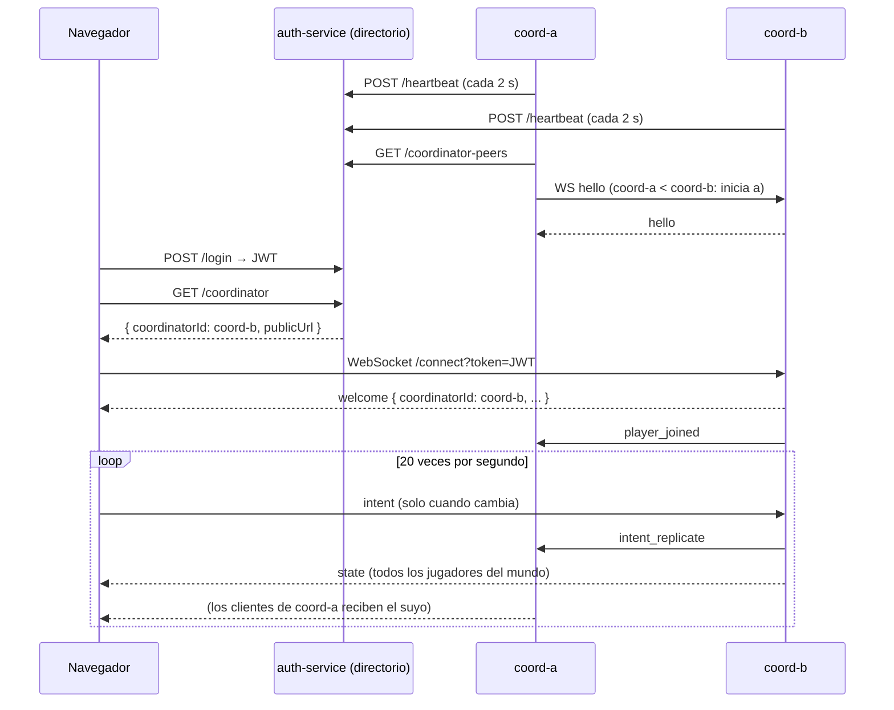

# Guaro Royal — Proyecto final y examen final

**Sistemas Distribuidos · Universidad de Boyacá** · Integrantes: Daniela Navarro, Camilo Tibocha, Jenifer Nossa, Francy Olmos

Videojuego web multijugador en tiempo real. En la Parte I (Taller 4) los jugadores se
identificaban y entraban a un lobby; en la Parte II (Taller 5) se agregó el juego en vivo con
servidor autoritativo y el login con Google. En esta **Parte III (Taller 6)** el coordinador
deja de ser un punto único de falla:

- **Varios coordinadores en paralelo**, intercambiables, con el mismo estado del juego.
- **El auth-service es también un directory service**: los coordinadores se registran con
  heartbeats (`POST /heartbeat`) y los clientes preguntan a cuál conectarse (`GET /coordinator`,
  el de menos jugadores). *Client-side load balancing*: el auth no proxea tráfico.
- **Mesh entre coordinadores** por WebSocket (`GET /coordinator-peers` + una conexión por par): lo que hace
  Alice en el coordinador A lo ve Bob en el coordinador B.
- **El cliente** hace login → `GET /coordinator` → WebSocket al coordinador asignado, **muestra
  cuál es**, y si se cae **vuelve a pedir** coordinador en vez de reintentar el mismo.

En la **Parte IV (Taller 7)** el auth-service también deja de ser un punto único de falla: hay
varios en computadores distintos, con **un líder** que acepta las escrituras y **réplicas** que
guardan su propia copia de la BD, y si el líder muere se **elige uno nuevo** solos. Los que ya
juegan no se enteran (el coordinador valida el JWT sin consultar al auth).

Sobre esa base corre **Guaro Royal**, un parqués multijugador para borrachos 🥃 (sección 31):
salas privadas con código y partidas públicas por nivel de shots, con un coordinador **dueño** por
sala que replica cada jugada a los demás y que otro coordinador **adopta** si se cae.

En el **examen final** (sección 32) se agregaron, sin cambiar la arquitectura ni el auth-service:

- **Chat distribuido** entre todos los coordinadores, ordenado con un reloj lógico híbrido (HLC), con
  rate limit, protección contra XSS e historial; además, un **chat independiente por partida**.
- **Modo espectador** sin login (`/spectate`): mira el mundo y las partidas en vivo, solo lectura.
- Recuadro desplegable **REGLAS DEL JUEGO**, nivel en partidas públicas y arreglos del tablero.

Todo lo de las Partes I y II (login local y Google, servidor autoritativo a 20 Hz, color e
insignia, duración de sesión en vivo) sigue igual. Las secciones 18 a 23 explican el Taller 6, las
**24 a 30 el Taller 7**, la **31 el parqués** y la **32 el examen final**.

---

## Contenido

1. [Arquitectura](#1-arquitectura)
2. [Estructura del repositorio](#2-estructura-del-repositorio)
3. [Tecnologías](#3-tecnologías)
4. [Modelo de datos](#4-modelo-de-datos)
5. [Endpoints HTTP](#5-endpoints-http)
6. [Protocolo WebSocket](#6-protocolo-websocket)
7. [Flujos de autenticación](#7-flujos-de-autenticación)
8. [Game loop y autoridad del servidor](#8-game-loop-y-autoridad-del-servidor)
9. [Característica extra: color e insignia](#9-característica-extra-color-e-insignia)
10. [Duración de sesión en vivo](#10-duración-de-sesión-en-vivo)
11. [Instalación y ejecución](#11-instalación-y-ejecución)
12. [Configuración de Google Cloud](#12-configuración-de-google-cloud)
13. [Despliegue con ngrok](#13-despliegue-con-ngrok)
14. [Pruebas](#14-pruebas)
15. [Decisiones de diseño](#15-decisiones-de-diseño)
16. [Limitaciones conocidas](#16-limitaciones-conocidas)
17. [Solución de problemas](#17-solución-de-problemas)
18. [Taller 6 — Directory service](#18-taller-6--directory-service-auth-service)
19. [Taller 6 — Mesh de coordinadores](#19-taller-6--mesh-de-coordinadores)
20. [Taller 6 — Cambios en el cliente](#20-taller-6--cambios-en-el-cliente)
21. [Taller 6 — Cómo ejecutar tres coordinadores](#21-taller-6--cómo-ejecutar-tres-coordinadores)
22. [Taller 6 — Guion de la sustentación](#22-taller-6--guion-de-la-sustentación)
23. [Taller 6 — Decisiones de diseño y limitaciones](#23-taller-6--decisiones-de-diseño-y-limitaciones)
24. [Taller 7 — Cluster de auth-services: roles y arquitectura](#24-taller-7--cluster-de-auth-services-roles-y-arquitectura)
25. [Taller 7 — Endpoints y protocolo del mesh de auth](#25-taller-7--endpoints-y-protocolo-del-mesh-de-auth)
26. [Taller 7 — Consistencia, réplicas atrasadas y elecciones](#26-taller-7--consistencia-réplicas-atrasadas-y-elecciones)
27. [Taller 7 — Cambios en el cliente y en los coordinadores](#27-taller-7--cambios-en-el-cliente-y-en-los-coordinadores)
28. [Taller 7 — Cómo ejecutar varios auth-services (varios computadores)](#28-taller-7--cómo-ejecutar-varios-auth-services-varios-computadores)
29. [Taller 7 — Guion de la sustentación](#29-taller-7--guion-de-la-sustentación)
30. [Taller 7 — Decisiones de diseño y limitaciones](#30-taller-7--decisiones-de-diseño-y-limitaciones)
31. [Guaro Royal — Parqués multijugador (salas y partidas)](#31-guaro-royal--parqués-multijugador-salas-y-partidas)
32. [Examen final — Chat distribuido y modo espectador](#32-examen-final--chat-distribuido-y-modo-espectador)
    - 32.1 Chat distribuido · 32.2 Modo espectador · 32.3 Reglas y nivel en públicas · 32.4 Archivos ·
      32.5 Pruebas · 32.6 Chat por partida y arreglos del tablero

---

## 1. Arquitectura

Procesos independientes, cada uno en su puerto y con su túnel de ngrok:

| Servicio | Puerto | Responsabilidad |
|---|---|---|
| **auth-service** | 4000 | Registro e inicio de sesión (local y Google), emisión del JWT. **Directory service**: registro de coordinadores por heartbeat y asignación (`/heartbeat`, `/coordinator`, `/coordinator-peers`). |
| **coordinator** × N | 5001 en cada PC (jugadores en `/connect`, espectadores en `/spectate`, mesh en `/peer`) | Recibe los WebSocket de jugadores, valida el JWT, mantiene el estado **de todo el mundo** (jugadores locales y remotos), ejecuta el game loop a 20 Hz y se replica con los demás coordinadores. También corre el **parqués** (salas, partidas, cola pública), el **chat distribuido** y el **modo espectador**. |
| **client** | 3000 | Login, pide coordinador al auth, canvas del juego, tablero de parqués, chat y página del espectador. Solo envía intenciones y acciones, y dibuja lo que manda su coordinador. |

```
                    ┌──────────────── auth-service :4000 ────────────────┐
                    │  /register /login /auth/google   (Partes I y II)   │
                    │  /heartbeat  /coordinator  /coordinator-peers      │
                    └───▲──────────────▲──────────────────▲──────────────┘
          POST /heartbeat (cada 2 s) │ GET /coordinator-peers │ GET /coordinator
         ┌───────────────┴──┐   ┌─────┴────────┐          │ (después del login)
         │                  │   │              │          │
   ┌─────┴──────┐  mesh WS ┌─┴──┴───────┐  mesh WS  ┌─────┴──────┐
   │  coord-a   │◄────────►│  coord-b   │◄─────────►│  coord-c   │
   │ :5001      │◄─────────┴────────────┴──────────►│ :5001      │
   └─────▲──────┘     (una conexión por par; el id menor la inicia)   └─────▲──────┘
         │ WS jugadores                  │ WS jugadores                    │
     Alice, ...                       Bob, ...                          Carol, ...
```



## 2. Estructura del repositorio

```
taller1-auth/
├── auth-service/                 Autenticación + directorio (HTTP :4000)
│   ├── index.js                  users, /register, /login, /auth/google, /session-policy,
│   │                             /heartbeat, /coordinator, /coordinator-peers, /coordinators,
│   │                             /status, /peers (cluster de auth, Taller 7)
│   ├── test.js                   Pruebas automáticas (npm test)
│   └── .env.example
├── coordinator/                  Juego + mesh (un puerto: /connect jugadores, /peer coordinadores)
│   ├── index.js                  verifyToken, game loop, mesh, heartbeat, descubrimiento
│   ├── parques/                  Parqués: GameRules, GameManager, RoomManager, Matchmaking, index, config
│   ├── chat.js                   Chat distribuido (HLC, canales general y por sala, rate limit, historial)
│   ├── espectadores.js           Modo espectador (/spectate, solo lectura, cupo)
│   ├── test.js                   Pruebas del juego, un coordinador (npm test)
│   ├── mesh-test.js              Pruebas del mesh, 3 coordinadores (npm run test:mesh)
│   ├── parques-test.js, salas-test.js                      Parqués y salas entre coordinadores
│   ├── chat-unit-test.js, chat-test.js, chat-sala-test.js  Chat sin red, entre 3 coordinadores y por partida
│   ├── espectador-test.js        Modo espectador
│   ├── .env.example              UN solo archivo para los 3 coordinadores (se copia como .env)
│   └── package.json              start:a · start:b · start:c
├── client/                       Cliente web (HTML + JS plano, :3000)
│   ├── login.html / js/login.js
│   ├── lobby.html / js/lobby.js  GET /coordinator, reconexión, "Coordinador: coord-x"
│   ├── js/auth-client.js         authFetch: varios auth, not_leader, elección (Taller 7)
│   ├── js/config.js              ÚNICO lugar con URLs: AUTH_URLS
│   ├── js/salas/                 Parqués en el navegador: online.js, partida.js, tablero.js, ui/ (Board, Reglas…)
│   ├── js/chat.js, js/chat-lobby.js   Panel del chat (pestañas Partida y General)
│   ├── espectador.html / js/espectador.js   Modo espectador sin login
│   └── css/styles.css, salas.css, chat.css, espectador.css
├── docs/taller1.postman_collection.json
├── .gitignore                    node_modules/, *.db, .env, .env.*
└── README.md
```

---

## 3. Tecnologías

| Pieza | Uso |
|---|---|
| Node.js 22.5+ | Los tres servicios. Incluye `node:sqlite` y `fetch` |
| Express 5 | HTTP del auth, del coordinador y del cliente |
| `node:sqlite` | Base de datos del auth (la misma API que usa el PDF) |
| `bcryptjs` | Hash de contraseñas (≥ 10 rounds) |
| `jsonwebtoken` | JWT propio (firmar en el auth, verificar en el coordinador) |
| `google-auth-library` | Verificación del ID Token de Google (`verifyIdToken`) |
| `ws` | WebSocket del coordinador |
| Google Identity Services | Botón oficial "Iniciar sesión con Google" en el cliente |
| HTML + JS plano + Canvas 2D | Cliente, sin frameworks |
| `dotenv` | Configuración por `.env` |

---

## 4. Modelo de datos

**Una sola tabla** `users` para los dos proveedores (`auth-service/index.js`, `USERS_SCHEMA`):

```sql
CREATE TABLE users (
  id            INTEGER PRIMARY KEY AUTOINCREMENT,
  username      TEXT UNIQUE NOT NULL COLLATE NOCASE,   -- 'Alice' y 'alice' son el mismo
  provider      TEXT NOT NULL CHECK (provider IN ('local','google')),
  password_hash TEXT,                                  -- NULL para usuarios de Google
  google_sub    TEXT UNIQUE,                           -- NULL para usuarios locales
  email         TEXT,                                  -- opcional para local
  created_at    TEXT DEFAULT CURRENT_TIMESTAMP,
  CHECK ((provider = 'local'  AND password_hash IS NOT NULL AND google_sub IS NULL) OR
         (provider = 'google' AND google_sub IS NOT NULL    AND password_hash IS NULL))
);
```

- `provider = 'local'` → tiene `password_hash`, no tiene `google_sub`.
- `provider = 'google'` → tiene `google_sub` y `email`, no tiene `password_hash`.
- El `CHECK` final hace que **la base misma** rechace un registro que rompa esas reglas.
- `UNIQUE ... COLLATE NOCASE`: un mismo username no puede repetirse **entre proveedores ni
  cambiando mayúsculas**.

**Migración automática.** Si el auth encuentra una `users.db` del Taller 4 (sin `provider`,
con `password_hash NOT NULL` o sin `NOCASE`), al arrancar:
1. Guarda una copia `users-backup-AAAAMMDDhhmmss.db`.
2. Crea la tabla nueva y copia los usuarios como `provider='local'`, del más antiguo al más nuevo.
3. Si dos usernames solo difieren en mayúsculas (`Alice` / `alice`), **conserva el más antiguo**
   y muestra en la consola cuál descartó.
4. Todo ocurre en una transacción: si algo falla, no se cambia nada.

---

## 5. Endpoints HTTP

Todos los errores tienen la misma forma: `{ "error": "codigo", "message": "qué pasó", "hint": "cómo solucionarlo" }`.

### auth-service (`:4000`)

| Método | Ruta | Body | Respuesta |
|---|---|---|---|
| POST | `/register` | `{ username, password }` | **201** `{ userId, username, message }` |
| POST | `/login` | `{ username, password }` | **200** `{ token, username, provider, expiresIn, message }` |
| POST | `/auth/google` | `{ idToken, username? }` | ver tabla siguiente |
| GET | `/auth/google/config` | — | `{ clientId }` (público; lo usa el botón de Google) |
| GET | `/session-policy` | — | `{ expiresIn, seconds, updatedAt }` |
| GET | `/health` · `/` | — | estado / información |

| Caso | HTTP | `error` |
|---|---|---|
| Registro: username ya existe (cualquier proveedor, sin importar mayúsculas) | 409 | `username_taken` |
| Registro: username fuera de 3–32 o con símbolos | 400 | `invalid_username` |
| Registro: contraseña < 6 caracteres (o > 72 bytes) | 400 | `invalid_password` |
| Falta username o password | 400 | `missing_fields` |
| Sin body JSON / JSON mal escrito | 400 | `missing_body` / `invalid_json` |
| Login: usuario inexistente **o** contraseña incorrecta | 401 | `invalid_credentials` |
| Login con contraseña de una cuenta de Google | 401 | `use_google_login` |
| **Google: ya existía o se creó** | **200** | `{ token, username }` |
| **Google: primer acceso sin username** | **409** | `username_required` |
| **Google: el username elegido ya existe** | **409** | `username_taken` |
| **Google: ID Token inválido** (firma, audience o vencido) | **401** | `invalid_id_token` |
| Google: correo no verificado | 401 | `email_not_verified` |
| Google: falta `idToken` | 400 | `missing_id_token` |
| Body > 4 KB | 413 | `body_too_large` |
| Ruta inexistente | 404 | `not_found` |
| Error interno | 500 | `internal` (sin detalles internos) |

**El JWT propio** (igual para los dos proveedores): `{ userId, username, provider, iat, exp }`,
firmado con `JWT_SECRET`.

### coordinator (`:5001`)

| Ruta | Respuesta |
|---|---|
| `GET /` | Información, mundo y mensajes que acepta |
| `GET /health` | `{ status, players, sessionPolicy }` |
| `GET /players` | Jugadores conectados |
| `WS /connect?token=` | Jugadores (sección 6) |
| `WS /spectate` | Espectadores, sin token (sección 32.2) |
| `WS /peer` | Mesh con otros coordinadores (sección 19) |

`GET /health` también reporta `spectators` y `spectatorsMax` (examen final).

---

## 6. Protocolo WebSocket

Conexión: `ws://HOST:5001/connect?token=JWT` (`wss://` por ngrok).

### Cliente → servidor

| Mensaje | Qué hace el servidor |
|---|---|
| `{"type":"intent","intent":{"dir":{"x":1,"y":0}}}` | Guarda la intención, con cada eje en -1, 0 o 1 (`Math.sign`). **No mueve ni responde**: la confirmación es el siguiente `state` |
| `{"type":"extras_update","extras":{"color":"#e53935"}}` | Valida (objeto, ≤ 1024 caracteres, color de la paleta), guarda en `player.extras` y responde `extras_ok` |
| `{"type":"ping"}` | `pong` |
| `{"type":"get_players"}` | `players_update` solo para quien pregunta |
| `{"type":"reauth","token":"..."}` | Vuelve a validar la sesión con otro token (lo envía el cliente si el token guardado cambia) |
| `{"type":"logout"}` | `logout_ok` y cierre 1000 |

### Servidor → cliente

| `type` | Cuándo | Contenido |
|---|---|---|
| `welcome` | al conectar | `you {userId, username, provider}`, `world {width, height, playerRadius, tickRate}`, `colors`, `tokenExpiresAt` |
| `state` | **20 veces por segundo** | `t`, `players: [{ userId, username, x, y, extras, badge }]` |
| `players_update` | alguien entra, sale o se reconecta | `players`, `event`, `message` |
| `extras_ok` | color aceptado | `extras`, `message` |
| `session_update` | cambió la duración de la sesión | `expiresAt`, `message` |
| `reauth_ok` · `pong` · `logout_ok` | respuestas | `message` |
| `error` | cualquier problema | `code`, `message`, `hint` |

### Errores y cierres

| `code` | Cierre | Cuándo |
|---|---|---|
| `missing_token`, `malformed_token`, `invalid_signature`, `invalid_token`, `token_expired` | `4001 invalid token` | token malo al conectar o en `reauth` |
| `token_expired` | `4001 token expired` | la sesión venció con la conexión abierta |
| `token_user_mismatch` | `4001 invalid token` | `reauth` con el token de otro usuario |
| `session_opened_elsewhere` | `4002 session opened elsewhere` | la misma cuenta se conectó en otro lugar |
| `bad_path` | `4004 bad path` | ruta distinta de `/connect` |
| `invalid_intent`, `invalid_extras`, `extras_too_large`, `invalid_color`, `invalid_json`, `missing_type`, `unknown_type` | — (no cierra) | mensaje inválido |

---

## 7. Flujos de autenticación

**Local.** `POST /register` → bcrypt → fila `provider='local'`. `POST /login` → busca el
usuario (sin importar mayúsculas) → si es de Google, lo rechaza → `bcrypt.compare` → JWT propio.

**Google (opción A del PDF: Google Identity Services).** Elegimos la opción A porque no necesita
`redirect_uri` ni Client Secret, el backend sigue siendo una API JSON igual a `/login`, y el
cliente usa el botón oficial de Google.

1. `login.html` carga `https://accounts.google.com/gsi/client` y pide el Client ID a
   `GET /auth/google/config`.
2. El usuario pulsa el botón y Google devuelve un **ID Token** (JWT firmado por Google).
3. El cliente envía `POST /auth/google { idToken }`.
4. El auth lo **verifica contra Google**: `googleClient.verifyIdToken({ idToken, audience: GOOGLE_CLIENT_ID })`
   revisa la firma con las claves públicas de Google, el vencimiento y que `aud` sea nuestro
   Client ID. Después exige `email_verified === true`.
5. Busca por **`sub`** (identificador estable de Google, no el email):
   - existe → **200** con el JWT propio;
   - no existe y no mandó username → **409 `username_required`**: el cliente muestra
     "Elige tu nombre de usuario" y reenvía `{ idToken, username }`;
   - el username está ocupado → **409 `username_taken`**;
   - si no → crea la fila `provider='google'` y responde **200**.

En los dos casos el cliente guarda el JWT en `sessionStorage` y entra al juego.

---

## 8. Game loop y autoridad del servidor

`coordinator/index.js`, sección 10:

```js
const PLAYER_SPEED = 200;  const TICK_RATE = 20;  const TICK_MS = 1000 / TICK_RATE;
function tick() {
  const now = Date.now();
  const dt  = (now - lastTick) / 1000;          // segundos desde el tick anterior
  lastTick  = now;
  for (const p of players.values()) {
    const mag = Math.hypot(p.intent.x, p.intent.y);
    if (mag > 0) { p.x += (p.intent.x / mag) * PLAYER_SPEED * dt;  p.y += (p.intent.y / mag) * PLAYER_SPEED * dt; }
    p.x = Math.max(PLAYER_RADIUS, Math.min(WORLD_WIDTH  - PLAYER_RADIUS, p.x));
    p.y = Math.max(PLAYER_RADIUS, Math.min(WORLD_HEIGHT - PLAYER_RADIUS, p.y));
  }
  broadcast({ type: 'state', t: now, players: snapshot() });
}
setInterval(tick, TICK_MS);
```

- **`dt`**: la velocidad no depende del `TICK_RATE`. Si un tick se atrasa, el siguiente
  compensa.
- **`Math.hypot`**: en diagonal la intención es (1, 1), de largo √2 ≈ 1,41. Al dividir por ese
  largo, la diagonal avanza igual que en línea recta (sin esto se iría ~41 % más rápido).
- **Límites**: `Math.max/Math.min` dejan el centro del círculo a un radio del borde.
- **Un solo `state` por tick**, para todos. El handler de `intent` **no** mueve ni hace
  broadcast.

**Autoridad.** El cliente nunca envía posiciones, solo `intent` con `Math.sign`, así que
`{x: 9999}` cuenta como 1. Lo que el cliente dibuja es `lastState`, el último `state` del
servidor. Si alguien modifica `lastState` desde DevTools, solo cambia **su propio dibujo**:
el servidor no se entera, la posición oficial no cambia y los demás siguen viendo la real.

**Mundo:** 960 × 600 px, radio 18 px. El cliente arma el canvas con el `world` del `welcome`.

---

## 9. Característica extra: color e insignia

**Color (replicado y persistente durante la sesión).**
1. El jugador elige un color en el panel **Tu color**.
2. El cliente envía `{"type":"extras_update","extras":{"color":"#8e24aa"}}`.
3. El servidor valida: debe ser un objeto (no un arreglo), de ≤ 1024 caracteres, y el color
   debe estar en la **paleta de 8 colores** (`ALLOWED_COLORS`). Así nadie puede inyectar texto
   arbitrario que luego se dibuje en otros navegadores.
4. Se guarda en `player.extras` y viaja en **cada** `state`: todos lo ven en el siguiente tick
   y se mantiene mientras el jugador esté conectado, aunque cambie de pestaña.

**Insignia del proveedor.** Cada jugador muestra `G` (Google) o `L` (local) dentro de su
círculo y en la lista. La decide **el servidor** a partir del `provider` del JWT (`badge`),
así que el cliente no puede falsificarla.

---

## 10. Duración de sesión en vivo

`JWT_EXPIRES_IN` se puede cambiar **con el sistema encendido**, sin reiniciar nada:

1. El auth vigila su `.env` cada segundo. Al guardar el archivo, los tokens nuevos salen con
   la duración nueva (`[config] Duración del token: 1h → 30s`). Un valor inválido se ignora.
2. El coordinador consulta `GET /session-policy` cada 3 segundos (`AUTH_URLS` en su `.env`). Si
   la duración cambió, recalcula para cada jugador conectado:
   **vence = mínimo(exp del token, iat + duración nueva)**. Envía `session_update` y saca con
   `4001 token expired` a quien ya superó la duración.
3. También el upgrade y `reauth` aplican la duración vigente.

Un token ya emitido no se puede **alargar**, porque su `exp` va firmado. Por eso, si se vuelve
de `30s` a `1h`, los tokens de 30 s siguen venciendo a los 30 s.

---

## 11. Instalación y ejecución

> Para levantar **tres coordinadores** y hacer la demo del Taller 6, ver la sección
> [21](#21-taller-6--cómo-ejecutar-tres-coordinadores). Esta sección es lo básico.

### Requisitos
- **Node.js 22.5 o superior** (recomendado 22 LTS): `node -v`.
- ngrok con cuenta (`ngrok config add-authtoken TU_TOKEN`).
- Para pruebas: `wscat` (`npm install -g wscat`), Thunder Client o curl.

### Dependencias (en cada carpeta)

```powershell
cd auth-service ; npm install ; cd ..
cd coordinator  ; npm install ; cd ..
cd client       ; npm install ; cd ..
```

Ninguna dependencia necesita compilarse, así que no hace falta Python ni Visual Studio Build Tools.

### Archivos `.env` (nunca se suben al repositorio)

| Archivo | Variables |
|---|---|
| `auth-service/.env` | `PORT=4000`, `JWT_SECRET` (≥ 32, igual en los coordinadores), `JWT_EXPIRES_IN=1h`, `GOOGLE_CLIENT_ID`, `BCRYPT_ROUNDS=10`, `DB_PATH=users.db`, y opcionales del directorio: `COORDINATOR_TTL_MS=6000`, `PENDING_TTL_MS=5000` |
| `coordinator/.env` (el mismo formato en cada PC) | `JWT_SECRET`, `AUTH_URLS` (las URLs de todos los auth, Taller 7), `HEARTBEAT_MS`, opcional `MESH_SECRET`, `COORD_PORT` (puerto local) y `COORD_PUBLIC_URL` (la URL de ngrok de **ese** PC; la usan jugadores **y** mesh). El ID sale del comando: `npm run start:a` / `:b` / `:c` |
| `client/.env` | `PORT=3000` |
| `client/js/config.js` | `AUTH_URLS` (las URLs de todos los auth-services; Taller 7) |

Generar una `JWT_SECRET`:
```powershell
node -e "console.log(require('crypto').randomBytes(32).toString('hex'))"
```

### Orden de arranque (una terminal por servicio)

```powershell
cd auth-service ; npm start        # 1. auth + directorio  → :4000
cd coordinator  ; npm run start:a  # 2. coord-a (PC 1)    → :5001 (jugadores /connect, mesh /peer)
cd coordinator  ; npm run start:b  #    coord-b (PC 2)    → :5001 en su equipo
cd coordinator  ; npm run start:c  #    coord-c (PC 3)    → :5001 en su equipo
cd client       ; npm start        # 3. cliente            → http://localhost:3000
```

Abrir **http://localhost:3000**. Para cerrar un servicio: `Ctrl+C`.

### Comprobar que cada servicio funciona
- Auth: `http://localhost:4000/health` y `http://localhost:4000/coordinators` (coordinadores vivos y su carga)
- Coordinador: `http://localhost:5001/health` → `{ coordinatorId, connectedPlayers, worldPlayers, peers: [...] }`; `http://localhost:5001/mesh`
- Cliente: `http://localhost:3000` → página de login

### Dos jugadores a la vez
- **Dos pestañas del mismo navegador, con usuarios distintos:** funciona, porque la sesión se
  guarda en `sessionStorage`, que es independiente por pestaña.
- **El mismo usuario en dos lugares** (aunque sea en dos coordinadores distintos): se cierra la
  conexión anterior (4002).

---

## 12. Configuración de Google Cloud

1. Entrar a https://console.cloud.google.com y crear un proyecto.
2. **Google Auth Platform** (antes: APIs y servicios → Pantalla de consentimiento de OAuth):
   público **Externo**, nombre de la app, correo de soporte y scopes `openid`, `email`, `profile`.
3. **Público → Usuarios de prueba:** agregar los correos que van a iniciar sesión (los
   integrantes y el profesor). Sin esto Google muestra "Acceso bloqueado".
4. **Clientes → Crear cliente → Aplicación web.** En **Orígenes de JavaScript autorizados**
   agregar `http://localhost:3000` y la URL https de ngrok **del cliente** (sin `/` final).
   Las URIs de redirección se dejan vacías (opción A).
5. Copiar el **Client ID** (`....apps.googleusercontent.com`) en `auth-service/.env` como
   `GOOGLE_CLIENT_ID`. El Client Secret no se usa.

El cliente obtiene el Client ID con `GET /auth/google/config`, así que no hay que repetirlo en
`config.js`.

---

## 13. Despliegue con ngrok

Cada servicio que el navegador necesita alcanzar tiene su propio túnel:

```powershell
ngrok http 4000   # auth         → https://AAAA.ngrok-free.dev
ngrok http 5001   # coord-a (PC 1) → https://BBBB.ngrok-free.dev
ngrok http 5001   # coord-b (PC 2) → https://CCCC.ngrok-free.dev
ngrok http 5001   # coord-c (PC 3) → https://DDDD.ngrok-free.dev
ngrok http 3000   # cliente      → https://EEEE.ngrok-free.dev
```

> El plan gratuito de ngrok limita el número de túneles/sesiones simultáneas. Si no alcanzan:
> `ngrok.yml` con varios túneles en una sola sesión (`ngrok start --all`), o un túnel menos
> sirviendo el cliente desde el mismo equipo (`http://localhost:3000`) y solo exponer auth y coordinadores.

Después:
1. `client/js/config.js`: `const AUTH_URLS = ['https://AAAA.ngrok-free.dev', …];` (ver sección 27)
2. En el `coordinator/.env` de **cada PC**: `COORD_PUBLIC_URL=wss://…` con la URL de **su** túnel
   (**`wss://`**: PC 1 `wss://BBBB…`, PC 2 `wss://CCCC…`, PC 3 `wss://DDDD…`) y
   `AUTH_URLS=https://AAAA.ngrok-free.dev,…` (todos los auth, sección 27). El mesh usa **esa misma URL** (`wss://BBBB…/peer`), así que
   **no hace falta un túnel extra** para los coordinadores.
3. Google Cloud: la URL del **cliente** en "Orígenes de JavaScript autorizados".
4. Reiniciar los coordinadores (leen el `.env` al arrancar).
5. En cada navegador, abrir una vez `https://BBBB.ngrok-free.dev/health` (y los de los otros
   coordinadores) y pulsar **Visit Site**: el aviso de ngrok del plan gratuito bloquea el
   WebSocket hasta hacerlo. Con varios coordinadores hay que hacerlo con **cada uno**.

URLs usadas en la entrega:
```
Cliente:  https://__________________.ngrok-free.dev   (ngrok http 3000)
Auth:     https://__________________.ngrok-free.dev   (ngrok http 4000)
coord-a:  wss://___________________.ngrok-free.dev    (ngrok http 5001)
coord-b:  wss://___________________.ngrok-free.dev    (ngrok http 5002)
coord-c:  wss://___________________.ngrok-free.dev    (ngrok http 5003)
```

---

## 14. Pruebas

### Pruebas automáticas

```powershell
# Con el auth encendido
cd auth-service ; npm test
# Con el auth y el coordinador encendidos
cd coordinator  ; npm test
# Por ngrok
node test.js https://AAAA.ngrok-free.dev                                    # auth
node test.js https://AAAA.ngrok-free.dev wss://BBBB.ngrok-free.dev          # coordinador
```

**`auth-service/test.js` (19 pruebas):** health, `session-policy`, registro 201, repetido 409,
mismo nombre en minúsculas y en MAYÚSCULAS 409, username inválido, contraseña corta, campos
faltantes, JSON roto, login 200, JWT con `userId/username/provider/iat/exp`, login sin importar
mayúsculas, contraseña incorrecta 401, usuario inexistente 401, Client ID, Google sin idToken
400, Google con token falso 401, ruta inexistente 404.

**`coordinator/test.js` (22 pruebas, dos jugadores reales):**

| Prueba | Resultado medido |
|---|---|
| `welcome` con `world` y `you` | ✔ |
| Mensajes `state` por segundo | 20 |
| Horizontal / vertical en 1 s | 201 px / 201 px |
| Diagonal en 1 s | **201 px** (sin normalizar serían 283) |
| `intent {x: 9999}` en 0,5 s | 100 px (no hay teletransporte) |
| Límites del mundo | se queda en (18, 18) |
| Mensajes inválidos | `invalid_intent`, `invalid_json`, `unknown_type`, `invalid_extras`, `extras_too_large`, `invalid_color` |
| Color replicado y persistente | el otro jugador lo ve y se mantiene |
| Desconexión | desaparece del `state` de los demás |
| Token alterado | cierre 4001 |

Resultados reales: **_(pegar aquí la salida de `npm test` de cada servicio)_**.

**`coordinator/mesh-test.js` (19 pruebas, Taller 6)** — con el auth y tres coordinadores
encendidos (`npm run test:mesh`): `/coordinator-peers` lista los tres, `POST /heartbeat` inválido → 400, 4
clientes pedidos a `GET /coordinator` se reparten entre los tres, Alice en un coordinador y Bob en
otro se ven y se mueven en vivo en ambos sentidos (posición coincide ±15 px), el color se replica,
la misma cuenta en dos coordinadores cierra la vieja con 4002 y no queda duplicada, y al
desconectarse desaparece en el otro coordinador.

**`auth-service/cluster-test.js` (37 pruebas, Taller 7)** — `npm run test:cluster`. No necesita
nada encendido: levanta **3 auth-services reales** (puertos 4101-4103, BD temporales) y repite la
sustentación: un líder y dos réplicas con el mismo `users`; una BD con un usuario "fantasma" que se
descarta (con copia de seguridad); `not_leader` al registrar en una réplica; el alta se propaga
con el **mismo `userId`** en los tres; `login` en cualquier nodo; heartbeat solo en el líder y
directorio copiado a las réplicas; **Ctrl+C al líder** → elección (~7 s) y término más alto; registro de
bob con el líder nuevo; el nodo caído vuelve, se sincroniza y entra como **réplica**. Tarda ~1 minuto.

### Pruebas manuales en el navegador
1. **Juego:** dos pestañas (`alice` y `bob_google`); mover con flechas/WASD en una y ver el
   movimiento en la otra; cambiar el color y verlo en la otra.
2. **Autoridad:** en la pestaña de `alice`, consola (F12):
   ```js
   setInterval(() => { const yo = lastState.players.find(p => p.username === miUsuario); yo.x = 60; yo.y = 60; }, 5);
   ```
   `alice` se ve en la esquina **solo en su pestaña**; en la otra sigue en su posición real.
   Al recargar se quita la trampa. También se puede probar
   `ws.send(JSON.stringify({type:'intent', intent:{dir:{x:9999, y:0}}}))`: se mueve a
   velocidad normal.
3. **Token propio inválido:** F12 → Application → Session Storage → `token`, cambiar unas
   letras → el jugador sale solo, sin recargar.
4. **Token vencido:** `JWT_EXPIRES_IN=30s` en `auth-service/.env` (sin reiniciar) → cerrar
   sesión, entrar de nuevo, esperar 30 s.

### Pruebas de Google
| Sin credenciales (cualquiera puede correrlas) | Con Client ID real y cuenta de prueba |
|---|---|
| `GET /auth/google/config` · sin idToken → 400 · token falso → 401 `invalid_id_token` | primer acceso → 409 `username_required` · elegir `alice` → 409 `username_taken` · elegir `bob_google` → 200 · segundo acceso → 200 directo · `bob_google` en `/login` → 401 `use_google_login` |

Para probar `/auth/google` en Thunder Client con un token real: en la consola de la página de
login escribir `MOSTRAR_ID_TOKEN = true`, pulsar el botón de Google y copiar el ID Token que
aparece en la consola (dura ~1 hora). La colección `docs/taller1.postman_collection.json` ya
trae todos estos casos.

---

## 15. Decisiones de diseño

1. **Una sola tabla `users` con `provider`.** Un username es único en todo el sistema y el
   coordinador no necesita saber cómo se autenticó cada uno: recibe el mismo JWT. El `CHECK`
   hace que la base garantice las reglas de cada proveedor.
2. **Google opción A** (sección 7). Verificación **en el backend** con `verifyIdToken` y
   `audience`: decodificar no alcanza, porque cualquiera puede fabricar un JSON con esa forma.
   Se usa `sub` (no el email) porque el email puede cambiar.
3. **Usernames sin distinguir mayúsculas** (`COLLATE NOCASE`), para que `Alice` y `alice` no
   sean dos cuentas. La migración conserva al usuario más antiguo.
4. **El JWT se verifica en el `upgrade`** (del Taller 4). Un token malo nunca llega al Map;
   antes de cerrar con 4001 se envía un `error` con el motivo exacto.
5. **Servidor autoritativo.** El cliente envía intenciones saneadas con `Math.sign`; el
   game loop mueve con `dt` y `Math.hypot` y envía un `state` por tick. Así la velocidad no
   depende de cuántos mensajes mande el cliente ni de su `TICK_RATE`.
6. **`intent` sin respuesta propia.** Un `intent` válido no se contesta (la confirmación es el
   `state` siguiente, 50 ms después); uno inválido sí recibe `error`. Responder cada tecla
   duplicaría el tráfico.
7. **Color con paleta cerrada.** Además del límite de 1024 caracteres, solo se aceptan 8
   colores: evita texto arbitrario o enorme replicado a todos.
8. **Insignia derivada del JWT**, no de `extras`, para que no se pueda falsificar.
9. **`sessionStorage` en vez de `localStorage`.** Con `localStorage` las pestañas comparten el
   token, y la demo de dos pestañas con usuarios distintos se rompía. La regla "una cuenta,
   una conexión" la sigue aplicando el coordinador (4002).
10. **Dos pestañas con la misma cuenta: gana la más nueva** (del Taller 4), conservando
    posición y color.
11. **Duración en vivo (sección 10).** El auth relee su `.env`; el coordinador consulta
    `/session-policy`, una ruta pública que solo informa la duración.
12. **Mensajes amigables para el jugador.** El servidor responde códigos y detalles técnicos
    (útiles en Thunder Client y wscat); el cliente los traduce a un texto sencillo y deja el
    detalle en la consola.
13. **El Client ID vive solo en el `.env` del auth** y el cliente lo pide a
    `/auth/google/config`. No es secreto, pero así se configura en un solo lugar.
14. **`node:sqlite` y `bcryptjs`** (los mismos del PDF): no necesitan compilarse en Windows.

---

## 16. Limitaciones conocidas

- El estado del juego vive **en memoria**. Con el mesh, si un coordinador muere sus jugadores
  se reconectan a otro y **reaparecen en una posición nueva** (ver sección 23).
- El cliente dibuja exactamente el último `state` (20 por segundo) sin interpolar; con mucha
  latencia el movimiento puede verse a saltos.
- Un token ya emitido no se puede alargar; los cambios de duración en vivo solo pueden acortarlo.
- Mientras la app de Google Cloud esté en modo de prueba, solo pueden entrar los correos
  agregados como usuarios de prueba.
- Si cambia la URL de ngrok del cliente, hay que agregarla en Google Cloud y esperar unos minutos.

---

## 17. Solución de problemas

| Síntoma | Causa | Solución |
|---|---|---|
| `JWT_SECRET falta o tiene menos de 32 caracteres` | Clave corta o sin `.env` | Generar una y ponerla **igual** en auth y coordinador |
| `GOOGLE_CLIENT_ID falta o no es válido` | Falta la línea en `auth-service/.env` | Agregarla (sección 12) |
| El botón de Google no aparece; consola: *origin is not allowed* | La URL del cliente no está en Google Cloud | Agregarla exacta en "Orígenes de JavaScript autorizados" |
| Google: *Acceso bloqueado* | El correo no es usuario de prueba | Agregarlo en Google Cloud |
| "No pudimos verificar tu cuenta de Google" | Client ID distinto entre Google Cloud y el `.env` | Revisar `GOOGLE_CLIENT_ID` |
| "Tu sesión no es válida" al entrar al juego | `JWT_SECRET` distinta entre auth y coordinador | Igualarlas y reiniciar ambos |
| "Se perdió la conexión con el servidor del juego" | `COORDINATOR_WS` mal escrita, `ws://` en vez de `wss://`, coordinador apagado o aviso de ngrok pendiente | Revisar `config.js`; abrir `https://URL-COORDINADOR/health` y pulsar "Visit Site" |
| `[sesión] No se pudo consultar …/session-policy` | `AUTH_URL` del coordinador incorrecta o auth apagado | Corregir `AUTH_URLS`; el juego funciona igual |
| `Cannot find module` | Faltan dependencias | `npm install` en esa carpeta |
| `EADDRINUSE` | El puerto ya está en uso | Cerrar la otra terminal con `Ctrl+C` |

---

## 18. Taller 6 — Directory service (auth-service)

El auth-service guarda **en memoria** un `Map<coordinatorId, { ...info, lastSeen }>`. Un
coordinador sin heartbeat en los últimos **6 s** (3 ciclos de 2 s, `COORDINATOR_TTL_MS`) se
considera muerto y se descarta (un barrido cada 1 s lo muestra en la consola:
`[directory] coord-c sin heartbeat hace 6.1 s: se descarta`).

| Método | Ruta | Quién la llama | Respuesta |
|---|---|---|---|
| POST | `/heartbeat` | cada coordinador, cada 2 s | **200** `{ ok: true }` · **400** `invalid_heartbeat` si faltan o son inválidos `coordinatorId`, `publicUrl`, `peerUrl` (ws:// o wss://), `connectedPlayers` (entero ≥ 0) o `uptime` |
| GET | `/coordinator` | el cliente, después del login | **200** `{ coordinatorId, publicUrl }` del vivo con menos carga · **503** `{ error: "no_coordinators_available" }` si no hay ninguno |
| GET | `/coordinator-peers` | los coordinadores, al arrancar y cada 2 s (antes del Taller 7 se llamaba `/peers`) | `{ peers: [{ coordinatorId, peerUrl }] }` (los vivos; cada coordinador se filtra a sí mismo) |
| GET | `/coordinators` | depuración | todos los registrados con carga, `alive` y `lastSeenMsAgo` |

**Estrategia de selección.** Menor `connectedPlayers` entre los vivos; en empate, el primero.
Hay un detalle práctico: `connectedPlayers` solo se actualiza cada 2 s, así que 4 clientes que
piden coordinador en el mismo segundo verían la misma carga y los 4 irían al mismo. Por eso el
auth suma a cada coordinador las **asignaciones recientes** que todavía no aparecen en su
heartbeat. Cuando el coordinador reporta más jugadores, esas asignaciones se descuentan (ya están
en `connectedPlayers`, así no se cuentan dos veces); si el cliente nunca llega, la asignación
vence a los `PENDING_TTL_MS` (5 s). Además, el coordinador envía un heartbeat **en cuanto** entra o
sale un jugador, sin esperar los 2 s. La métrica sigue siendo `connectedPlayers`.

**Rebalanceo automático (sin recargar).** Si un coordinador le lleva **2 o más** jugadores al menos
cargado (por ejemplo, porque se encendió uno nuevo), la respuesta de su `POST /heartbeat` trae
`{ "ok": true, "rebalance": N }` con N = la mitad de la diferencia. El coordinador elige a sus N
jugadores más recientes y les envía `{"type":"rebalance"}`. Cada cliente pide `GET /coordinator`, abre
el WebSocket nuevo **sin recargar la página**, y al entrar allá el `player_joined` del mesh hace que
el coordinador viejo cierre la conexión anterior (4002), conservando posición y color. Solo se le
ordena mover al más cargado, y con una pausa de 4 s, para que no se muevan todos a la vez.
Ejemplo medido: 6 jugadores en un coordinador, se encienden 2 más → **2 / 2 / 2** en unos segundos.
Se desactiva con `AUTO_REBALANCE=false` en `auth-service/.env`.

**Cambio de coordinador sin saltos ni cambio de color.** Antes de avisar `rebalance`, el coordinador
viejo detiene al jugador y envía por el mesh (`positions_sync`) su posición, dirección y **color**
exactos; el nuevo ya lo tiene en el mismo punto cuando el cliente llega. El `positions_sync`
periódico (cada 1 s) también lleva el color, y si a un coordinador le falta la copia de un jugador,
la crea con esos datos. Solo se mueve a clientes que saben cambiarse (el navegador manda `seq`;
`wscat` no, y nunca se le mueve).

**Si se cae un coordinador, sus jugadores vuelven casi al instante** (medido: 120–180 ms):
- El cliente reconecta **de inmediato** (sin esperar 1 s) y pide `GET /coordinator?exclude=caido`:
  el auth no le devuelve el que se acaba de caer aunque aún no hayan pasado los 6 s. Además, entre
  los vivos prefiere los que mandaron heartbeat hace ≤ 3 s.
- Los demás coordinadores **no borran** a esos jugadores: los dejan quietos en su sitio, con su
  color ("fantasmas"), hasta 8 s (`GHOST_MS`). Si vuelven en otro coordinador, siguen ahí mismo; si
  no, se quitan. Así nadie los ve desaparecer y reaparecer.
- Cada conexión lleva `seq` (la hora en que el navegador la abrió). Si por una carrera la misma
  cuenta queda en dos coordinadores, todos se quedan con la **más nueva** (la otra recibe 4002). En la consola del auth se ve la cuenta
(`coord-a=0+1 coord-b=0+0` = jugadores + pendientes).

Esto es **client-side load balancing**: el auth no proxea tráfico, solo le dice al cliente a
dónde conectarse.

Probar con curl:
```powershell
curl http://localhost:4000/coordinator-peers
curl http://localhost:4000/coordinator
curl http://localhost:4000/coordinators
curl -X POST http://localhost:4000/heartbeat -H "Content-Type: application/json" -d "{\"coordinatorId\":\"coord-z\"}"   # → 400
```

---

## 19. Taller 6 — Mesh de coordinadores

Cada coordinador abre **un** servidor y una sola URL pública (`COORD_PUBLIC_URL`): los jugadores entran
por `/connect?token=` y los otros coordinadores por `/peer` (el `peerUrl` que se publica en el heartbeat
es `COORD_PUBLIC_URL + /peer`). El PDF permite "el mismo puerto u otro"; usamos el mismo para que cada
PC necesite **un solo túnel de ngrok**. Cada `PEER_POLL_MS` (2 s) llama `GET /coordinator-peers`.

### Una sola conexión por par
- El coordinador con el `coordinatorId` **menor** (orden lexicográfico) inicia; el mayor espera.
  Con `coord-a < coord-b < coord-c`: a→b, a→c, b→c.
- Si llega una conexión que viola la regla y ya hay una, se cierra la **nueva** (código 4010).
  Si el menor se reinicia y llega su conexión nueva mientras la vieja sigue "viva" en el otro
  lado, la nueva **reemplaza** a la vieja.
- Si un peer desaparece de `/coordinator-peers` durante dos consultas seguidas, se cierra su conexión.
  Además hay ping/pong cada 5 s para detectar peers congelados sin `close`.

### Mensajes
Todos llevan `origin` (el coordinador que los originó). **Nunca se retransmiten**: cada
coordinador manda directo a todos los demás, así que no hay bucles. Si llega un mensaje cuyo
`origin` es el propio coordinador se descarta, y si el `origin` no coincide con el dueño de la
conexión también (nadie puede hablar en nombre de otro).

| Mensaje | Cuándo | Qué hace el que lo recibe |
|---|---|---|
| `hello { coordinatorId }` | primer mensaje en ambos sentidos | registra al peer y le manda la foto de sus jugadores locales |
| `intent_replicate { origin, userId, intent }` | un cliente local cambió de dirección | aplica el intent a **su copia** del jugador |
| `extras_replicate { origin, userId, extras }` | un cliente local cambió su color | valida (paleta) y guarda |
| `player_joined { origin, userId, username, x, y, … }` | un cliente se conecta | crea el jugador remoto; si el mismo usuario estaba conectado **aquí**, cierra esa conexión (4002) |
| `player_left { origin, userId }` | un cliente se desconecta | lo elimina (solo si sigue siendo de ese `origin`) |
| `positions_sync { origin, players:[{userId,x,y,intent}] }` | cada 1 s (**extra**, ver 23) | corrige la deriva de los jugadores de ese origen |

Un `player_joined` extra lleva `provider`, `extras`, `intent` y, en la foto inicial, `sync: true`
(no se anuncia "entró al juego" otra vez).

### Game loop
Cada coordinador, a 20 Hz: (1) aplica los intents de **todos** los jugadores del mundo, locales
y remotos; (2) hace broadcast del `state` **solo a sus clientes locales** (nunca a peers). Cada
cliente recibe únicamente el `state` de su coordinador, pero ese `state` incluye a todo el mundo
(y `coordinator` por jugador, que la UI muestra en la lista).

### Coordinadores que entran, salen o mueren
- **Entra uno nuevo:** se registra por heartbeat → los demás lo ven en `/coordinator-peers` (≤ 2 s) → el
  menor abre la conexión → ambos se mandan `hello` y la foto de sus jugadores locales. El nuevo
  queda con el mismo mundo.
- **Muere uno (Ctrl+C o caída):** sus conexiones de mesh se cierran → cada peer borra a sus
  jugadores remotos y lo avisa a sus clientes. Sus clientes, desconectados, piden `/coordinator`
  de nuevo. Pasados 6 s sin heartbeat el auth lo descarta.
- **Se pierde solo el mesh (no el coordinador):** al reconectar, el `hello` + la foto reemplazan
  cualquier estado viejo; los fantasmas de esa conexión se borran antes.

---

## 20. Taller 6 — Cambios en el cliente

`client/js/lobby.js`, sección 6:

1. Tras el login, `GET /coordinator` (a cualquier auth, con `authFetch`; sección 27) → `{ coordinatorId, publicUrl }`.
2. Abre `WebSocket(publicUrl + '/connect?token=…')`.
3. **Muestra el coordinador:** en la cabecera (`Coordinador: coord-b`), en el panel
   "Tu sesión" (`Coordinador:` y `Tick: 20 Hz`) y una etiqueta con el coordinador de cada
   jugador en la lista.
4. **Si el WebSocket se cae no reconecta al mismo:** vuelve al paso 1. Cada intento espera 1 s;
   si el socket no abre en 4 s se descarta y se pregunta otra vez (un coordinador recién
   muerto puede seguir unos segundos en el directorio). Con `503` reintenta cada segundo.
   Mientras tanto la UI dice "Se perdió coord-a. Buscando otro coordinador…".
5. Los errores de **sesión** (token vencido o inválido `4001`, cuenta abierta en otro lado
   `4002`) siguen llevando al login, como antes. Solo las caídas del coordinador reconectan.
6. Al reconectar se reenvía la tecla que siga apretada.

---

## 21. Taller 6 — Cómo ejecutar tres coordinadores

Tres coordinadores, **un solo código**, normalmente **uno por computador**. Cada PC tiene un
`coordinator/.env` con la misma forma; solo cambia `COORD_PUBLIC_URL` (la URL de ngrok de ese PC).
El ID sale del comando: `npm run start:a` ejecuta `node index.js coord-a`. Si no existe:
`copy .env.example .env`.

**Nombres.** Además de `start:a` / `:b` / `:c` se puede usar cualquier nombre:
`npm start -- pc-danna` (letras, números, `.` `_` `-`; máx. 64). El directorio **no deja dos
coordinadores vivos con el mismo nombre, sin importar mayúsculas** (`Coord-A` = `coord-a`): el
segundo recibe `409 coordinator_id_taken` en su heartbeat y se apaga con un mensaje claro. El mismo
coordinador sí puede reiniciarse enseguida (misma URL).

**Si el mesh se conecta y se pierde una y otra vez**, el log dice el motivo del cierre:
`1006` = se cayó la red o el túnel; `4010 duplicate connection` / `replaced` = hay otro proceso con
ese nombre o un coordinador viejo; `1000 left directory` = el otro no lo ve en el directorio (revisar que
los dos usen los **mismos** `AUTH_URLS`). La consola del otro coordinador muestra su versión del motivo.

```env
JWT_SECRET=...                                   # igual en todos y en el auth
AUTH_URLS=https://AAAA.ngrok-free.dev
COORD_PORT=5001
COORD_PUBLIC_URL=wss://BBBB.ngrok-free.dev       # la de ESTE computador
```

**Los tres en un solo PC (para probar):** el `.env` da el puerto 5001, así que los otros dos se
arrancan cambiando las variables en la terminal (tienen prioridad sobre el `.env`):

```powershell
cd coordinator ; npm run start:a
cd coordinator ; $env:COORD_PORT=5002; $env:COORD_PUBLIC_URL="ws://localhost:5002"; npm run start:b
cd coordinator ; $env:COORD_PORT=5003; $env:COORD_PUBLIC_URL="ws://localhost:5003"; npm run start:c
```

```powershell
# Terminal 1
cd auth-service ; npm start
# Terminales 2, 3 y 4
cd coordinator ; npm run start:a
cd coordinator ; npm run start:b
cd coordinator ; npm run start:c
# Terminal 5
cd client ; npm start
```

Qué se debe ver:
```
[a] [directorio] … / [mesh] ✔ conectado con coord-b (yo inicié). Peers: coord-b
[a] [mesh] ✔ conectado con coord-c (yo inicié). Peers: coord-b, coord-c
[b] [mesh] ✔ conectado con coord-a (él inició). Peers: coord-a  → luego coord-c (yo inicié)
auth: [directory] coord-a registrado … Coordinadores vivos: coord-a, coord-b, coord-c
```

Pruebas automáticas del mesh: `cd coordinator ; npm run test:mesh`.

---

## 22. Taller 6 — Guion de la sustentación

| # | Qué mostrar | Cómo |
|---|---|---|
| 1 | **Tres coordinadores en `/coordinator-peers`** (3 min) | Levantar los tres y abrir `…/coordinator-peers` del auth. En la consola de cada uno: `[mesh] ✔ conectado con …`. Extra: `…/coordinators` y `http://localhost:5001/mesh`. |
| 2 | **4 clientes repartidos** (3 min) | Cuatro pestañas (usuarios distintos). Cada una muestra su `Coordinador: …`; en la consola del auth se ve la carga (`coord-a=0+1 …`). Quedan 2-1-1. |
| 3 | **Alice en coord-A, Bob en coord-B** (2 min) | Dos pestañas: la cabecera dice a qué coordinador está cada una. Mover a Alice → Bob la ve; mover a Bob → Alice lo ve. La lista de jugadores muestra el coordinador de cada uno. |
| 4 | **Matar un coordinador** (4 min) | `Ctrl+C` en uno. (a) sus clientes dicen "Buscando otro coordinador…"; (b) tras 6 s, `…/coordinator-peers` ya no lo lista y el auth imprime `[directory] coord-x … se descarta`; (c) los clientes quedan conectados a los vivos y siguen viéndose. Los otros coordinadores imprimen `[mesh] ✘ se perdió coord-x`. |
| 5 | **Preguntas** (3 min) | Ver sección 23: bucles, conexión duplicada, consistencia, `positions_sync`. |

Antes de empezar con ngrok: abrir una vez cada URL de coordinador (`…/health`) → **Visit Site**.

---

## 23. Taller 6 — Decisiones de diseño y limitaciones

**Los problemas que el PDF anuncia, y cómo se resolvieron**

| Problema | Solución |
|---|---|
| **Descubrimiento de pares** | `GET /coordinator-peers` al arrancar y cada 2 s; cualquier coordinador que aparezca se conecta solo. |
| **Bucles infinitos** | `origin` en todos los mensajes, **sin retransmisión** (cada uno manda directo a todos) y se descarta lo que traiga mi propio `origin` o un `origin` ajeno a la conexión. |
| **Conexión duplicada** | Solo inicia el `coordinatorId` menor; la que llega a contramano se cierra (4010). |
| **Consistencia** | Ver abajo. |
| **Coordinadores que entran y salen** | Foto de jugadores locales en el `hello`; borrado de jugadores remotos al perder la conexión; el auth descarta al muerto a los 6 s. |

**Consistencia.** Cada coordinador aplica los mismos intents con su propio reloj, así que las
copias de un jugador remoto se pueden separar unos píxeles (latencia de red × 200 px/s). Para
que no se acumule, el coordinador **dueño** de cada jugador manda `positions_sync` una vez por
segundo y los demás adoptan esa posición. Esto **no está en el PDF**: es un mensaje extra que
se puede quitar (`SYNC_MS`) para ver la deriva. Solo el dueño puede modificar a un jugador:
un `intent_replicate` de otro `origin` se ignora.

**Otras decisiones**
- **Mismo usuario en dos coordinadores:** gana la conexión **nueva**, igual que en el Taller 5. El
  `player_joined` hace que el coordinador viejo cierre su socket con 4002 y deje al jugador como
  remoto, conservando posición y color.
- **Carga pendiente** en `/coordinator` (sección 18): evita que 4 clientes simultáneos vean la
  misma carga vieja.
- **Mesh por la misma URL que los jugadores** (ruta `/peer`; el PDF permite "el mismo puerto u
  otro"). Así cada computador expone un solo túnel de ngrok y el `.env` solo necesita
  `COORD_PUBLIC_URL`. El upgrade separa el tráfico: `/connect` = jugadores, `/peer` = coordinadores.
- **`MESH_SECRET` (opcional):** si se define, el `hello` debe traerlo; evita que un tercero que
  conozca el `peerUrl` se meta al mesh. Ponerlo igual en todos los coordinadores.
- **Un mensaje del mesh nunca se confía:** se valida (`Math.sign`, paleta de colores, límites del
  mundo) igual que lo que manda un cliente.

**Limitaciones**
- Estado **en memoria**: si muere un coordinador, sus jugadores reaparecen en una posición nueva
  al reconectarse a otro; si mueren todos, se pierde el mundo.
- El auth-service es el **único directorio**: si cae, los coordinadores ya conectados siguen
  jugando entre sí y sus clientes también, pero no se pueden asignar clientes nuevos ni
  descubrir coordinadores nuevos hasta que vuelva (los heartbeats lo repueblan en ≤ 2 s).
- `POST /heartbeat` y `GET /coordinator-peers` son públicos (como pide el PDF). Quien alcance el auth podría
  registrar un coordinador falso; el `MESH_SECRET` protege el mesh, no el directorio.
- Si el mismo usuario se conecta en el mismo instante a dos coordinadores, ambos se pueden
  cerrar mutuamente (hay que volver a entrar).
- Si el reloj de un coordinador se desincroniza mucho no afecta al juego (usa `dt` local), pero sí
  la caducidad del token, que ya se compensa con el reloj del auth.

---

## 24. Taller 7 — Cluster de auth-services: roles y arquitectura

Antes, si moría el auth nadie nuevo entraba y nadie podía reconectarse. Ahora hay **varios
auth-services** (uno por computador) con **single-writer replication**:

| Rol | Qué hace |
|---|---|
| **leader** | Único que acepta escrituras (`/register`, primera vez de Google) y el **directorio de coordinadores** (`/heartbeat`). Cada escritura se aplica a su BD y se propaga a las réplicas. Emite heartbeat de cluster cada 2 s. |
| **replica** | Solo lecturas (`/login`, Google de usuario existente, `/session-policy`...). Rechaza escrituras con `503 not_leader` + `leaderUrl`. Aplica lo que el líder propaga a **su propia copia** de la BD. Si pasan 6 s sin heartbeat del líder, inicia una elección. |

```
        navegador / coordinadores  (authFetch: prueban en orden; not_leader → leaderUrl)
              │            │             │
        ┌─────▼────┐  ┌────▼─────┐  ┌────▼─────┐
        │  auth-a  │  │  auth-b  │  │  auth-c  │      cada uno: su BD SQLite + su ngrok
        │ réplica  │◄─┤  LÍDER   ├─►│ réplica  │      mesh WS por la misma URL (/peer)
        └────▲─────┘  └────┬─────┘  └─────▲────┘      el id menor inicia: a→b, a→c, b→c
             └─────────────┴───────────────┘
        write_propagate · heartbeat (2 s) · election / vote / new_leader · request_sync
```

Cada nodo guarda, además de `users`, un **log de escrituras** (`oplog`: seq, term, op, data,
hash). El líder escribe el usuario y su entrada en la **misma transacción**; las réplicas aplican
las mismas entradas **en orden**. Por eso el `userId` que firma el JWT es **el mismo en todos los
nodos**: lo decide el líder una sola vez y las réplicas lo copian (no lo vuelven a generar).

**Cómo se descubren los nodos.** Cada `.env` trae `AUTH_URLS` (las URLs de todos). Cada
`DISCOVERY_MS` (3 s) un nodo pregunta `GET /peers` a esas URLs y a las que ya conoce, aprende
`authId`, `publicUrl` y `peerUrl`, y abre el WebSocket hacia los de `authId` **mayor** (el menor
inicia, igual que en el mesh de coordinadores). Para **añadir un cuarto nodo**, agrégalo a `AUTH_URLS`
de los demás (reiniciándolos de uno en uno): un nodo que nadie tiene en su lista solo se une si
su `authId` es menor que el de los otros (así él inicia la conexión y lo conocen por el `hello`).

**Un solo auth-service (como antes).** Si `AUTH_URLS` está vacío, el nodo arranca como `auth-1`,
es su propio líder desde el primer segundo y todo funciona igual que en el Taller 6.

---

## 25. Taller 7 — Endpoints y protocolo del mesh de auth

### HTTP

| Método | Ruta | Respuesta |
|---|---|---|
| GET | `/status` | `{ authId, role, publicUrl, peerUrl, leaderUrl, knownPeers, lastAppliedSeq, users }` + extras de depuración: `term`, `leaderId`, `electing`, `connectedPeers`, `clusterSize`, `quorum`, `lag`, `replicas` (solo líder), `sessionDuration` |
| GET | `/peers` | `{ peers: [{ authId, publicUrl, peerUrl, role }] }` (todos los conocidos, incluido el propio con `self: true`) |
| POST | `/register`, `/auth/google` (primera vez) | líder: normal · réplica: `503 { error: "not_leader", leaderUrl }` · sin líder: `503 { error: "no_leader" }` |
| POST | `/login`, `/auth/google` (existente), `/refresh` | líder: normal · réplica: responde si no está muy atrasada (ver sección 26) |
| POST | `/heartbeat` (coordinadores) | solo el líder; una réplica responde `not_leader` |

Todas las respuestas llevan los headers `X-Auth-Id` y `X-Auth-Role`: así el cliente muestra qué
nodo le contestó. **Cambio de nombre:** el `GET /peers` de los coordinadores (Taller 6) pasó a
`GET /coordinator-peers`, porque el PDF del Taller 7 usa `/peers` para los auth-services.

### Mesh (WebSocket en `/peer`, la misma URL pública)

| Mensaje | Quién lo manda | Para qué |
|---|---|---|
| `hello { authId, role, term, publicUrl, peerUrl, lastSeq }` | ambos, al abrir | handshake; si dice `leader` con término ≥ al mío, lo sigo |
| `heartbeat { authId, term, lastSeq, lastHash, session, directory }` | líder → réplicas, cada 2 s | "sigo vivo", punta del log, duración de la sesión, copia del directorio de coordinadores |
| `write_propagate { term, seq, op, data, hash }` | líder | una escritura (`op`: `register` o `register_google`) |
| `request_sync { fromSeq, lastHash }` | réplica → líder | "voy atrasada (o mi log es raro): mándame lo que falta" |
| `sync_response { entries, reset }` | líder | las entradas desde `fromSeq`; `reset: true` = "tu historia no coincide: reconstruye todo" |
| `election { candidate, term, lastSeq, lastTerm }` | candidato | pide votos |
| `vote { voter, term, voteGranted }` | votante | respuesta |
| `new_leader { leader, term }` | ganador | anuncio |

Mensajes extra que **no están en el PDF** (se explican abajo): `heartbeat_ack` y `write_ack`
(la réplica confirma hasta qué `seq` tiene), y los campos extra `lastHash`, `lastTerm`, `session`,
`directory`, `reset`.

---

## 26. Taller 7 — Consistencia, réplicas atrasadas y elecciones

### Opción elegida: **B** (propagar primero, responder después)
El líder aplica la escritura en su log, la propaga y **espera la confirmación de la mayoría**
(él cuenta como uno: con 3 nodos basta **1** réplica) antes de responder `201`. Si no llega
en `ACK_TIMEOUT_MS` (3 s) responde `503 replication_timeout`.

**Por qué B.** Lo que se escribe aquí es una cuenta de usuario: si el cliente recibe `201`,
tiene que existir mañana. Con la Opción A, un líder que muere justo después de responder pierde
a ese usuario para siempre y el jugador cree estar registrado. Con B, si el líder muere después
del `201`, la mayoría ya tiene la escritura y el líder nuevo (que se elige entre quienes tienen el
log más completo) la conserva. El costo es latencia (un viaje de ida y vuelta al más rápido de las
réplicas) y que **sin mayoría no hay escrituras**: con 3 nodos, si caen 2, `/register` responde
`503 no_quorum`. Registrar usuarios es poco frecuente, así que la seguridad pesa más que la
velocidad. Las **lecturas** (`/login`) siguen funcionando con un solo nodo vivo.

Si el líder aplicó la entrada pero no consiguió la mayoría, el usuario queda en el líder (el `503`
lo avisa: *"intenta iniciar sesión; si no existe, regístralo de nuevo"*).

### Réplicas atrasadas (lecturas)
El PDF pregunta si una réplica atrasada debe responder un `/login`. **Decisión:** depende de la
respuesta, no solo del atraso.

| Situación de la réplica | Login correcto | Usuario no encontrado |
|---|---|---|
| Al día (`lag = 0`) | responde | `401 invalid_credentials` |
| Atrasada `< MAX_REPLICA_LAG` (10) | responde | `503 not_leader` → líder (podría ser un usuario nuevo que aún no le llegó) |
| Atrasada `≥ 10` | `503 not_leader` | `503 not_leader` |
| Sin líder conocido | solo si ya sabía del líder y no está muy atrasada | `503 no_leader` |

Una respuesta **positiva** de una réplica no puede ser falsa (no existen cambios de contraseña,
solo altas); una **negativa** sí podría serlo si le falta una alta reciente. Por eso una réplica
con un poco de atraso sigue emitiendo tokens a quien sí conoce, pero nunca dice "credenciales
inválidas" si no está segura. Esto cumple "un replica NO emite tokens si su BD está desactualizada"
(el límite es `MAX_REPLICA_LAG`, configurable en el `.env`) sin rechazar sesiones válidas por un
atraso de una escritura.

### Elección de líder
Raft simplificado:
1. Una réplica que lleva **6 s** (`LEADER_TTL_MS`) sin heartbeat espera un tiempo **aleatorio**
   (0.2-1.7 s, para que no se postulen todas a la vez) y, si sigue sin líder, sube el **término**
   (`term + 1`), vota por sí misma y manda `election`.
2. Un nodo **vota** si el término es nuevo, no votó ya por otro en ese término y el **log del
   candidato es al menos tan completo** como el suyo (mayor `lastTerm`, o igual y mayor `lastSeq`).
   Así el líder nuevo siempre tiene todo lo que la mayoría confirmó.
3. Con votos de la **mayoría** (de todos los nodos conocidos, vivos o no) gana, manda `new_leader`
   y empieza a emitir heartbeats. Si nadie gana en 3 s, se reintenta con otro término.
4. Un nodo **no se postula si no ve a la mayoría conectada** (así uno aislado no infla su término
   ni tumba a un líder sano) y **no vota por nadie mientras oye a un líder vivo**.
5. El término y el voto se guardan en la BD (`meta`): sobreviven a reinicios.

**Durante la elección** (unos 7-10 s tras morir el líder) **no se aceptan escrituras**:
`/register` responde `503 no_leader`. El cliente reintenta solo hasta 12 s (`authFetch`).

### Cuando vuelve un nodo caído
Entra siempre como **réplica** (no recupera el liderazgo): oye el heartbeat del líder, ve que su
`lastSeq` está atrasado y manda `request_sync`; el líder le envía lo que falta y su `users` queda
al día. La **comprobación de hash** cubre un caso peligroso: un líder viejo que escribió algo que
**nunca llegó a la mayoría** (por eso el cliente nunca vio `201`). Al volver, su log tiene una
entrada que el cluster no tiene; el líder lo detecta (el hash en ese `seq` no coincide), le manda
`reset: true` con todo su log y el nodo **reconstruye su BD** (antes guarda una copia
`users-backup-<fecha>.db`). Lo mismo pasa con una BD que se usó sola antes de entrar al cluster.

**Consecuencia a tener en cuenta:** al formarse el cluster, **gana la historia del nodo con el log
más completo**. Si cada PC traía su propio `users.db` con usuarios distintos, el cluster adopta los
del líder y los demás conservan solo una copia de seguridad. Para el taller: arranca el primero con
tu `users.db` real y los demás con base vacía o la que sea; adoptarán la del líder.

### Sesión y directorio también viajan por el cluster
- **Duración de la sesión.** `JWT_EXPIRES_IN` la define **el líder**: la anuncia en su heartbeat y
  las réplicas la adoptan (si no, cada nodo emitiría tokens de distinta duración y los coordinadores
  recibirían una política distinta según el auth que contesten). Cambiar el `.env` de una réplica se
  ignora (lo avisa por consola); cambia el del líder y se aplica a todo el cluster en ≤ 2 s,
  y de ahí a los jugadores conectados como antes (sección 10).
- **Directorio de coordinadores.** Los heartbeats de los coordinadores van **al líder**; este copia el
  directorio en su heartbeat de cluster. Así (a) una réplica puede responder `GET /coordinator` y
  `GET /coordinator-peers`, y (b) la réplica que llega a líder **no empieza de cero**: hereda la lista y
  les da 6 s de gracia para volver a reportarse. Si no hay líder, el directorio responde `503 no_leader`
  (y el mesh de coordinadores **no se toca**: una elección no corta partidas).

---

## 27. Taller 7 — Cambios en el cliente y en los coordinadores

Los dos usan la misma lógica de respaldo (`authFetch`):

1. Prueban el **último auth que respondió bien** (al inicio, el primero de la lista).
2. **Error de red, timeout (4 s), 5xx, o respuesta que no es JSON** (un túnel de ngrok caído devuelve
   una página HTML, no el JSON del auth) → siguiente.
3. **`503 not_leader`** → repiten la petición **directo contra `leaderUrl`** y se quedan con ese.
4. **`503 no_leader`** (elección) → siguiente; el cliente insiste hasta 12 s en login/registro.

### Cliente
- `js/config.js`: `const AUTH_URLS = ['https://…', 'https://…', 'https://…']`.
- `js/auth-client.js` (nuevo): `authFetch`. `login.js` y `lobby.js` lo usan para `/login`, `/register`,
  `/auth/google*`, `/coordinator` y `/refresh`.
- **Muestra a qué auth está conectado**: etiqueta `Auth: auth-b (líder)` en el login, y en el lobby
  junto a `Coordinador: …` (y una línea en "Tu sesión"). En el lobby se refresca cada 3 s con
  `GET /status`: si ese nodo muere, la etiqueta pasa sola a otro.
- Los jugadores **ya conectados no se desconectan** si caen auths: el WebSocket va al coordinador y el
  JWT se valida con `JWT_SECRET`, sin llamar al auth.

### Coordinadores
- `.env`: `AUTH_URLS=url1,url2,url3` (si solo hay `AUTH_URL`, sigue valiendo).
- Heartbeat, `GET /coordinator-peers` y `GET /session-policy` salen por `authFetch`: el heartbeat
  (escritura) termina siempre en el **líder**; si el líder cambia, el siguiente heartbeat se **reorienta**
  solo. Mensaje de consola: `[auth] usando http://… (auth-b, leader)`.
- **El mesh no se corta si el directorio falla** (p. ej. en una elección): antes, dos consultas fallidas
  podían cerrar conexiones; ahora un fallo reinicia la cuenta y no cierra a nadie.

---

## 28. Taller 7 — Cómo ejecutar varios auth-services (varios computadores)

Un solo formato de `.env` en cada computador (como con el coordinador). **Solo cambian
`AUTH_PUBLIC_URL` y el nombre que sale del comando.**

```
# auth-service/.env  (PC 1; igual en los demás salvo AUTH_PUBLIC_URL)
PORT=4000
JWT_SECRET=...MISMA en todos los auth y en todos los coordinadores...
GOOGLE_CLIENT_ID=...el mismo...
JWT_EXPIRES_IN=30m
AUTH_PUBLIC_URL=https://aaaa.ngrok-free.dev      ← el túnel de ESTE computador  (ngrok http 4000)
AUTH_URLS=https://aaaa.ngrok-free.dev,https://bbbb.ngrok-free.dev,https://cccc.ngrok-free.dev   ← la MISMA lista en todos
```

```powershell
# PC 1                        # PC 2                        # PC 3
cd auth-service               cd auth-service               cd auth-service
npm install                   npm install                   npm install
npm run start:a               npm run start:b               npm run start:c
```

- El nombre (`auth-a`, `auth-b`, `auth-c` o cualquiera con `npm start -- mi-nombre`) debe ser **único**.
  El menor alfabéticamente inicia las conexiones del mesh.
- **`npm install` otra vez** en `auth-service`: ahora usa `ws` (mesh por WebSocket).
- `JWT_SECRET` idéntica en todos los auth **y** coordinadores; `GOOGLE_CLIENT_ID` el mismo.
- Cada PC necesita **un** túnel (`ngrok http 4000`); el mesh de auth viaja por esa misma URL (`/peer`).
- Cada coordinador: `AUTH_URLS=` con las tres URLs. El cliente: `AUTH_URLS` en `js/config.js`.
- En cada navegador, abrir una vez cada URL de ngrok (aviso **Visit Site** del plan gratuito).
- Arranque en frío: los nodos esperan ~5 s oyendo a un líder y después eligen uno. Hacen falta
  **2 de los 3** encendidos para que haya líder (mayoría); con uno solo, `/register` y `/login`
  responden `503 no_leader`. Para probar con un solo auth, deja `AUTH_URLS=` vacío.
- Probarlo todo en **un** computador, sin ngrok: `cd auth-service ; npm run test:cluster`
  (levanta 3 auth reales en los puertos 4101-4103, mata al líder y lo revive).

Comprobar: `GET <url>/status` y `GET <url>/peers` de cada nodo.

---

## 29. Taller 7 — Guion de la sustentación

| # | Qué mostrar | Cómo |
|---|---|---|
| 1 | **3 auths y 3 coordinadores; `/status` de cada auth** (3 min) | Un `leader` y dos `replica`; los tres con `users: N` igual. Extra: `/peers` y la etiqueta `Auth:` del cliente. |
| 2 | **Registrar a alice** (3 min) | `POST /register` (incluso contra una réplica: responde `not_leader` y el cliente la manda al líder). Después, `/status` de los tres: `users: N+1` y el mismo `lastAppliedSeq`. |
| 3 | **Matar al líder con Ctrl+C** (2 min) | Esperar ~10 s. `/status` de las dos réplicas: una dice `role: "leader"` y el `term` subió. Consola: `[elección] … se postula … voto de … ✔ es el LÍDER`. |
| 4 | **Registrar a bob** (4 min) | Funciona: lo acepta el líder nuevo y se propaga (`users: N+2`). |
| 5 | **Levantar el auth muerto** (3 min) | Consola: `pide sincronización` → `sincronizada`. `/status`: `role: "replica"` (no recupera el liderazgo) y `users` al día. |
| — | **Un cliente jugando toda la demo** | Que el círculo siga moviéndose mientras caen auths y hay elecciones: el coordinador valida el JWT sin auth. La etiqueta `Auth:` cambia sola al nodo vivo. |

---

## 30. Taller 7 — Decisiones de diseño y limitaciones

| Decisión | Motivo |
|---|---|
| **Mesh de auth por la misma URL** (ruta `/peer`, no un puerto aparte) | Igual que en los coordinadores: un solo túnel de ngrok por PC y `.env` simple. El PDF dice "puerto separado"; aquí lo separa la **ruta**. |
| **Log numerado con hash encadenado** (`oplog`) | Permite saber si dos nodos comparten historia, sincronizar solo lo que falta y descartar las escrituras que nunca llegaron a la mayoría. |
| **Quórum = mayoría de los nodos conocidos (vivos o no)** | Evita dos líderes a la vez (split-brain). Con 3 nodos, 2 mandan. |
| **Opción B** para escrituras | Sección 26. |
| **`GET /peers` pasó a ser de auth**; el de coordinadores es `/coordinator-peers` | El PDF del Taller 7 define `/peers` para auth-services. |
| **Las réplicas sirven `/coordinator`** con una copia del directorio (que el líder les manda en cada heartbeat) | Reparte las consultas de los clientes entre los nodos. Durante una elección, sin líder vigente, el directorio responde `503 no_leader` en vez de servir una copia que podría estar vieja. |
| **Duración de sesión del líder** | Una sola política para todo el cluster. |

**Limitaciones**
- Los nodos conocidos **se guardan en memoria**: tras reiniciar se redescubren por `AUTH_URLS` (≤ 3 s).
  Un nodo que muere **sigue contando** para la mayoría (por eso con 3 nodos hacen falta 2 vivos).
- Con **2 de 3 nodos caídos no hay escrituras** (`no_quorum`) ni líder; solo lecturas ya al día.
- Durante una elección (~7-10 s) no se puede registrar; el cliente reintenta solo.
- Si el líder aplica una escritura y no logra la mayoría en 3 s, el usuario queda en él pero el cliente
  recibe `503`; puede existir aunque parezca que falló.
- Sin cambio de contraseña ni borrado de usuarios (el log solo tiene altas): añadirlos exigiría nuevos `op`.
- Los heartbeats de **coordinadores** que lleguen mientras no hay líder se pierden (~10 s): los
  coordinadores reintentan cada 2 s y el nuevo líder les da 6 s de gracia, así que no se caen del directorio.
- `MESH_SECRET` protege el mesh de auth igual que el de coordinadores; `/status` y `/peers` son públicos.
- Para actualizar un cluster en marcha hay que reiniciar los nodos de uno en uno (esperando a que cada
  uno se sincronice) para no perder la mayoría.

---

## 31. Guaro Royal — Parqués multijugador (salas y partidas)

Los jugadores del lobby juegan **parqués con shots 🥃** desde computadores distintos, aunque estén
conectados a coordinadores distintos. Todo usa el **mismo WebSocket** del lobby y el **mismo mesh**;
el auth-service no cambió.

**Cómo se juega** (tarjeta **Salas** del lobby):

- **Jugar partida pública:** el sistema junta a los que están buscando. Arranca apenas hay
  `SALA_PUBLICA_MAX` jugadores, o con `SALA_PUBLICA_MIN` si pasan `PUBLICA_ESPERA_MS` sin que llegue
  nadie más. En la sala de espera hay una cuenta regresiva para elegir **Modo Agua 💧** y la partida
  empieza sola.
- **Crear sala privada:** el anfitrión 👑 elige el máximo de jugadores y el nivel (🍹 Suave,
  🍺 Normal, 🔥 Modo Guaro). La sala tiene un **código de 6 letras** que no aparece en ninguna lista:
  solo se entra escribiéndolo. Todos marcan **¿Listo?** y el anfitrión pulsa **Empezar**.
- Cada uno tira y mueve **solo en su turno**; todos ven los dados, las fichas y los shots a la vez.
  Con un shot pendiente la partida se pausa; solo quien toma confirma ("¡Ya me lo tomé!"). Al comer,
  quien comió elige a quién mandar a tomar. Con Modo Agua el shot es de agua o un reto.
- "← Lobby" esconde el tablero sin salir de la sala. Si recargas o te pasan a otro coordinador,
  vuelves a tu sala.

**Arquitectura** (`coordinator/parques/`, un módulo dentro del coordinador, no un servicio nuevo):

| Módulo | Qué hace |
|---|---|
| `GameRules.js` | Reglas puras del parqués y de los shots. No conoce WebSocket ni el azar: los dados le llegan ya tirados. |
| `GameManager.js` | Una partida por sala: turnos, **dados con `crypto.randomInt` del servidor**, jugadas válidas, shots, fin. |
| `RoomManager.js` | Salas privadas y públicas, códigos, capacidad, una sala por jugador. **Coordinador dueño**, versión `v`, réplica (`sala_upsert`), reenvío al dueño (`sala_accion`), adopción si el dueño se cae, cierre de salas abandonadas. |
| `Matchmaking.js` | Una sola cola de partidas públicas, en el coordinador vivo de id menor. Los demás le reenvían `mm_buscar` y `mm_cancelar`. |
| `index.js` / `config.js` | Valida los mensajes y los pasa al módulo correcto; lee las variables del `.env`. |

- **Una sola autoridad por partida:** el coordinador donde se creó la sala es su dueño y es el único
  que aplica acciones. Los demás tienen una copia y le reenvían las acciones de sus jugadores. El
  dueño solo acepta una acción si llega del coordinador donde ese jugador está conectado.
- **El dueño replica antes de avisar** a sus propios jugadores, así nadie ve una jugada que los otros
  coordinadores no tengan. Ante dos copias gana la `v` más alta (en empate, el dueño de id menor).
- **Sin jugadas duplicadas:** `sala_tirar` y `sala_mover` llevan la `v` que vio el jugador; si la sala
  cambió, se rechaza con `sala_desactualizada` y se le manda la sala actual.
- **El navegador no decide nada:** recibe la lista de `jugadas` válidas y solo dibuja
  (`client/js/salas/tablero.js` es solo geometría). Si manda dados, se ignoran.
- **Si se cae el dueño:** el coordinador vivo de id menor adopta sus salas después de 2 s, desde la
  última versión replicada.
- **Si se cae quien lleva la cola:** el siguiente id menor pasa a llevarla y cada coordinador le
  reenvía sus jugadores que siguen buscando.
- **Limitación aceptada:** el mesh no confirma la entrega. Si el dueño se cae justo cuando un
  coordinador no había recibido la última versión, la partida puede seguir desde una jugada antes.

**Mensajes nuevos**

- Cliente → coordinador: `partida_buscar`, `partida_cancelar`, `sala_crear`, `sala_unirse`,
  `sala_salir`, `sala_listo`, `sala_agua`, `sala_empezar`, `sala_tirar`, `sala_mover`, `sala_shot_ok`,
  `sala_elegir`, `sala_saltar`, `sala_revancha`. También aparecen en `welcome.clientMessages`.
- Coordinador → cliente: `salas_config`, `sala_estado { sala, jugadas }`, `busqueda_estado`,
  `sala_error { code, message, hint }`.
- Mesh: `sala_upsert`, `sala_borrar`, `sala_accion`, `sala_error`, `mm_buscar`, `mm_cancelar`,
  `mm_estado`.

**Variables opcionales** del `coordinator/.env` (ver `.env.example`): `SALA_PUBLICA_MIN` y
`SALA_PUBLICA_MAX` (2 y 4), `SALA_PRIVADA_MIN` y `SALA_PRIVADA_MAX` (2 y 4), `PUBLICA_ESPERA_MS`
(20000), `PUBLICA_CUENTA_MS` (10000), `PUBLICA_NIVEL` (`normal`) y `SALA_ABANDONADA_MS` (120000).

**Archivos:**

- **Nuevos:** `coordinator/parques/*`, `coordinator/parques-test.js`, `coordinator/salas-test.js`,
  `client/js/salas/*` y `client/css/salas.css`.
- **Modificados** (solo se agregaron líneas): `coordinator/index.js` (12 líneas de ganchos),
  `client/js/lobby.js` (reenvío de mensajes y teclado), `client/lobby.html` (tarjeta Salas),
  `coordinator/package.json`, `coordinator/.env.example` y este README.

**Pruebas**

```bash
cd coordinator
npm run test:parques     # 41 pruebas sin red: reglas, partida, salas, cola, caída del dueño
npm run test:salas       # con el auth y dos coordinadores encendidos (5001 y 5002): privada, partida y pública
node salas-test.js http://localhost:4000 ws://localhost:5001 ws://localhost:5002 --matar-dueno
                         # al ver MATAR_AHORA, apaga coord-a: el otro adopta la sala y la partida sigue
```

Las pruebas anteriores siguen pasando: auth 19, clúster 38, coordinador 22 y mesh 19.

Solo para mayores de edad; el Modo Agua está para quien no quiera tomar.

---

## 32. Examen final — Chat distribuido y modo espectador

Se eligieron **dos tracks**: el **chat distribuido** (principal) y el **modo espectador** (secundario).
Son dos tracks que se apoyan entre sí y comparten piezas que ya existían: el mismo mesh y el mismo
`replicate()` para el chat, y el mismo game loop y la misma vista de partida para el espectador. Así la
extensión se integra sin cambiar la arquitectura. Además se agregaron:

- el recuadro **REGLAS DEL JUEGO** al lado del tablero;
- la elección del **nivel de shots en partidas públicas**.

Ninguna de las cuatro cosas toca el auth-service.

### 32.1 Chat distribuido (track principal)

```
Alicia ──chat_send──▶ coord-A ──chat_msg (mesh)──▶ coord-B ──▶ Bruno
                        │                 └───────▶ coord-C ──▶ Carla
                        └──▶ jugadores y espectadores de coord-A
```

- **Envío:**
  - El jugador manda `{"type":"chat_send","text":"hola"}` por **su** WebSocket (`/connect`) al coordinador local.
  - El coordinador valida el mensaje y le pone de autor al usuario del **JWT**; nunca toma el autor del mensaje.
  - Lo replica a todos los coordinadores (`chat_msg`) y lo entrega a sus jugadores y espectadores.
- **Validación** (servidor, `coordinator/chat.js`):
  - máximo `CHAT_MAX_LARGO` caracteres (200), contados como caracteres reales;
  - se quitan los caracteres de control, los invisibles y los bidi (`U+202E`, etc.);
  - el texto queda en una sola línea, y si queda vacío se rechaza;
  - **lo que llega por el mesh se vuelve a validar**: no se confía en ningún peer.
- **Rate limiting** por jugador:
  - Se aceptan `CHAT_POR_VENTANA` mensajes cada `CHAT_VENTANA_MS` (5 cada 10 s).
  - El exceso recibe `chat_error chat_rate_limited` con `retryInMs`.
  - Quien insiste `CHAT_AVISOS` veces queda **silenciado** `CHAT_SILENCIO_MS` (30 s, `chat_silenciado`).
  - Los demás siguen escribiendo.
- **XSS:**
  - El servidor guarda el texto tal cual; no lo escapa, para no dañar mensajes legítimos como "2 < 3".
  - El navegador lo pinta **siempre con `textContent`** (`client/js/chat.js`), nunca con `innerHTML`.
  - `` se ve como texto: no se crea ningún elemento ni se ejecuta nada.
- **Historial:**
  - Cada coordinador guarda en memoria los últimos `CHAT_HISTORIAL` (50).
  - Un cliente recién conectado los recibe en `chat_historial`.
  - Un coordinador que entra al mesh recibe el historial de cada peer y lo mezcla con el suyo, sin
    duplicados. Así, un coordinador reiniciado recupera el chat.
- **Orden (lo difícil):** cada mensaje lleva una marca de **reloj lógico híbrido (HLC)**: tiempo físico
  más un contador lógico. El orden es **total** por la clave `(t, c, origin, seq)`:
  - **Causal:** si Bruno escribe después de haber visto el "hola" de Alicia, su marca es mayor. Su
    respuesta va después aunque su reloj esté atrasado.
  - **Concurrente:** si Alicia en coord-A y Bruno en coord-B escriben casi al mismo tiempo, va primero
    el de menor `t`, y en empate decide el id del coordinador. Es una decisión arbitraria, pero **igual
    para todos**: Carla, en coord-C, los ve en el mismo orden que Alicia y Bruno.
  - **Llegada tardía:** un mensaje que llega tarde se inserta en su lugar, así todos terminan con la
    misma lista sin importar el orden de llegada.
  - **Relojes desfasados:** un peer con el reloj adelantado más de `CHAT_MAX_DESFASE_MS` no arrastra el
    reloj de los demás. Su mensaje se ordena con su marca, pero esa marca no se adopta.
- **Interfaz:**
  - Es un panel flotante y plegable abajo a la izquierda, con mensajes sin leer, contador de caracteres
    y aviso de rate limit.
  - Funciona en el lobby, encima de la partida y en la página del espectador.
  - Escribir no mueve al personaje.

**Demo:**
1. Abre tres navegadores, cada uno con un usuario en un coordinador distinto.
2. Los tres escriben a la vez: todos ven lo mismo, en el mismo orden.
3. Pega 7 mensajes seguidos: aparece "Vas muy rápido" y luego "Silenciado".

### 32.2 Modo espectador (track secundario)

- **Endpoint:** WebSocket `ws(s)://<coordinador>/spectate`, **sin token**. Usa la misma URL de ngrok
  del coordinador, en otra ruta que `/connect` (jugadores) y `/peer` (mesh).
- **Qué recibe:**
  - `bienvenida_espectador`;
  - el `state` del mundo, igual que un jugador;
  - el chat, solo para leer;
  - `salas_publicas`, la lista de partidas para mirar;
  - con `espectar_sala {codigo}`, la partida en vivo (`sala_estado`). Una privada solo se mira con su código.
- **Qué NO puede hacer:**
  - `intent`, `extras_update`, `chat_send`, `sala_*`, `partida_*` o un mensaje mal formado se **ignoran sin
    tocar el estado**.
  - Se le responde `spectator_read_only`, como máximo un aviso por segundo.
  - Los mensajes de más de 2 KB cierran solo esa conexión.
- **Jugadores y espectadores van separados:** los espectadores están en su propio conjunto, nunca en el
  `Map` de jugadores. No aparecen en el mundo y no cuentan en `connectedPlayers`, que es lo que el
  heartbeat le reporta al directorio, así que **no afectan el balanceo**. `GET /health` los muestra
  aparte (`spectators`, `spectatorsMax`).
- **Costo (lo difícil):** un espectador cuesta casi lo mismo en red que un jugador. Por eso:
  - el estado se **serializa una vez** y se manda el mismo texto a todos;
  - se manda a **10 Hz** en vez de 20 (`SPECTATOR_STATE_EVERY=2`);
  - hay un **tope por coordinador** (`SPECTATORS_MAX=100`). El siguiente recibe `spectators_full` y se
    cierra con `4003`, y la página del espectador pide **otro** coordinador al directorio
    (`GET /coordinator?exclude=…`), como hace el lobby. La carga de espectadores se reparte sola.
  - No se creó un coordinador "solo de espectadores": sería un punto único de falla y obligaría a
    replicarle todo el estado.
- **Interfaz:** `client/espectador.html`, enlazada desde el login con "Mirar sin iniciar sesión".
  - Tiene una cinta y una etiqueta **"MODO ESPECTADOR"**, el mundo en vivo con marca de agua, los
    jugadores en línea, las partidas para mirar y el chat de solo lectura.
  - La partida se ve con **la misma vista que el jugador** (`client/js/salas/partida.js` en modo
    `soloLectura`): sin botón de tirar, sin clics en el tablero y con el recuadro de reglas.

**Demo:**
1. Abre `espectador.html` en una pestaña sin iniciar sesión, y otra como jugador.
2. El espectador ve moverse al jugador.
3. En DevTools del espectador ejecuta
   `guaroEspectador.enviar({type:'intent',intent:{dir:{x:1,y:0}}})`: el servidor responde "Modo
   espectador: solo puedes mirar" y no pasa nada.
4. `GET /health` del coordinador muestra `spectators: 1` y `connectedPlayers` sin el espectador.

### 32.3 Recuadro de reglas y nivel en partidas públicas

- **REGLAS DEL JUEGO** (`client/js/salas/ui/Reglas.js`):
  - Va al lado del tablero: en una tercera columna desde 1280 px, debajo de los dados entre 860 y
    1279 px, y debajo del tablero en el celular, sin scroll horizontal.
  - También aparece en la sala de espera.
  - **No se escribió a mano:** se arma con `sala.reglas` (las mismas `REGLAS` con que `GameRules` juega
    esa sala) y `sala.tablaShots` (los `NIVELES` del nivel de la sala), que el coordinador guarda en cada sala.
- **Nivel en públicas:**
  - El lobby muestra el **mismo selector** de la sala privada (una sola función `selectorNivel`) encima de
    "Jugar partida pública".
  - `partida_buscar` lleva `nivel`. El servidor lo valida: si no es `suave`, `normal` o `guaro`, usa `PUBLICA_NIVEL`.
  - La cola de `Matchmaking` se **agrupa por nivel**: solo se juntan jugadores que eligieron el mismo
    nivel, y cada nivel tiene su propia espera.
  - La sala pública se crea con ese nivel y su tabla de shots. Todos lo ven en la cabecera y en las
    reglas, y se mantiene toda la partida.

### 32.4 Archivos

- **Nuevos:**
  - `coordinator/chat.js` y `coordinator/espectadores.js`;
  - `coordinator/chat-test.js`, `coordinator/chat-unit-test.js` y `coordinator/espectador-test.js`;
  - `client/js/chat.js`, `client/js/chat-lobby.js`, `client/css/chat.css`;
  - `client/espectador.html`, `client/js/espectador.js`, `client/css/espectador.css`;
  - `client/js/salas/partida.js` (la vista de la partida, sacada de `online.js` para que la use también
    el espectador) y `client/js/salas/ui/Reglas.js`.
- **Modificados** (solo se agregaron líneas, salvo el texto de ayuda del 404):
  - `coordinator/index.js`: ganchos del chat y del espectador, ruta `/spectate` y `spectators` en
    `/health`. Son 28 líneas.
  - `coordinator/parques/{Matchmaking,RoomManager,GameManager,index}.js`: nivel en públicas, `reglas` y
    `tablaShots` en la sala, y aviso de cambios de sala para los espectadores.
  - `client/js/salas/online.js`: selector de nivel compartido, reglas en la espera y uso de `partida.js`.
  - `client/js/lobby.js`: reenvía los mensajes del chat.
  - `client/lobby.html`: estilos y script del chat.
  - `client/login.html`: enlace al modo espectador.
  - `client/server.js`: sirve `espectador.html`.
  - `client/css/salas.css` y `client/css/styles.css`.
  - `coordinator/package.json`, `coordinator/.env.example` y este README.

**Endpoints y mensajes nuevos**

| Dónde | Nuevo |
|---|---|
| Coordinador | WebSocket `/spectate` (sin token). `GET /health` agrega `spectators` y `spectatorsMax`. |
| Jugador → coordinador | `chat_send { text, canal }` · `chat_historial_pedir { canal }` · `partida_buscar` ahora acepta `{ nivel }` |
| Coordinador → jugador y espectador | `chat_historial { canal, mensajes, maxLargo }` · `chat_msg { msg }` (con `msg.canal`) · `chat_error { code, message, hint, retryInMs, canal }` |
| Espectador → coordinador | `ping`, `salas_listar`, `espectar_sala { codigo }`, `dejar_sala`. Todo lo demás → `spectator_read_only` |
| Coordinador → espectador | `bienvenida_espectador`, `state` (10 Hz), `salas_publicas`, `sala_estado` |
| Mesh | `chat_msg` (con `canal`), `chat_historial { canales }` · `mm_buscar` lleva `nivel` · `mm_estado { porNivel }` |
| Cliente (estático) | `/espectador.html` |

### 32.5 Pruebas

```bash
cd coordinator
npm run test:chat-unit     # sin red: orden con entregas desordenadas, relojes desfasados, historial, saneo
npm run test:chat          # auth + 3 coordinadores: orden igual en los 3, autor del JWT, longitud, control,
                           # HTML como texto, rate limit y silencio, historial (con --reinicio: reinicia coord-c)
npm run test:espectador    # auth + 2 coordinadores: sin login, ve moverse, 10 Hz, solo lectura, no cuenta
                           # en /health ni en el directorio, mira una partida, chat (con --cupo=N: tope 4003)
npm run test:chat-sala     # auth + 3 coordinadores: chat independiente por partida (ver 32.6)
npm run test:parques       # 46 pruebas: nivel en públicas, salidas como seguro, el que se sale de la sala
```

Resultados de la última corrida:

| Prueba | Resultado |
|---|---|
| auth | 19 |
| clúster | 38 |
| coordinador | 22 |
| mesh | 19 |
| salas | 11 |
| salas con caída del dueño | 12 |
| parqués | 46 |
| chat unit | 8 |
| chat con reinicio | 19 |
| chat por partida | 18 |
| espectador con cupo | 24 |
| navegador: chat (general y por partida), nivel, reglas y espectador | 25 |

**Limitaciones conocidas:**
- El chat vive en memoria. Si se apagan **todos** los coordinadores a la vez, se pierde. Si queda al
  menos uno, los demás lo recuperan al volver.
- El rate limit es por coordinador: alguien que se pase a otro coordinador empieza con su ventana limpia.
- El orden concurrente depende de relojes razonablemente sincronizados (NTP). Con relojes muy desfasados
  sigue siendo **igual para todos**, pero puede no coincidir con el orden "real".
- Los espectadores no reciben las jugadas válidas (`jugadas`) de nadie. No hacen falta: no juegan.

### 32.6 Chat por partida y arreglos del tablero

**Chat independiente por sala (partida).**
- Cada sala tiene su propio canal, `sala:CODIGO`. El panel del chat tiene dos pestañas:
  - **🎲 Partida**: solo aparece si estás en una sala, y se abre sola al entrar a una partida;
  - **🌎 General**: el chat distribuido de 32.1, que **se dejó** para no quitar nada que ya funcionaba.
- Cada pestaña tiene su lista, su historial y su contador de no leídos.
- **Quién lo recibe:** solo los jugadores de esa sala, estén en el coordinador que estén (el mensaje viaja
  por el mesh igual que el general), y los espectadores que la están mirando (en solo lectura).
- **Quién puede escribir:** solo un jugador de la sala que no se haya salido. Cualquier otro recibe
  `chat_error chat_no_en_sala`. El servidor también valida el formato del canal.
- **Historial:**
  - Cada canal guarda sus últimos 50 mensajes.
  - Al entrar a una sala (o al reconectarse), el cliente pide `chat_historial_pedir { canal }`.
    Solo se le entrega a un miembro de la sala.
  - El espectador lo recibe al empezar a mirar (`espectar_sala`).
  - Cuando la sala se cierra, su canal se borra.
- Mismas reglas del chat general: autor del JWT, saneo, 200 caracteres, rate limit, orden HLC y `textContent`.
- Archivos: `coordinator/chat.js` (canales), `coordinator/index.js` (entrega a la sala), `coordinator/espectadores.js`,
  `client/js/chat.js` (pestañas), `client/js/chat-lobby.js`, `client/js/espectador.js`, `client/css/chat.css`,
  y la prueba nueva `coordinator/chat-sala-test.js`.

**Arreglos del parqués.**
- **Jugador que se sale:** sus fichas vuelven a la casa, se ven **grises** (tablero, cárcel "· SALIÓ" y tabla),
  y su turno **se salta** siempre (`GameManager.normalizar` y `GameRules.pasarTurno`).
- **Elegir quién toma el shot:** al elegir, el modal le aparece **al instante** al jugador elegido, sin
  refrescar. El shot conserva su id al pasar de "elegir" a "tomar"; el cliente ahora reconoce el cambio
  por `id + tipo + jugador` (`partida.js`).
- **La salida es seguro:** en la casilla de salida de cada color no se come a nadie, ni al caer ni al salir
  de la cárcel (`REGLAS.comerAlSalir: false`; `estaProtegida` incluye las `SALIDAS`). El tablero le pone
  un escudo a cada salida.
- **Sentido del recorrido:** el tablero se dibuja reflejado (`espejo` en `client/js/salas/tablero.js`), así
  las fichas avanzan hacia la **derecha**. Solo cambia el dibujo: las reglas del servidor son las mismas.
- **Reglas en desplegable:** "📜 REGLAS DEL JUEGO ▾" se abre y se cierra, y cada sección también. El
  navegador recuerda si lo dejaste abierto.
- **Casas más pequeñas:** las esquinas pasan de 8 a 7,2 unidades (`L = 9`, `Board.js`) y los brazos del
  recorrido crecen. El tablero es de unos 776 px de ancho en una pantalla de 1440 px.