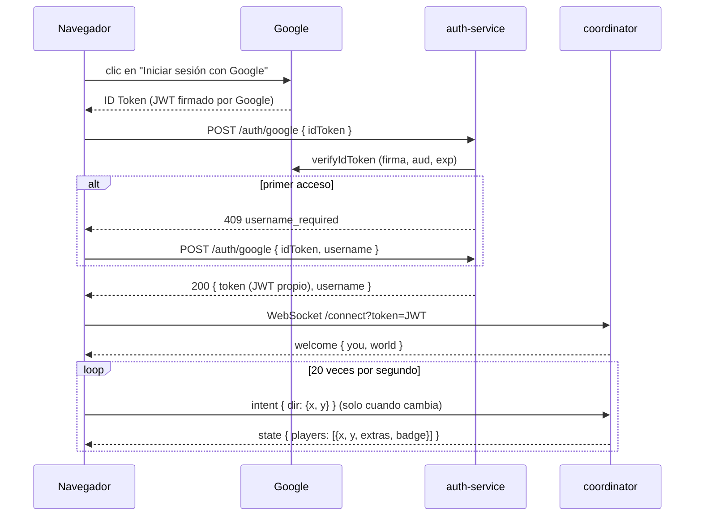

# Parqués en línea — Taller 5 · Proyecto final, Parte II

**Sistemas Distribuidos · Universidad de Boyacá** · Integrantes: Andres Camilo Tibocha, Jenifer Nossa, Daniela Navarro, Francy Olmos

Videojuego web multijugador en tiempo real. En la Parte I (Taller 4) los jugadores se
identificaban y entraban a un lobby. En esta Parte II se agregan dos cosas grandes:

- **El juego en vivo.** Los jugadores se mueven en un canvas y todos ven a todos en tiempo
  real. **El servidor es la autoridad**: el cliente solo dice hacia dónde quiere ir, y el
  servidor decide la posición.
- **Login con Google.** Además del registro con usuario y contraseña, se puede entrar con una
  cuenta de Google. Los dos métodos producen **el mismo JWT propio** y conviven en **una sola
  tabla `users`**.

Además: una **característica extra replicada** (color del jugador + insignia del proveedor),
**duración de sesión configurable en vivo** y **usernames que no distinguen mayúsculas**.

---

## Contenido

1. [Arquitectura](#1-arquitectura)
2. [Estructura del repositorio](#2-estructura-del-repositorio)
3. [Tecnologías](#3-tecnologías)
4. [Modelo de datos](#4-modelo-de-datos)
5. [Endpoints HTTP](#5-endpoints-http)
6. [Protocolo WebSocket](#6-protocolo-websocket)
7. [Flujos de autenticación](#7-flujos-de-autenticación)
8. [Game loop y autoridad del servidor](#8-game-loop-y-autoridad-del-servidor)
9. [Característica extra: color e insignia](#9-característica-extra-color-e-insignia)
10. [Duración de sesión en vivo](#10-duración-de-sesión-en-vivo)
11. [Instalación y ejecución](#11-instalación-y-ejecución)
12. [Configuración de Google Cloud](#12-configuración-de-google-cloud)
13. [Despliegue con ngrok](#13-despliegue-con-ngrok)
14. [Pruebas](#14-pruebas)
15. [Decisiones de diseño](#15-decisiones-de-diseño)
16. [Limitaciones conocidas](#16-limitaciones-conocidas)
17. [Solución de problemas](#17-solución-de-problemas)

---

## 1. Arquitectura

Tres procesos independientes, en puertos distintos, cada uno con su túnel de ngrok:

| Servicio | Puerto | Responsabilidad |
|---|---|---|
| **auth-service** | 4000 | Registro e inicio de sesión local, inicio de sesión con Google, emisión del JWT propio. Tiene su propia base SQLite (`users.db`). |
| **coordinator** | 5000 | Recibe los WebSocket, valida el JWT, mantiene el estado de cada jugador, **ejecuta el game loop a 20 Hz** y envía el estado a todos. |
| **client** | 3000 | Página de login (local + Google) y sala de juego (canvas). Solo envía intenciones y dibuja lo que manda el servidor. |

```
                              ┌─────────────────────────────────┐
                              │       Navegador (client)        │
                              │  login.html      lobby.html     │
                              │  (local+Google)  (canvas)       │
                              └───┬──────────┬───────────┬──────┘
        (1) botón de Google       │          │           │ (4) WebSocket /connect?token=JWT
            ← ID Token  ┌─────────┘          │           │     → intent {dir}, extras_update
        ┌───────────────┴──┐   (2) POST /register, /login │     ← welcome, state (20/s)
        │      Google      │       POST /auth/google      │
        │ (claves públicas)│   (3) ← { token: JWT propio }│
        └────────▲─────────┘          │                   │
                 │ verifyIdToken      ▼                   ▼
┌────────────────┴───────────────────────┐   ┌──────────────────────────────────────┐
│ auth-service                     :4000 │   │ coordinator                    :5000 │
│ · tabla users (provider local|google)  │   │ · verifica el JWT en el "upgrade"    │
│ · bcryptjs (≥10 rounds)                │   │ · Map userId → {x, y, intent, extras}│
│ · google-auth-library                  │◄──│ · game loop 20 Hz → "state" a todos  │
│ · JWT {userId, username, provider}     │   │ · consulta GET /session-policy (3 s) │
│ · GET /session-policy                  │   └──────────────────────────────────────┘
└────────────────────────────────────────┘
          Ambos tienen la MISMA JWT_SECRET (≥ 32 caracteres) en su .env.
```



---

## 2. Estructura del repositorio

```
taller1-auth/
├── auth-service/                 Autenticación (HTTP :4000)
│   ├── index.js                  Tabla users + migración, /register, /login, /auth/google, /session-policy
│   ├── test.js                   Pruebas automáticas (npm test)
│   ├── package.json
│   └── .env.example
├── coordinator/                  Juego (HTTP + WebSocket :5000)
│   ├── index.js                  verifyToken, addPlayer, game loop, intent, extras_update
│   ├── test.js                   Pruebas del juego (npm test)
│   ├── package.json
│   └── .env.example
├── client/                       Cliente web (HTML + JS plano, :3000)
│   ├── login.html / js/login.js  Registro, login local y botón de Google
│   ├── lobby.html / js/lobby.js  Canvas, teclado, color, lastState
│   ├── js/config.js              ÚNICO lugar con AUTH_URL y COORDINATOR_WS
│   ├── css/styles.css
│   ├── server.js                 Express mínimo que sirve los archivos
│   ├── package.json
│   └── .env.example
├── docs/taller1.postman_collection.json   Colección para Thunder Client / Postman
├── .gitignore                    node_modules/, *.db, .env
└── README.md
```

---

## 3. Tecnologías

| Pieza | Uso |
|---|---|
| Node.js 22.5+ | Los tres servicios. Incluye `node:sqlite` y `fetch` |
| Express 5 | HTTP del auth, del coordinador y del cliente |
| `node:sqlite` | Base de datos del auth (la misma API que usa el PDF) |
| `bcryptjs` | Hash de contraseñas (≥ 10 rounds) |
| `jsonwebtoken` | JWT propio (firmar en el auth, verificar en el coordinador) |
| `google-auth-library` | Verificación del ID Token de Google (`verifyIdToken`) |
| `ws` | WebSocket del coordinador |
| Google Identity Services | Botón oficial "Iniciar sesión con Google" en el cliente |
| HTML + JS plano + Canvas 2D | Cliente, sin frameworks |
| `dotenv` | Configuración por `.env` |

---

## 4. Modelo de datos

**Una sola tabla** `users` para los dos proveedores (`auth-service/index.js`, `USERS_SCHEMA`):

```sql
CREATE TABLE users (
  id            INTEGER PRIMARY KEY AUTOINCREMENT,
  username      TEXT UNIQUE NOT NULL COLLATE NOCASE,   -- 'Alice' y 'alice' son el mismo
  provider      TEXT NOT NULL CHECK (provider IN ('local','google')),
  password_hash TEXT,                                  -- NULL para usuarios de Google
  google_sub    TEXT UNIQUE,                           -- NULL para usuarios locales
  email         TEXT,                                  -- opcional para local
  created_at    TEXT DEFAULT CURRENT_TIMESTAMP,
  CHECK ((provider = 'local'  AND password_hash IS NOT NULL AND google_sub IS NULL) OR
         (provider = 'google' AND google_sub IS NOT NULL    AND password_hash IS NULL))
);
```

- `provider = 'local'` → tiene `password_hash`, no tiene `google_sub`.
- `provider = 'google'` → tiene `google_sub` y `email`, no tiene `password_hash`.
- El `CHECK` final hace que **la base misma** rechace un registro que rompa esas reglas.
- `UNIQUE ... COLLATE NOCASE`: un mismo username no puede repetirse **entre proveedores ni
  cambiando mayúsculas**.

**Migración automática.** Si el auth encuentra una `users.db` del Taller 4 (sin `provider`,
con `password_hash NOT NULL` o sin `NOCASE`), al arrancar:
1. Guarda una copia `users-backup-AAAAMMDDhhmmss.db`.
2. Crea la tabla nueva y copia los usuarios como `provider='local'`, del más antiguo al más nuevo.
3. Si dos usernames solo difieren en mayúsculas (`Alice` / `alice`), **conserva el más antiguo**
   y muestra en la consola cuál descartó.
4. Todo ocurre en una transacción: si algo falla, no se cambia nada.

---

## 5. Endpoints HTTP

Todos los errores tienen la misma forma: `{ "error": "codigo", "message": "qué pasó", "hint": "cómo solucionarlo" }`.

### auth-service (`:4000`)

| Método | Ruta | Body | Respuesta |
|---|---|---|---|
| POST | `/register` | `{ username, password }` | **201** `{ userId, username, message }` |
| POST | `/login` | `{ username, password }` | **200** `{ token, username, provider, expiresIn, message }` |
| POST | `/auth/google` | `{ idToken, username? }` | ver tabla siguiente |
| GET | `/auth/google/config` | — | `{ clientId }` (público; lo usa el botón de Google) |
| GET | `/session-policy` | — | `{ expiresIn, seconds, updatedAt }` |
| GET | `/health` · `/` | — | estado / información |

| Caso | HTTP | `error` |
|---|---|---|
| Registro: username ya existe (cualquier proveedor, sin importar mayúsculas) | 409 | `username_taken` |
| Registro: username fuera de 3–32 o con símbolos | 400 | `invalid_username` |
| Registro: contraseña < 6 caracteres (o > 72 bytes) | 400 | `invalid_password` |
| Falta username o password | 400 | `missing_fields` |
| Sin body JSON / JSON mal escrito | 400 | `missing_body` / `invalid_json` |
| Login: usuario inexistente **o** contraseña incorrecta | 401 | `invalid_credentials` |
| Login con contraseña de una cuenta de Google | 401 | `use_google_login` |
| **Google: ya existía o se creó** | **200** | `{ token, username }` |
| **Google: primer acceso sin username** | **409** | `username_required` |
| **Google: el username elegido ya existe** | **409** | `username_taken` |
| **Google: ID Token inválido** (firma, audience o vencido) | **401** | `invalid_id_token` |
| Google: correo no verificado | 401 | `email_not_verified` |
| Google: falta `idToken` | 400 | `missing_id_token` |
| Body > 4 KB | 413 | `body_too_large` |
| Ruta inexistente | 404 | `not_found` |
| Error interno | 500 | `internal` (sin detalles internos) |

**El JWT propio** (igual para los dos proveedores): `{ userId, username, provider, iat, exp }`,
firmado con `JWT_SECRET`.

### coordinator (`:5000`)

| Ruta | Respuesta |
|---|---|
| `GET /` | Información, mundo y mensajes que acepta |
| `GET /health` | `{ status, players, sessionPolicy }` |
| `GET /players` | Jugadores conectados |

---

## 6. Protocolo WebSocket

Conexión: `ws://HOST:5000/connect?token=JWT` (`wss://` por ngrok).

### Cliente → servidor

| Mensaje | Qué hace el servidor |
|---|---|
| `{"type":"intent","intent":{"dir":{"x":1,"y":0}}}` | Guarda la intención, con cada eje en -1, 0 o 1 (`Math.sign`). **No mueve ni responde**: la confirmación es el siguiente `state` |
| `{"type":"extras_update","extras":{"color":"#e53935"}}` | Valida (objeto, ≤ 1024 caracteres, color de la paleta), guarda en `player.extras` y responde `extras_ok` |
| `{"type":"ping"}` | `pong` |
| `{"type":"get_players"}` | `players_update` solo para quien pregunta |
| `{"type":"reauth","token":"..."}` | Vuelve a validar la sesión con otro token (lo envía el cliente si el token guardado cambia) |
| `{"type":"logout"}` | `logout_ok` y cierre 1000 |

### Servidor → cliente

| `type` | Cuándo | Contenido |
|---|---|---|
| `welcome` | al conectar | `you {userId, username, provider}`, `world {width, height, playerRadius, tickRate}`, `colors`, `tokenExpiresAt` |
| `state` | **20 veces por segundo** | `t`, `players: [{ userId, username, x, y, extras, badge }]` |
| `players_update` | alguien entra, sale o se reconecta | `players`, `event`, `message` |
| `extras_ok` | color aceptado | `extras`, `message` |
| `session_update` | cambió la duración de la sesión | `expiresAt`, `message` |
| `reauth_ok` · `pong` · `logout_ok` | respuestas | `message` |
| `error` | cualquier problema | `code`, `message`, `hint` |

### Errores y cierres

| `code` | Cierre | Cuándo |
|---|---|---|
| `missing_token`, `malformed_token`, `invalid_signature`, `invalid_token`, `token_expired` | `4001 invalid token` | token malo al conectar o en `reauth` |
| `token_expired` | `4001 token expired` | la sesión venció con la conexión abierta |
| `token_user_mismatch` | `4001 invalid token` | `reauth` con el token de otro usuario |
| `session_opened_elsewhere` | `4002 session opened elsewhere` | la misma cuenta se conectó en otro lugar |
| `bad_path` | `4004 bad path` | ruta distinta de `/connect` |
| `invalid_intent`, `invalid_extras`, `extras_too_large`, `invalid_color`, `invalid_json`, `missing_type`, `unknown_type` | — (no cierra) | mensaje inválido |

---

## 7. Flujos de autenticación

**Local.** `POST /register` → bcrypt → fila `provider='local'`. `POST /login` → busca el
usuario (sin importar mayúsculas) → si es de Google, lo rechaza → `bcrypt.compare` → JWT propio.

**Google (opción A del PDF: Google Identity Services).** Elegimos la opción A porque no necesita
`redirect_uri` ni Client Secret, el backend sigue siendo una API JSON igual a `/login`, y el
cliente usa el botón oficial de Google.

1. `login.html` carga `https://accounts.google.com/gsi/client` y pide el Client ID a
   `GET /auth/google/config`.
2. El usuario pulsa el botón y Google devuelve un **ID Token** (JWT firmado por Google).
3. El cliente envía `POST /auth/google { idToken }`.
4. El auth lo **verifica contra Google**: `googleClient.verifyIdToken({ idToken, audience: GOOGLE_CLIENT_ID })`
   revisa la firma con las claves públicas de Google, el vencimiento y que `aud` sea nuestro
   Client ID. Después exige `email_verified === true`.
5. Busca por **`sub`** (identificador estable de Google, no el email):
   - existe → **200** con el JWT propio;
   - no existe y no mandó username → **409 `username_required`**: el cliente muestra
     "Elige tu nombre de usuario" y reenvía `{ idToken, username }`;
   - el username está ocupado → **409 `username_taken`**;
   - si no → crea la fila `provider='google'` y responde **200**.

En los dos casos el cliente guarda el JWT en `sessionStorage` y entra al juego.

---

## 8. Game loop y autoridad del servidor

`coordinator/index.js`, sección 10:

```js
const PLAYER_SPEED = 200;  const TICK_RATE = 20;  const TICK_MS = 1000 / TICK_RATE;
function tick() {
  const now = Date.now();
  const dt  = (now - lastTick) / 1000;          // segundos desde el tick anterior
  lastTick  = now;
  for (const p of players.values()) {
    const mag = Math.hypot(p.intent.x, p.intent.y);
    if (mag > 0) { p.x += (p.intent.x / mag) * PLAYER_SPEED * dt;  p.y += (p.intent.y / mag) * PLAYER_SPEED * dt; }
    p.x = Math.max(PLAYER_RADIUS, Math.min(WORLD_WIDTH  - PLAYER_RADIUS, p.x));
    p.y = Math.max(PLAYER_RADIUS, Math.min(WORLD_HEIGHT - PLAYER_RADIUS, p.y));
  }
  broadcast({ type: 'state', t: now, players: snapshot() });
}
setInterval(tick, TICK_MS);
```

- **`dt`**: la velocidad no depende del `TICK_RATE`. Si un tick se atrasa, el siguiente
  compensa.
- **`Math.hypot`**: en diagonal la intención es (1, 1), de largo √2 ≈ 1,41. Al dividir por ese
  largo, la diagonal avanza igual que en línea recta (sin esto se iría ~41 % más rápido).
- **Límites**: `Math.max/Math.min` dejan el centro del círculo a un radio del borde.
- **Un solo `state` por tick**, para todos. El handler de `intent` **no** mueve ni hace
  broadcast.

**Autoridad.** El cliente nunca envía posiciones, solo `intent` con `Math.sign`, así que
`{x: 9999}` cuenta como 1. Lo que el cliente dibuja es `lastState`, el último `state` del
servidor. Si alguien modifica `lastState` desde DevTools, solo cambia **su propio dibujo**:
el servidor no se entera, la posición oficial no cambia y los demás siguen viendo la real.

**Mundo:** 960 × 600 px, radio 18 px. El cliente arma el canvas con el `world` del `welcome`.

---

## 9. Característica extra: color e insignia

**Color (replicado y persistente durante la sesión).**
1. El jugador elige un color en el panel **Tu color**.
2. El cliente envía `{"type":"extras_update","extras":{"color":"#8e24aa"}}`.
3. El servidor valida: debe ser un objeto (no un arreglo), de ≤ 1024 caracteres, y el color
   debe estar en la **paleta de 8 colores** (`ALLOWED_COLORS`). Así nadie puede inyectar texto
   arbitrario que luego se dibuje en otros navegadores.
4. Se guarda en `player.extras` y viaja en **cada** `state`: todos lo ven en el siguiente tick
   y se mantiene mientras el jugador esté conectado, aunque cambie de pestaña.

**Insignia del proveedor.** Cada jugador muestra `G` (Google) o `L` (local) dentro de su
círculo y en la lista. La decide **el servidor** a partir del `provider` del JWT (`badge`),
así que el cliente no puede falsificarla.

---

## 10. Duración de sesión en vivo

`JWT_EXPIRES_IN` se puede cambiar **con el sistema encendido**, sin reiniciar nada:

1. El auth vigila su `.env` cada segundo. Al guardar el archivo, los tokens nuevos salen con
   la duración nueva (`[config] Duración del token: 1h → 30s`). Un valor inválido se ignora.
2. El coordinador consulta `GET /session-policy` cada 3 segundos (`AUTH_URL` en su `.env`). Si
   la duración cambió, recalcula para cada jugador conectado:
   **vence = mínimo(exp del token, iat + duración nueva)**. Envía `session_update` y saca con
   `4001 token expired` a quien ya superó la duración.
3. También el upgrade y `reauth` aplican la duración vigente.

Un token ya emitido no se puede **alargar**, porque su `exp` va firmado. Por eso, si se vuelve
de `30s` a `1h`, los tokens de 30 s siguen venciendo a los 30 s.

---

## 11. Instalación y ejecución

### Requisitos
- **Node.js 22.5 o superior** (recomendado 22 LTS): `node -v`.
- ngrok con cuenta (`ngrok config add-authtoken TU_TOKEN`).
- Para pruebas: `wscat` (`npm install -g wscat`), Thunder Client o curl.

### Dependencias (en cada carpeta)

```powershell
cd auth-service ; npm install ; cd ..
cd coordinator  ; npm install ; cd ..
cd client       ; npm install ; cd ..
```

Ninguna dependencia necesita compilarse, así que no hace falta Python ni Visual Studio Build Tools.

### Archivos `.env` (copiar desde `.env.example`; nunca se suben al repositorio)

| Archivo | Variables |
|---|---|
| `auth-service/.env` | `PORT=4000`, `JWT_SECRET` (≥ 32, igual al coordinador), `JWT_EXPIRES_IN=1h`, `GOOGLE_CLIENT_ID`, `BCRYPT_ROUNDS=10`, `DB_PATH=users.db` |
| `coordinator/.env` | `PORT=5000`, `JWT_SECRET` (la misma), `AUTH_URL` (URL del auth, para la duración en vivo), `HEARTBEAT_MS=30000` |
| `client/.env` | `PORT=3000` |
| `client/js/config.js` | `AUTH_URL` y `COORDINATOR_WS` (las URLs que usa el navegador) |

Generar una `JWT_SECRET`:
```powershell
node -e "console.log(require('crypto').randomBytes(32).toString('hex'))"
```

### Orden de arranque (una terminal por servicio)

```powershell
# 1. auth-service
cd auth-service ; npm start   # → Auth service en puerto 4000 (tokens de 1h, base users.db)
# 2. coordinator
cd coordinator  ; npm start   # → Coordinador en puerto 5000 (... juego a 20 Hz ...)
# 3. client
cd client       ; npm start   # → Cliente en http://localhost:3000
```

Abrir **http://localhost:3000**. Para cerrar un servicio: `Ctrl+C` en su terminal; para
volver a ejecutarlo: `npm start`.

### Comprobar que cada servicio funciona
- Auth: `http://localhost:4000/health` → `{"status":"ok",...}`
- Coordinador: `http://localhost:5000/health` → `{"status":"ok", "players": N, "sessionPolicy": "1h"}`
- Cliente: `http://localhost:3000` → página de login

### Dos jugadores a la vez
- **Dos pestañas del mismo navegador, con usuarios distintos:** funciona, porque la sesión se
  guarda en `sessionStorage`, que es independiente por pestaña.
- **El mismo usuario en dos lugares:** se cierra la conexión anterior (4002).
- También sirve una ventana de incógnito u otro navegador.

---

## 12. Configuración de Google Cloud

1. Entrar a https://console.cloud.google.com y crear un proyecto.
2. **Google Auth Platform** (antes: APIs y servicios → Pantalla de consentimiento de OAuth):
   público **Externo**, nombre de la app, correo de soporte y scopes `openid`, `email`, `profile`.
3. **Público → Usuarios de prueba:** agregar los correos que van a iniciar sesión (los
   integrantes y el profesor). Sin esto Google muestra "Acceso bloqueado".
4. **Clientes → Crear cliente → Aplicación web.** En **Orígenes de JavaScript autorizados**
   agregar `http://localhost:3000` y la URL https de ngrok **del cliente** (sin `/` final).
   Las URIs de redirección se dejan vacías (opción A).
5. Copiar el **Client ID** (`....apps.googleusercontent.com`) en `auth-service/.env` como
   `GOOGLE_CLIENT_ID`. El Client Secret no se usa.

El cliente obtiene el Client ID con `GET /auth/google/config`, así que no hay que repetirlo en
`config.js`.

---

## 13. Despliegue con ngrok

Cada servicio en su propio túnel, en el equipo donde corre ese servicio:

```powershell
ngrok http 4000   # auth         → https://AAAA.ngrok-free.dev
ngrok http 5000   # coordinador  → https://BBBB.ngrok-free.dev
ngrok http 3000   # cliente      → https://CCCC.ngrok-free.dev
```

Después:
1. `client/js/config.js`:
   ```js
   const AUTH_URL       = 'https://AAAA.ngrok-free.dev';
   const COORDINATOR_WS = 'wss://BBBB.ngrok-free.dev';   // wss://, no ws://
   ```
2. `coordinator/.env`: `AUTH_URL=https://AAAA.ngrok-free.dev` (y reiniciar el coordinador).
3. Google Cloud: la URL del **cliente** (`https://CCCC...`) en "Orígenes de JavaScript autorizados".
4. En cada navegador, abrir una vez `https://BBBB.ngrok-free.dev/health` y pulsar
   **Visit Site** (el aviso de ngrok del plan gratuito bloquea el WebSocket hasta hacerlo).

URLs usadas en la entrega:
```
Cliente:      https://__________________.ngrok-free.dev   (ngrok http 3000)
Auth:         https://__________________.ngrok-free.dev   (ngrok http 4000)
Coordinador:  wss://___________________.ngrok-free.dev    (ngrok http 5000)
```

---

## 14. Pruebas

### Pruebas automáticas

```powershell
# Con el auth encendido
cd auth-service ; npm test
# Con el auth y el coordinador encendidos
cd coordinator  ; npm test
# Por ngrok
node test.js https://AAAA.ngrok-free.dev                                    # auth
node test.js https://AAAA.ngrok-free.dev wss://BBBB.ngrok-free.dev          # coordinador
```

**`auth-service/test.js` (19 pruebas):** health, `session-policy`, registro 201, repetido 409,
mismo nombre en minúsculas y en MAYÚSCULAS 409, username inválido, contraseña corta, campos
faltantes, JSON roto, login 200, JWT con `userId/username/provider/iat/exp`, login sin importar
mayúsculas, contraseña incorrecta 401, usuario inexistente 401, Client ID, Google sin idToken
400, Google con token falso 401, ruta inexistente 404.

**`coordinator/test.js` (22 pruebas, dos jugadores reales):**

| Prueba | Resultado medido |
|---|---|
| `welcome` con `world` y `you` | ✔ |
| Mensajes `state` por segundo | 20 |
| Horizontal / vertical en 1 s | 201 px / 201 px |
| Diagonal en 1 s | **201 px** (sin normalizar serían 283) |
| `intent {x: 9999}` en 0,5 s | 100 px (no hay teletransporte) |
| Límites del mundo | se queda en (18, 18) |
| Mensajes inválidos | `invalid_intent`, `invalid_json`, `unknown_type`, `invalid_extras`, `extras_too_large`, `invalid_color` |
| Color replicado y persistente | el otro jugador lo ve y se mantiene |
| Desconexión | desaparece del `state` de los demás |
| Token alterado | cierre 4001 |

Resultados reales: **_(pegar aquí la salida de `npm test` de cada servicio)_**.

### Pruebas manuales en el navegador
1. **Juego:** dos pestañas (`alice` y `bob_google`); mover con flechas/WASD en una y ver el
   movimiento en la otra; cambiar el color y verlo en la otra.
2. **Autoridad:** en la pestaña de `alice`, consola (F12):
   ```js
   setInterval(() => { const yo = lastState.players.find(p => p.username === miUsuario); yo.x = 60; yo.y = 60; }, 5);
   ```
   `alice` se ve en la esquina **solo en su pestaña**; en la otra sigue en su posición real.
   Al recargar se quita la trampa. También se puede probar
   `ws.send(JSON.stringify({type:'intent', intent:{dir:{x:9999, y:0}}}))`: se mueve a
   velocidad normal.
3. **Token propio inválido:** F12 → Application → Session Storage → `token`, cambiar unas
   letras → el jugador sale solo, sin recargar.
4. **Token vencido:** `JWT_EXPIRES_IN=30s` en `auth-service/.env` (sin reiniciar) → cerrar
   sesión, entrar de nuevo, esperar 30 s.

### Pruebas de Google
| Sin credenciales (cualquiera puede correrlas) | Con Client ID real y cuenta de prueba |
|---|---|
| `GET /auth/google/config` · sin idToken → 400 · token falso → 401 `invalid_id_token` | primer acceso → 409 `username_required` · elegir `alice` → 409 `username_taken` · elegir `bob_google` → 200 · segundo acceso → 200 directo · `bob_google` en `/login` → 401 `use_google_login` |

Para probar `/auth/google` en Thunder Client con un token real: en la consola de la página de
login escribir `MOSTRAR_ID_TOKEN = true`, pulsar el botón de Google y copiar el ID Token que
aparece en la consola (dura ~1 hora). La colección `docs/taller1.postman_collection.json` ya
trae todos estos casos.

---

## 15. Decisiones de diseño

1. **Una sola tabla `users` con `provider`.** Un username es único en todo el sistema y el
   coordinador no necesita saber cómo se autenticó cada uno: recibe el mismo JWT. El `CHECK`
   hace que la base garantice las reglas de cada proveedor.
2. **Google opción A** (sección 7). Verificación **en el backend** con `verifyIdToken` y
   `audience`: decodificar no alcanza, porque cualquiera puede fabricar un JSON con esa forma.
   Se usa `sub` (no el email) porque el email puede cambiar.
3. **Usernames sin distinguir mayúsculas** (`COLLATE NOCASE`), para que `Alice` y `alice` no
   sean dos cuentas. La migración conserva al usuario más antiguo.
4. **El JWT se verifica en el `upgrade`** (del Taller 4). Un token malo nunca llega al Map;
   antes de cerrar con 4001 se envía un `error` con el motivo exacto.
5. **Servidor autoritativo.** El cliente envía intenciones saneadas con `Math.sign`; el
   game loop mueve con `dt` y `Math.hypot` y envía un `state` por tick. Así la velocidad no
   depende de cuántos mensajes mande el cliente ni de su `TICK_RATE`.
6. **`intent` sin respuesta propia.** Un `intent` válido no se contesta (la confirmación es el
   `state` siguiente, 50 ms después); uno inválido sí recibe `error`. Responder cada tecla
   duplicaría el tráfico.
7. **Color con paleta cerrada.** Además del límite de 1024 caracteres, solo se aceptan 8
   colores: evita texto arbitrario o enorme replicado a todos.
8. **Insignia derivada del JWT**, no de `extras`, para que no se pueda falsificar.
9. **`sessionStorage` en vez de `localStorage`.** Con `localStorage` las pestañas comparten el
   token, y la demo de dos pestañas con usuarios distintos se rompía. La regla "una cuenta,
   una conexión" la sigue aplicando el coordinador (4002).
10. **Dos pestañas con la misma cuenta: gana la más nueva** (del Taller 4), conservando
    posición y color.
11. **Duración en vivo (sección 10).** El auth relee su `.env`; el coordinador consulta
    `/session-policy`, una ruta pública que solo informa la duración.
12. **Mensajes amigables para el jugador.** El servidor responde códigos y detalles técnicos
    (útiles en Thunder Client y wscat); el cliente los traduce a un texto sencillo y deja el
    detalle en la consola.
13. **El Client ID vive solo en el `.env` del auth** y el cliente lo pide a
    `/auth/google/config`. No es secreto, pero así se configura en un solo lugar.
14. **`node:sqlite` y `bcryptjs`** (los mismos del PDF): no necesitan compilarse en Windows.

---

## 16. Limitaciones conocidas

- El estado del juego vive **en memoria** del coordinador: si se reinicia, los jugadores se
  reconectan en posiciones nuevas (la replicación entre coordinadores es la siguiente parte).
- El cliente dibuja exactamente el último `state` (20 por segundo) sin interpolar; con mucha
  latencia el movimiento puede verse a saltos.
- Un token ya emitido no se puede alargar; los cambios de duración en vivo solo pueden acortarlo.
- Mientras la app de Google Cloud esté en modo de prueba, solo pueden entrar los correos
  agregados como usuarios de prueba.
- Si cambia la URL de ngrok del cliente, hay que agregarla en Google Cloud y esperar unos minutos.

---

## 17. Solución de problemas

| Síntoma | Causa | Solución |
|---|---|---|
| `JWT_SECRET falta o tiene menos de 32 caracteres` | Clave corta o sin `.env` | Generar una y ponerla **igual** en auth y coordinador |
| `GOOGLE_CLIENT_ID falta o no es válido` | Falta la línea en `auth-service/.env` | Agregarla (sección 12) |
| El botón de Google no aparece; consola: *origin is not allowed* | La URL del cliente no está en Google Cloud | Agregarla exacta en "Orígenes de JavaScript autorizados" |
| Google: *Acceso bloqueado* | El correo no es usuario de prueba | Agregarlo en Google Cloud |
| "No pudimos verificar tu cuenta de Google" | Client ID distinto entre Google Cloud y el `.env` | Revisar `GOOGLE_CLIENT_ID` |
| "Tu sesión no es válida" al entrar al juego | `JWT_SECRET` distinta entre auth y coordinador | Igualarlas y reiniciar ambos |
| "Se perdió la conexión con el servidor del juego" | `COORDINATOR_WS` mal escrita, `ws://` en vez de `wss://`, coordinador apagado o aviso de ngrok pendiente | Revisar `config.js`; abrir `https://URL-COORDINADOR/health` y pulsar "Visit Site" |
| `[sesión] No se pudo consultar …/session-policy` | `AUTH_URL` del coordinador incorrecta o auth apagado | Corregir `AUTH_URL`; el juego funciona igual |
| `Cannot find module` | Faltan dependencias | `npm install` en esa carpeta |
| `EADDRINUSE` | El puerto ya está en uso | Cerrar la otra terminal con `Ctrl+C` |
